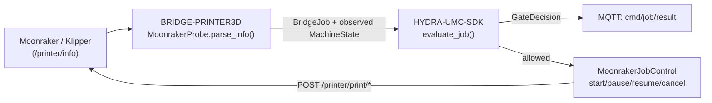

<!-- =============================================================================
HYDRA-UMC-BRIDGE-PRINTER3D - 3D printer coordination bridge
Copyright (C) JuanenRac (Electro Hobby 3D) <electrohobby3d@gmail.com>
GPL-3.0-or-later - see LICENSE
============================================================================= -->

<p align="center">
  
</p>

# 🖨️ HYDRA-UMC-BRIDGE-PRINTER3D

<p align="center">🇺🇸 <b>English</b> | <a href="README_spa.md">🇪🇸 Español</a> | <a href="README_fra.md">🇫🇷 Français</a> | <a href="README_ita.md">🇮🇹 Italiano</a> | <a href="README_deu.md">🇩🇪 Deutsch</a> | <a href="README_zho.md">🇨🇳 简体中文</a> | <a href="README_jpn.md">🇯🇵 日本語</a> | <a href="README_por.md">🇵🇹 Português</a></p>

### 🌡️ Fail-Safe Coordination Bridge for Open 3D-Printing Software

<p align="center">
  
  
  
  
  
  
</p>

---

> **Honesty check - what actually runs today:** the Moonraker readiness probe and safety gate (`moonraker.py`'s `MoonrakerProbe`/`PrinterBridge`, funneling every job through `HYDRA-UMC-SDK`'s own `evaluate_job()`), the real SDK-gated job commands (`MoonrakerJobControl`'s start/pause/resume/cancel), the read-only artifact/profile evidence (`artifacts.py`, `profiles.py`), and the MQTT command/status bridge (`mqtt_transport.py`) are real and covered by 125 passing `unittest` cases (`python tools/build_test.py`). The Moonraker-facing tests run against a real local `ThreadingHTTPServer` fixture standing in for Moonraker's own REST API - not a real printer - and the MQTT layer's own `connect_with_retry()`/message-routing logic is tested without ever opening a real `paho-mqtt` connection or broker. As the README already states below, this bridge has not been exercised against a real printer, hotend or robot yet. Raw G-code streaming is deliberately not implemented - only an already-uploaded, already-sliced file can be started/paused/resumed/cancelled by name. See "Roadmap & Known limits" below, which already says this plainly, and `CHANGELOG.md` for exactly what has shipped so far.

> **Safety and security status:** this ecosystem is not a certified safety system. There is no hardware E-STOP path, no firmware-enforced limits or interlocks and no verified motion command yet; firmware images are checked with CRC-32 and an Ed25519 signature, and a release build refuses the published development keys (the tool heads and expansion boards behind the relay still run URTC bootloaders, which take a shared-key HMAC-SHA256 instead of a signature); TLS and mutual TLS are optional and off by default; no custom board has been populated or tested yet. Read the [security baseline](https://github.com/JuanenRac/HYDRA-UMC-DOCS/blob/main/docs/SECURITY_BASELINE.md) and the [threat model](https://github.com/JuanenRac/HYDRA-UMC-DOCS/blob/main/docs/THREAT_MODEL.md) before relying on any statement here for the safety of a person.

---

## 📋 At a glance

| | |
|---|---|
| Version | `0.2.0` |
| Maturity | Functional |
| Tests | 125 (`python tools/build_test.py`) |
| Stack | Python / Moonraker / Klipper / G-code / 3MF |
| Target | The Raspberry Pi CM5 of a HYDRA-UMC cell |
| On real hardware | Simulated only: tested against emulators, fakes or simulators; no run on real hardware is recorded for this version |

**Jump to:** [Overview](#-overview) · [Architecture](#-architecture) · [Features](#-features) · [Security & Safety](#-security--safety) · [Interfaces](#-interfaces) · [Configuration](#-configuration) · [Quick start](#-quick-start) · [Testing](#-testing) · [Troubleshooting](#-troubleshooting) · [Repository Structure](#-repository-structure) · [Related Projects](#-related-projects)

## 🚦 Project status

Each line is one part of this repository and the light says how far it is today. It is written from what the repository can show (tests, builds, runs), not from what is planned.

🟢 Done and verified · 🟡 Works, with known limits · 🟠 Partly done or not verified yet · 🔴 Not done or not working

| Area | State | What it means here |
|---|---|---|
| Software | 🟡 | Works for its main purpose; the honesty check above lists what is still missing |
| Tests | 🟢 | 125 automated tests, run on every change |
| Real hardware | 🟠 | Simulated only: tested against emulators, fakes or simulators; no run on real hardware is recorded for this version |
| Documentation | 🟢 | README in eight languages, checked against the manifest on every change |

## 🎯 Overview

**HYDRA-UMC-BRIDGE-PRINTER3D** is the high-level coordinator for open 3D-printing software (Moonraker/Klipper) and HYDRA-UMC robotic auxiliaries. It also recognizes local slicer artifacts read-only, and can send SDK-gated job commands (start/pause/resume/cancel an already-uploaded, already-sliced file, plus a hard emergency stop) through Moonraker's own REST API; the tests use a local HTTP fixture, and no real printer has received one. Native printer firmware remains responsible for motion, heaters, thermal protection and machine interlocks at all times — this bridge never streams raw G-code and never replaces that authority; it only reads readiness, records artifact evidence, sends already-safe job-level commands and coordinates auxiliaries around it.

It belongs to the **External Automation Bridges** family: a set of sibling repositories (CNC, LASER, OPENPNP, PRINTER3D, ROS2) that all speak the same shared safety contract from `HYDRA-UMC-SDK`, so no bridge can invent its own definition of "safe to work".

## 🧩 Role in HYDRA-UMC

**HYDRA-UMC-BRIDGE-PRINTER3D** sits between a Moonraker/Klipper 3D printer and the robot cell. It reports what that side says, asks the shared gate before any auxiliary work and never takes over the authority of the machine it coordinates with.

Every bridge speaks the shared safety contract of `HYDRA-UMC-SDK`: a job is accepted only after the shared `evaluate_job()` gate says so, and the gate fails closed. The parent project is `HYDRA-UMC-SERVER`; this bridge does not call it, it answers over MQTT through `HYDRA-UMC-MQTT-BROKER` to whoever commands the cell.

## 🏛️ Architecture

<p align="center">
  
</p>

<details>
<summary>Text version of the diagram (Mermaid)</summary>



</details>

**Why it is built this way**

* **Why only Moonraker's literal `"ready"` state maps to idle.** `parse_info()`'s state mapping is intentionally narrow: `ready` → `IDLE`, `shutdown`/`error` → `FAULT`, `startup` → `OFFLINE` (fail closed), and every other or missing value → `OFFLINE`. There is no default-to-safe assumption for an unrecognized printer state.
* **Why parsing is a separate `@staticmethod` from the network fetch.** `MoonrakerProbe.parse_info()` takes a plain `dict` and is fully unit-testable without a network call or a running printer; `fetch()` is the thin, necessarily-network piece that calls it. The safety-relevant logic lives in the part that never needs a live printer to test.
* **Why the probe uses stdlib `urlopen`/`json` instead of a Moonraker client library.** Keeping the dependency surface to the Python standard library keeps the safety-relevant parsing minimal, auditable and free of a third-party client's own assumptions about retries, timeouts or error handling.
* **Why the bridge builds a new `BridgeJob` and delegates to the shared `evaluate_job()` instead of writing its own accept/reject logic.** All five External Automation Bridges (CNC, LASER, OPENPNP, PRINTER3D, ROS2) reuse the exact same `bridge_contract` from `HYDRA-UMC-SDK`, so "what counts as safe to start a job" cannot silently diverge between them.
* **Why job commands (start/pause/resume/cancel) are real but raw G-code streaming still isn't.** Moonraker's `/printer/print/*` endpoints only ever reference an already-uploaded, already-sliced file by name - the same safety envelope Moonraker/Klipper themselves already enforce on that file. Arbitrary raw G-code is a fundamentally different, much larger trust surface (it can contain anything) and still needs a tested profile, authentication and physical safety review this bridge doesn't have yet.
* **Why `resume_job()` doesn't reuse the generic `evaluate_job()` gate.** That gate is built around "productive work needs an IDLE machine" - backwards for resuming a paused job, which only makes sense from `HOLDING`. Same standalone-gate reasoning already used for DROIDS's `stand_request()`/`sit_request()`.
* **How this fits the rest of the ecosystem.** BRIDGE-PRINTER3D sits between Moonraker/Klipper and `HYDRA-UMC-SDK` → `HYDRA-UMC-MQTT-BROKER` → cell safety — it coordinates auxiliary robot work around the printer and now sends real, gated job commands, but it never streams raw G-code and never replaces native firmware, heaters or thermal protection.

## ✨ Features

* ✅ **Real Moonraker readiness probe:** `moonraker.py`'s `MoonrakerProbe` consumes Moonraker's documented `/printer/info` endpoint with a small stdlib-only client (`urlopen` + `json`) — no extra dependency beyond the Python standard library. *(implemented, tested in `tests/test_moonraker.py`)*
* ✅ **Real fail-closed state parsing:** `parse_info()` maps only the literal `"ready"` to `MachineState.IDLE`; `shutdown`/`error` map to `FAULT`, and anything else (including a malformed response) maps to `OFFLINE` — never to a state that would allow a robot to be planned around the printer. *(implemented)*
* ✅ **Real shared safety gate:** every observed job is re-evaluated through `evaluate_job()` from `HYDRA-UMC-SDK`'s `bridge_contract`, the same gate every sibling bridge uses. *(implemented)*
* ✅ **Slicer-agnostic artifact inspection:** `artifacts.py` identifies plain FDM G-code from OrcaSlicer, Ultimaker Cura, PrusaSlicer, Bambu Studio and other slicers from local evidence only; it also recognizes 3MF packages and opaque Lychee-compatible resin slices without unpacking, parsing commands, uploading or printing. *(implemented, tested in `tests/test_artifacts.py`)*
* ✅ **Profile-evidence boundary:** `profiles.py` can match an inspected artifact to a declared FDM or resin profile, but returns `execution_authorized=False` even on a match. *(implemented, tested in `tests/test_profiles.py`)*
* ✅ **Real, SDK-gated job commands:** `MoonrakerJobControl` sends real `POST` requests to Moonraker's documented `/printer/print/start|pause|resume|cancel` endpoints — `start_job()` is gated through the same `evaluate_job()` decision every productive dispatch in this ecosystem uses; `pause_job()`/`cancel_job()` are always allowed (same de-escalation reasoning as `ABORT`); `resume_job()` requires a genuinely `HOLDING` printer. It only ever starts an already-uploaded, already-sliced file by name — it never streams raw G-code. *(implemented, tested in `tests/test_moonraker.py`)*
* ✅ **Non-mutating build/test:** `build-test.bat`/`.sh` compile the response parser and safety gate without sending a real command, changing versions or touching a printer. *(implemented, see Build & Release below)*
* 🔜 **Raw G-code streaming** — deliberately still deferred: sending arbitrary low-level commands (not a named, already-sliced job) needs a tested profile, authentication and physical safety review this bridge doesn't have yet. *(planned)*
* ✅ **Repeated idempotency keys:** `PrinterMqttBridge` accepts an `IdempotencyStore`: a repeated job key gets the answer given the first time instead of being evaluated again, so that a repeated `cmd/start` never starts a second print. *(implemented, tested in `tests/test_idempotency.py`)*
* ✅ **Hardened MQTT loop:** a payload that is too large (over 16 KiB) or cannot be read, deeply nested JSON and any unexpected failure are answered with a refusal on the result topic and never end the loop; pause, cancel and the new `cmd/emergency_stop` (Klipper M112) are handled on a lane of their own, so a slow Moonraker never delays a stop; idempotency keys are kept per verb (`job:`/`start:`); `cmd/job` answers say `"mode": "gate-only"` and an ABORT through it says that nothing was stopped; the state carries `observed_at` and the bridge announces itself on an `availability` topic with a Last Will; the Moonraker API key (`MOONRAKER_API_KEY`, sent as `X-Api-Key`) is supported, and a start is sent only for a file that Moonraker knows. *(implemented, tested in `tests/test_hardening.py`)*

### SLICER ARTIFACT COMPATIBILITY

The read-only artifact lane supports ordinary FDM G-code (`.gcode`, `.gco`, `.gc`) produced by OrcaSlicer, Ultimaker Cura, PrusaSlicer, Bambu Studio and other slicers. Familiar comments supply an origin hint; a missing marker remains `unknown-slicer`. `.gcode.3mf` and generic `.3mf` are fingerprinted but never unpacked. Resin slices (`.ctb`, `.goo`, `.photon`, `.pwmo`, `.pws`, `.sl1`) from Lychee-compatible workflows are deliberately opaque and never attributed to a specific printer or slicer.

This is compatibility with **output artifacts**, not remote control of those applications. The bridge does not start slicers, alter profiles, parse/execute G-code, upload files, contact cloud services or start prints. See [Slicer Artifact Compatibility](docs/SLICER_ARTIFACT_COMPATIBILITY.md) for the precise matrix and future-control prerequisites.

An artifact/profile match is still evidence, never permission to print. [Print Profile Admission Boundary](docs/PRINT_PROFILE_BOUNDARY.md) documents the separate validation required before any future native-controller operation.

## 🔒 Security & Safety

| Threat | Defence | Where |
|---|---|---|
| A job for a cell or machine that is not in a safe state | Every job goes through the shared `evaluate_job()` gate of the SDK, which fails closed; the bridge has no accept/reject logic of its own | SDK `bridge_contract` |
| Oversized or unbounded job data | At most 32 parameters, keys up to 64 characters, values up to 1024, identifiers up to 128 (`MAX_PARAMETERS`, `MAX_PARAMETER_KEY_CHARS`, `MAX_PARAMETER_VALUE_CHARS`, `MAX_IDENTIFIER_CHARS`) | SDK `bridge_contract` |
| A repeated or replayed order | An `IdempotencyStore` remembers each key for 24 hours and at most 10 000 entries; a repeat gets the first answer instead of being evaluated again | SDK `job_intake` |
| A huge or hostile MQTT payload | A payload over 16 KiB, unreadable or deeply nested JSON and any unexpected failure are answered with a refusal on the result topic and never end the loop | `mqtt_transport.py` |
| A printer started by an unsafe order | `MoonrakerJobControl` (start, pause, resume, cancel) acts only behind the SDK gate; the bridge reads readiness and never controls firmware or heaters; the stop verbs `cmd/pause`, `cmd/cancel` and `cmd/emergency_stop` run on a lane of their own | `moonraker.py`, `mqtt_transport.py` |
| A hostile print file | `artifacts.py` identifies a file without unpacking, running or sending it (`.gcode.3mf` and `.3mf` are fingerprinted, never opened); `profiles.py` only matches evidence to a declared profile and never authorises a print | `artifacts.py`, `profiles.py` |
| An exposed Moonraker API key | The key is sent only in the `X-Api-Key` header and read from `MOONRAKER_API_KEY` | `moonraker.py` |

**What it never does:** it never controls firmware or heaters and never unpacks or runs a print file.

## 🔌 Interfaces

Topics under `hydra/bridges/printer3d/`; every command is answered on `<verb>/result`.

| Topic or route | What it carries |
|---|---|
| `cmd/status`, `cmd/job` | the printer readiness; a `BridgeJob` answered with a `GateDecision` |
| `cmd/start`, `cmd/resume` | gated: a real `POST /printer/print/*` only when the gate allows it |
| `cmd/pause`, `cmd/cancel`, `cmd/emergency_stop` | the stop verbs, on a lane of their own |
| `state`, `availability` | the retained printer state and `online`/`offline` |

## ⚙️ Configuration

| Variable | Default | What it sets |
|---|---|---|
| `MOONRAKER_API_KEY` | unset (no key) | the Moonraker API key, sent as `X-Api-Key` |
| `HYDRA_MQTT_USERNAME` | none | The MQTT user name; the broker binds it to a client-ID prefix |
| `HYDRA_MQTT_PASSWORD` | none | The password; only valid together with the user name |
| `HYDRA_MQTT_PASSWORD_FILE` | none | The password read from a file (a Docker or systemd secret); ignored when `HYDRA_MQTT_PASSWORD` is set |
| `HYDRA_MQTT_TLS_CA` | none | The CA file that signed the broker's certificate: the connection is TLS and the certificate is verified |
| `HYDRA_MQTT_TLS` | off | `1` turns TLS on, verified against the system's trusted CAs |
| `HYDRA_MQTT_TLS_CERT` / `HYDRA_MQTT_TLS_KEY` | none | The client certificate and its key for a broker that demands mutual TLS; both are needed |

## 🚀 Quick start

Requires Python 3.11 or newer. The tests and the build scripts expect `HYDRA-UMC-SDK` checked out next to this repository (`../HYDRA-UMC-SDK`) or pointed at with `HYDRA_UMC_SDK_ROOT`.

Try it without hardware (this checks the whole bridge against its emulators and fakes):

```bash
py -3 tools/build_test.py          # Windows
python3 tools/build_test.py         # Linux, macOS
```

Start the service (there is no console script: the service is the `run_forever()` of the MQTT transport, which you call from your own start-up code):

```python
from hydra_umc_bridge_printer3d.mqtt_transport import PrinterMqttBridge, run_forever
bridge = PrinterMqttBridge("http://192.168.0.50:7125", cell_state=lambda: cell_state)   # the Moonraker address; the key from MOONRAKER_API_KEY
run_forever(bridge, host="192.168.0.180")                                              # serves cmd/# forever
```

The user name, the password and the TLS files come from the `HYDRA_MQTT_*` variables (see Configuration); the code above needs no credentials of its own.

## 🧪 Testing

125 automated `unittest` cases run with `python tools/build_test.py` (it also compiles every module). The tests need no hardware, no network and no optional package: the ones that would need `paho-mqtt`, `pyserial` or a vendor library use a stand-in or are skipped when the package is missing.

| Test file | Tests | What it covers |
|---|---|---|
| `test_moonraker.py` | - | readiness parsing and the gated job commands against a local stand-in |
| `test_artifacts.py`, `test_profiles.py` | - | file identification and profile matching |
| `test_mqtt_transport.py`, `test_mqtt_environment.py`, `test_hardening.py`, `test_edge_cases.py`, `test_idempotency.py` | - | topic dispatch, the credentials of the environment, hostile clients, edge cases, repeated keys |

The CI runs `HYDRA_UMC_CI=1 python tools/ci_validate.py`, which checks the manifest, the documents, the eight READMEs and the pictures, and runs the tests with an SDK checkout.

## 🏗️ Build & Release

Requires Python 3.11+. `tools/build_test.py` expects `HYDRA-UMC-SDK` checked out as a sibling directory (`../HYDRA-UMC-SDK`) or pointed at via the `HYDRA_UMC_SDK_ROOT` environment variable.

```bash
# Windows
build-test.bat      # validate only — no version/CHANGELOG change
build.bat            # Validate and build (building never changes the version)

# Linux/macOS
bash build-test.sh
bash build.sh
```

`build-test` compiles every module under `src/` and `tools/` with `py_compile` and runs the full `unittest` suite discovered under `tests/` (`test_moonraker.py`, `test_artifacts.py`, `test_profiles.py`, `test_mqtt_transport.py`, `test_hardening.py`, `test_idempotency.py`, `test_mqtt_environment.py` - 125 tests), proving readiness-response parsing, artifact inspection and the fail-safe gate among everything else covered — it sends no G-code, touches no printer and never modifies the repository. `build` runs that same validation first and, only on success, calls `tools/bump_version.py` to synchronize the version across `pyproject.toml`, `hydra-umc.project.json` and `CHANGELOG.md`. There is no live printer `run` command yet — that requires a tested profile, authentication and physical safety review.

To inspect a local slicer output without contacting a printer:

```bash
py tools/inspect_print_artifact.py path/to/job.gcode      # Windows
python3 tools/inspect_print_artifact.py path/to/job.gcode  # Linux / macOS
```

## 🩺 Troubleshooting

| You see | Because | Do |
|---|---|---|
| `ModuleNotFoundError: hydra_umc_sdk` | The SDK is not installed or not next to this repository | Check out `HYDRA-UMC-SDK` next to this repository or set `HYDRA_UMC_SDK_ROOT` |
| `paho-mqtt is not installed` | The MQTT client is an optional extra | `pip install ".[mqtt]"` (it needs `paho-mqtt` 2.1 or newer, below 3) |
| `password was given without a username` | MQTT credentials need both parts | Set `HYDRA_MQTT_USERNAME` as well as the password |
| `could not reach the MQTT broker after N attempts` | The broker is down, the address is wrong or the port is closed | Start `HYDRA-UMC-MQTT-BROKER`, check the host and port given to the transport (it tries 5 times, 2 seconds apart); a TLS handshake failure is not retried |
| `the MQTT broker refused the connection` | The broker refused the credential (or did not answer within the time limit) | Check `HYDRA_MQTT_USERNAME` and the password; the client ID must start with the prefix the broker bound to the credential |
| `"allowed": false` + `reason` | The shared gate or a guard refused the order | Read `reason` and fix the cause; do not retry blindly |

## 📂 Repository Structure

<p align="center">
  
</p>

<details>
<summary>Text version of the tree</summary>

```text
HYDRA-UMC-BRIDGE-PRINTER3D/
├── src/hydra_umc_bridge_printer3d/
│   ├── moonraker.py               printer readiness and gated job control
│   ├── artifacts.py               identify print files, never unpack them
│   ├── profiles.py                match evidence to a declared profile
│   └── mqtt_transport.py          MQTT command and status transport
├── tests/                         125 tests, against a local Moonraker stand-in
├── docs/                          bridge guide, profile boundary, slicer files
├── tools/                         build and test runner, version bump, CI validator, README and picture generators and checks
├── images/                        banner and the pictures of the README
├── .github/                       CI workflow and issue templates
├── pyproject.toml                 package metadata and dependencies
├── hydra-umc.project.json         manifest: version, maturity, family
├── CHANGELOG.md                   what changed in each version
├── build.sh build.bat             build scripts (they never change the version)
├── build-test.sh build-test.bat   build scripts (they never change the version)
├── test.sh test.bat               run the tests
└── SECURITY.md SUPPORT.md CONTRIBUTING.md CODE_OF_CONDUCT.md LICENSE LICENSE.md
```

</details>

## 🗺️ Roadmap & Known limits

**Known limits today**

**Real today:** version `0.2.0`, a locally tested Moonraker readiness adapter (`MoonrakerProbe` + `PrinterBridge`) backed by `HYDRA-UMC-SDK`'s shared job gate, real SDK-gated job commands (`MoonrakerJobControl`: start/pause/resume/cancel an already-uploaded file through Moonraker's own REST API), read-only G-code/3MF/resin-slice and profile-compatibility evidence for the major slicer families, a deterministic 125-test `unittest` suite including local HTTP `/printer/info`, the real, separate `/printer/objects/query?print_stats=state` contract, and real `POST` job-command verification, and non-mutating build-test scripts wired into CI with an SDK checkout.

**Integration boundary:** native printer firmware (Klipper via Moonraker) retains motion, heaters, thermal protection and machine interlocks at all times; this bridge reads readiness, sends only already-safe job-level commands (never raw G-code) and gates *auxiliary* robot work around it.

**Still ahead:** the bridge has not been exercised against a real printer, hotend or robot yet (only against a local fixture HTTP server) — a first run against a real printer still requires a tested printer profile and a physical safety review first; raw G-code streaming is deliberately not implemented.

## 🌍 Languages

This README and the documents of the repository exist in eight languages: English, Spanish, German, French, Italian, Japanese, Chinese and Portuguese (Portugal). They are written together and checked in the CI so that the eight files have the same sections and the same links. This repository has no screen or message catalogue of its own, so there are no interface strings to translate.

## 🔗 Related Projects

This project is part of the HYDRA-UMC robotics ecosystem by the same author (JuanenRac / Electro Hobby 3D). Worth knowing about, since a request might actually be about one of these rather than this repository.

**Parent Project**
- **[HYDRA-UMC-SERVER](https://github.com/JuanenRac/HYDRA-UMC-SERVER)** — the real headless backend (REST/WebSocket) every control client actually talks to; this bridge does not call it - it answers over MQTT, through HYDRA-UMC-MQTT-BROKER, to whoever commands the cell.

**Sibling Projects** — also talk to HYDRA-UMC-SERVER's own API, each their own client
- **[HYDRA-UMC-STUDIO](https://github.com/JuanenRac/HYDRA-UMC-STUDIO)** — web control dashboard with real-time multi-robot 3D visualization.
- **[HYDRA-UMC-SUITE](https://github.com/JuanenRac/HYDRA-UMC-SUITE)** — desktop (PySide6) swarm command center for multiple servers at once, packaged as a standalone executable.
- **[HYDRA-UMC-ANDROID-CONTROL](https://github.com/JuanenRac/HYDRA-UMC-ANDROID-CONTROL)** — native Android control app with biometric login and a paired Wear OS companion.
- **[HYDRA-UMC-IOS-CONTROL](https://github.com/JuanenRac/HYDRA-UMC-IOS-CONTROL)** — iOS/iPadOS control app (Flutter) with real-time WebSocket sync.
- **[HYDRA-UMC-DSI](https://github.com/JuanenRac/HYDRA-UMC-DSI)** — native touch UI for the onboard 7" DSI touchscreen, embedded on the CM5 itself.
- **[HYDRA-UMC-BRIDGE-AMR](https://github.com/JuanenRac/HYDRA-UMC-BRIDGE-AMR)** — coordination boundary for AGV/AMR fleets via a VDA 5050 MQTT publisher (tested against an emulated fleet only).
- **[HYDRA-UMC-BRIDGE-CNC](https://github.com/JuanenRac/HYDRA-UMC-BRIDGE-CNC)** — high-level CNC-cell coordinator with GRBL status/control-byte access (tested against an emulator only).
- **[HYDRA-UMC-BRIDGE-DROIDS](https://github.com/JuanenRac/HYDRA-UMC-BRIDGE-DROIDS)** — coordination boundary for legged/humanoid droids, with a Boston Dynamics Spot command sender (tested against an emulator only).
- **[HYDRA-UMC-BRIDGE-LASER](https://github.com/JuanenRac/HYDRA-UMC-BRIDGE-LASER)** — laser-cell coordinator reading 3 key/enclosure/interlock GPIO signals (tested against a fake chip only; it cannot arm or fire a laser).
- **[HYDRA-UMC-BRIDGE-OPENPNP](https://github.com/JuanenRac/HYDRA-UMC-BRIDGE-OPENPNP)** — safe high-level board-flow coordinator for OpenPnP pick-and-place.
- **[HYDRA-UMC-BRIDGE-ROS2](https://github.com/JuanenRac/HYDRA-UMC-BRIDGE-ROS2)** — coordinator with a lazily imported rclpy ROS 2 transport (not yet run against a ROS 2 installation).
- **[HYDRA-UMC-BRIDGE-UAV](https://github.com/JuanenRac/HYDRA-UMC-BRIDGE-UAV)** — coordination boundary for camera-equipped UAVs, with a MAVLink command sender (tested against an emulator only).

**Directly Related**
- **[HYDRA-UMC-SDK](https://github.com/JuanenRac/HYDRA-UMC-SDK)** — the shared JSON-Schema contract and software job-gate boundary every bridge validates its commands against (not a certified safety function).
- **[HYDRA-UMC-CONNECTOR-HUB](https://github.com/JuanenRac/HYDRA-UMC-CONNECTOR-HUB)** — declarative adapter-manifest registry and validator for external-machine connectors; extends the SDK's own contract idea to external machines without replacing the industrial-gateway projects.
- **[HYDRA-UMC-MQTT-BROKER](https://github.com/JuanenRac/HYDRA-UMC-MQTT-BROKER)** — `mqtt_transport.py`'s real transport for this bridge's own `hydra/bridges/printer3d/...` topics — status plus real Moonraker start/pause/resume/cancel commands, alongside the shared job gate; see that repo's own `docs/BRIDGE_TOPICS.md`.
- **[HYDRA-UMC-SAFETY-ZONES](https://github.com/JuanenRac/HYDRA-UMC-SAFETY-ZONES)** — future workspace safety evidence for this bridge.

**Also Part of the Ecosystem**

*Core Hardware & Platform*
- **[HYDRA-UMC](https://github.com/JuanenRac/HYDRA-UMC)** — the robot-arm motherboard design: CM5 host + dual-core STM32H745, meant to orchestrate up to 8 tool arms over CAN-OTA/SPI-OTA (firmware at an early stage; no populated board yet).
- **[HYDRA-UMC-OS](https://github.com/JuanenRac/HYDRA-UMC-OS)** — reproducible Raspberry Pi OS product layer for the CM5: read-only agent, validated config/profiles, WiFi first-contact provisioning.

*Core Backend & Clients*
- **[HYDRA-UMC-EDITOR-URDF](https://github.com/JuanenRac/HYDRA-UMC-EDITOR-URDF)** — desktop graphical URDF creator/editor that pushes finished models into STUDIO's own catalog.
- **[HYDRA-UMC-EDITOR-STL](https://github.com/JuanenRac/HYDRA-UMC-EDITOR-STL)** — desktop STL model editor, transforming/replacing/removing/adding real parts in the same model catalog HYDRA-UMC-EDITOR-URDF also edits.

*URTC Tool Platform*
- **[URTC](https://github.com/JuanenRac/URTC)** — firmware for the physical Universal Robot Tool Controller PCB, 25+ tool profiles over CAN bus.
- **[URTC-FLASHER](https://github.com/JuanenRac/URTC-FLASHER)** — desktop GUI flashing tool for URTC boards, CAN-OTA plus full-chip SWD/JTAG.
- **[URTC-TESTER](https://github.com/JuanenRac/URTC-TESTER)** — desktop live CAN-bus diagnostic tool for URTC boards, one panel per tool profile.
- **[URTC-WEB-STUDIO](https://github.com/JuanenRac/URTC-WEB-STUDIO)** — browser-based alternative to URTC-TESTER via the Web Serial API, no local install needed.
- **[URTC-GATEWAY](https://github.com/JuanenRac/URTC-GATEWAY)** — gateway in front of the URTC CAN bus: an allowed list of identifiers, a rate limit and a session key; software tested on a computer, not yet on a real bus.

*Vision AI Node (Hailo-8)*
- **[HYDRA-UMC-VISION-NODE](https://github.com/JuanenRac/HYDRA-UMC-VISION-NODE)** — integration hub for the Hailo-8 vision pipeline, with a real per-stage hardware-readiness check.
- **[HYDRA-UMC-DETECTION-HEF](https://github.com/JuanenRac/HYDRA-UMC-DETECTION-HEF)** — real compiled-model registry with Hailo-architecture/checksum safe-load verification.
- **[HYDRA-UMC-VISION-STREAMER](https://github.com/JuanenRac/HYDRA-UMC-VISION-STREAMER)** — real GStreamer pipeline + MediaMTX config generator with a real HailoRT integration boundary.
- **[HYDRA-UMC-VISUAL-SERVOING-API](https://github.com/JuanenRac/HYDRA-UMC-VISUAL-SERVOING-API)** — Position-Based Visual Servoing correction law with authorisation gated on the zone state; no camera pose estimation yet.

*Cognitive AI Node (Hailo-10)*
- **[HYDRA-UMC-COGNITIVE-NODE](https://github.com/JuanenRac/HYDRA-UMC-COGNITIVE-NODE)** — integration hub for the Hailo-10 cognitive pipeline (LLM/VLA/voice orchestration).
- **[HYDRA-UMC-VLA-ENGINE](https://github.com/JuanenRac/HYDRA-UMC-VLA-ENGINE)** — real action-token encoding/decoding and trajectory generation for a Vision-Language-Action model.
- **[HYDRA-UMC-VOICE-UI](https://github.com/JuanenRac/HYDRA-UMC-VOICE-UI)** — real voice front-end (VAD + intent parser) with a bounded, confirmation-gated Watch relay.
- **[HYDRA-UMC-SEMANTIC-PLANNER](https://github.com/JuanenRac/HYDRA-UMC-SEMANTIC-PLANNER)** — real rule-based task decomposition and semantic error recovery over MCU error codes.
- **[HYDRA-UMC-DOCS-QA](https://github.com/JuanenRac/HYDRA-UMC-DOCS-QA)** — real stdlib-only TF-IDF document search over this ecosystem's own Markdown docs.
- **[HYDRA-UMC-LOCAL-TECHNICIAN](https://github.com/JuanenRac/HYDRA-UMC-LOCAL-TECHNICIAN)** — local, policy-gated AI maintenance technician for the ecosystem itself - observes, diagnoses and proposes fixes; the two highest risk levels are deliberately not implemented yet.

*Orchestration & Swarm*
- **[HYDRA-UMC-ORCHESTRATOR](https://github.com/JuanenRac/HYDRA-UMC-ORCHESTRATOR)** — integration hub with a real gRPC/Protobuf health-report contract and mission state machine.
- **[HYDRA-UMC-JOB-DISPATCHER](https://github.com/JuanenRac/HYDRA-UMC-JOB-DISPATCHER)** — real priority-based job queue with deduplication, over a real HTTP API.
- **[HYDRA-UMC-NODE-HEALING](https://github.com/JuanenRac/HYDRA-UMC-NODE-HEALING)** — real gRPC-based fleet health watchdog with retry/backoff and identity-mismatch detection.
- **[HYDRA-UMC-PATH-PLANNER-3D](https://github.com/JuanenRac/HYDRA-UMC-PATH-PLANNER-3D)** — real RRT-based 3D path planner with real obstacle/workspace collision validation.
- **[HYDRA-UMC-SWARM-SYNC](https://github.com/JuanenRac/HYDRA-UMC-SWARM-SYNC)** — real CRDT LWW-Element-Map state sync, property-tested for multi-cell convergence.

*Digital Twin & Simulation*
- **[HYDRA-UMC-TWIN](https://github.com/JuanenRac/HYDRA-UMC-TWIN)** — integration hub for the digital-twin engine, with a real version-compatibility sync contract.
- **[HYDRA-UMC-HIL-BRIDGE](https://github.com/JuanenRac/HYDRA-UMC-HIL-BRIDGE)** — hardware-in-the-loop router with a software collision interlock between simulation and real hardware (tested without real hardware).
- **[HYDRA-UMC-PHYSICS-REPLICA](https://github.com/JuanenRac/HYDRA-UMC-PHYSICS-REPLICA)** — real forward kinematics and joint-limit validation over a real URDF subset.
- **[HYDRA-UMC-SYNTHETIC-DATA-GEN](https://github.com/JuanenRac/HYDRA-UMC-SYNTHETIC-DATA-GEN)** — real procedural 2D scene generator with YOLO/COCO annotation export.

*Data & Analytics*
- **[HYDRA-UMC-DATALAKE](https://github.com/JuanenRac/HYDRA-UMC-DATALAKE)** — real sqlite3-backed time-series store with a real ingest/query HTTP API.
- **[HYDRA-UMC-ANOMALY-DETECTOR](https://github.com/JuanenRac/HYDRA-UMC-ANOMALY-DETECTOR)** — real FFT + statistical baseline anomaly detector with drift monitoring.
- **[HYDRA-UMC-PRODUCTION-REPORTS](https://github.com/JuanenRac/HYDRA-UMC-PRODUCTION-REPORTS)** — real OEE/availability calculation over DATALAKE history, with reproducible CSV export.
- **[HYDRA-UMC-TELEMETRY-COLLECTOR](https://github.com/JuanenRac/HYDRA-UMC-TELEMETRY-COLLECTOR)** — real CAN/WebSocket ingestion pipeline into DATALAKE, with sequence deduplication.

*Industrial Gateway*
- **[HYDRA-UMC-GATEWAY-INDUSTRIAL](https://github.com/JuanenRac/HYDRA-UMC-GATEWAY-INDUSTRIAL)** — integration hub relaying to industrial protocols, with a real command allowlist/backpressure layer.
- **[HYDRA-UMC-OPCUA-SERVER](https://github.com/JuanenRac/HYDRA-UMC-OPCUA-SERVER)** — real OPC-UA address space, verified with a real binary-protocol client session.
- **[HYDRA-UMC-MTCONNECT-ADAPTER](https://github.com/JuanenRac/HYDRA-UMC-MTCONNECT-ADAPTER)** — real MTConnect `/probe` and `/current` XML endpoints with degraded-mode output.

*Complementary Tools & Ecosystem Operations*
- **[HYDRA-UMC-DASHBOARD-AI](https://github.com/JuanenRac/HYDRA-UMC-DASHBOARD-AI)** — Smart Summaries and Anomaly Highlighting panels over DATALAKE/ANOMALY-DETECTOR, with an honest statistical fallback.
- **[HYDRA-UMC-TOOL-CLI](https://github.com/JuanenRac/HYDRA-UMC-TOOL-CLI)** — fleet CLI with a real, stable exit-code contract, a genuine live client of HYDRA-UMC-SERVER's own API.
- **[HYDRA-UMC-WATCH](https://github.com/JuanenRac/HYDRA-UMC-WATCH)** — WearOS companion app with haptic alert patterns and a paired-phone voice relay (not yet run on a physical watch).
- **[URTC-SMART-RACK](https://github.com/JuanenRac/URTC-SMART-RACK)** — firmware for a board-mounting rack with real tool-ID decoding and Smart Idle pre-heating logic.
- **[URTC-VISION-TOOL](https://github.com/JuanenRac/URTC-VISION-TOOL)** — firmware plus a real Python vision companion for a thermal/RGB inspection tool head.
- **[HYDRA-UMC-UPDATER](https://github.com/JuanenRac/HYDRA-UMC-UPDATER)** — administrative desktop tool that discovers, clones and updates every repo in this ecosystem.
- **[HYDRA-UMC-OS-REBUILDER](https://github.com/JuanenRac/HYDRA-UMC-OS-REBUILDER)** — Windows/Linux desktop tool that builds a ready-to-flash CM5 image pre-loaded with the ecosystem's most current versions, with Raspberry-Pi-Imager-style first-boot Wi-Fi/user/SSH configuration.
- **[HYDRA-UMC-OPS-AGENT](https://github.com/JuanenRac/HYDRA-UMC-OPS-AGENT)** — maintenance-incident coordinator: a low-privilege edge role collects a sanitized inventory/health snapshot, a control-plane role renders it read-only and asks an AI provider to suggest a diagnosis - never applies a patch or deploys anything.
- **[HYDRA-UMC-DEV-SERVER](https://github.com/JuanenRac/HYDRA-UMC-DEV-SERVER)** — reproducible development host (Raspberry Pi 5 / CM5) that stores the ecosystem's source and runs bounded build/test tasks under a durable queue; a dedicated dev role, explicitly not an operational CM5.

## 📚 Documentation

Where to read more:

* [docs/BRIDGE_GUIDE.md](docs/BRIDGE_GUIDE.md) - scope, Moonraker, scripts, the hardware acceptance gate
* [docs/SLICER_ARTIFACT_COMPATIBILITY.md](docs/SLICER_ARTIFACT_COMPATIBILITY.md) - which slicer files are recognised and how
* [docs/PRINT_PROFILE_BOUNDARY.md](docs/PRINT_PROFILE_BOUNDARY.md) - the validation needed before any native-controller operation
* [Security baseline of the ecosystem](https://github.com/JuanenRac/HYDRA-UMC-DOCS/blob/main/docs/SECURITY_BASELINE.md)
* [Threat model of the ecosystem](https://github.com/JuanenRac/HYDRA-UMC-DOCS/blob/main/docs/THREAT_MODEL.md)
* [Changelog of this repository](CHANGELOG.md)
* [License of this repository](LICENSE.md)

## 🤝 Contributing & Community

* Before a pull request run `HYDRA_UMC_CI=1 py -3 tools/ci_validate.py` (or `HYDRA_UMC_CI=1 python3 tools/ci_validate.py`): it must print `CI_VALIDATION=PASS`. Do not run `build.sh` or `build.bat` for this check; building is not a check.
* The eight READMEs are written from one source in HYDRA-UMC-DOCS; do not edit them by hand. Change the source and write them again with `tools/make_readmes.py`.
* Do not state in a README what has not run: say "simulated" or "not tried on hardware" where that is the truth.
* See [CONTRIBUTING.md](CONTRIBUTING.md), the [code of conduct](CODE_OF_CONDUCT.md), [SECURITY.md](SECURITY.md) and [SUPPORT.md](SUPPORT.md).

## 👤 AUTHOR

**JuanenRac (Electro Hobby 3D)** · electrohobby3d@gmail.com

## 📜 LICENSE

GPL-3.0-or-later - [LICENSE](LICENSE).
