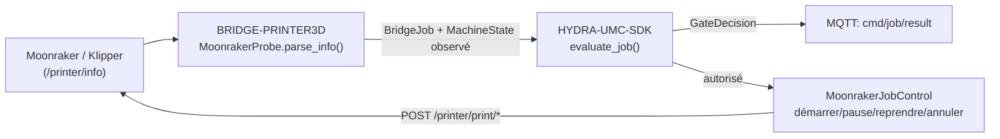

<!-- =============================================================================
HYDRA-UMC-BRIDGE-PRINTER3D - 3D printer coordination bridge
Copyright (C) JuanenRac (Electro Hobby 3D) <electrohobby3d@gmail.com>
GPL-3.0-or-later - see LICENSE
============================================================================= -->

<p align="center">
  
</p>

# 🖨️ HYDRA-UMC-BRIDGE-PRINTER3D

<p align="center"><a href="README.md">🇺🇸 English</a> | <a href="README_spa.md">🇪🇸 Español</a> | 🇫🇷 <b>Français</b> | <a href="README_ita.md">🇮🇹 Italiano</a> | <a href="README_deu.md">🇩🇪 Deutsch</a> | <a href="README_zho.md">🇨🇳 简体中文</a> | <a href="README_jpn.md">🇯🇵 日本語</a> | <a href="README_por.md">🇵🇹 Português</a></p>

### 🌡️ Pont de coordination à sécurité intrinsèque pour logiciels d'impression 3D ouverts

<p align="center">
  
  
  
  
  
  
</p>

---

> **Vérification d'honnêteté - ce qui fonctionne réellement aujourd'hui :** la sonde de disponibilité Moonraker et la porte de sécurité (`moonraker.py` avec `MoonrakerProbe`/`PrinterBridge`, faisant passer chaque tâche par le propre `evaluate_job()` de `HYDRA-UMC-SDK`), les vraies commandes de tâche pilotées par le SDK (`MoonrakerJobControl` : démarrer/mettre en pause/reprendre/annuler), l'évidence en lecture seule d'artefacts/profils (`artifacts.py`, `profiles.py`), et le pont de commandes/état MQTT (`mqtt_transport.py`) sont réels et couverts par 157 cas `unittest` qui passent (`python tools/build_test.py`). Les tests orientés Moonraker tournent contre un vrai `ThreadingHTTPServer` local se substituant à la véritable API REST de Moonraker - pas une vraie imprimante -, et la logique propre de `connect_with_retry()`/routage de messages de la couche MQTT est testée sans jamais ouvrir une vraie connexion ou un vrai broker `paho-mqtt`. Comme le README le dit déjà plus bas, ce bridge n'a pas encore été testé contre une vraie imprimante, un vrai hotend ou un vrai robot. Le streaming de G-code brut n'est délibérément pas implémenté - seul un fichier déjà téléversé et déjà tranché peut être démarré/mis en pause/repris/annulé par son nom. Voir « Feuille de route et limites connues » ci-dessous, qui le dit déjà clairement, et `CHANGELOG.md` pour ce qui a été exactement livré jusqu'à présent.

> **État de la sûreté et de la cybersécurité :** cet écosystème n'est pas un système de sécurité certifié. Il n'existe pas encore de chaîne d'E-STOP matérielle, ni de limites ou de verrouillages imposés par le firmware, ni de commande de mouvement vérifiée ; les images de firmware sont contrôlées par CRC-32 et une signature Ed25519, et une compilation de version refuse les clés de développement publiées (les têtes d'outil et les cartes d'extension derrière le relais utilisent encore les chargeurs d'URTC, qui prennent un HMAC-SHA256 à clé partagée au lieu d'une signature) ; TLS et TLS mutuel sont optionnels et désactivés par défaut ; aucune carte propre n'a encore été assemblée ni testée. Lisez la [base de sécurité](https://github.com/JuanenRac/HYDRA-UMC-DOCS/blob/main/docs/SECURITY_BASELINE.md) et le [modèle de menaces](https://github.com/JuanenRac/HYDRA-UMC-DOCS/blob/main/docs/THREAT_MODEL.md) avant de vous fier à une affirmation d'ici pour la sécurité d'une personne.

---

## 📋 En un coup d'œil

| | |
|---|---|
| Version | `0.2.0` |
| Maturité | Fonctionnel |
| Tests | 157 (`python tools/build_test.py`) |
| Technologie | Python / Moonraker / Klipper / G-code / 3MF |
| Cible | Le Raspberry Pi CM5 d'une cellule HYDRA-UMC |
| Sur matériel réel | Simulé seulement : testé avec des émulateurs, des doubles de test ou des simulateurs ; aucune exécution sur du matériel réel n'est consignée pour cette version |

**Aller à :** [Présentation](#-présentation) · [Architecture](#-architecture) · [Fonctionnalités](#-fonctionnalités) · [Sécurité et protection](#-sécurité-et-protection) · [Interfaces](#-interfaces) · [Configuration](#-configuration) · [Démarrage rapide](#-démarrage-rapide) · [Tests](#-tests) · [Dépannage](#-dépannage) · [Structure du dépôt](#-structure-du-dépôt) · [Projets liés](#-projets-liés)

## 🚦 État du projet

Chaque ligne est une partie de ce dépôt et le feu dit où elle en est aujourd'hui. Elle est écrite d'après ce que le dépôt peut montrer (tests, compilations, exécutions), pas d'après ce qui est prévu.

🟢 Fait et vérifié · 🟡 Fonctionne, avec des limites connues · 🟠 À moitié fait ou pas encore vérifié · 🔴 Pas fait ou ne fonctionne pas

| Domaine | État | Ce que cela veut dire ici |
|---|---|---|
| Logiciel | 🟡 | Fonctionne pour son usage principal ; la vérification d'honnêteté ci-dessus liste ce qui manque encore |
| Tests | 🟢 | 157 tests automatiques, exécutés à chaque modification |
| Matériel réel | 🟠 | Simulé seulement : testé avec des émulateurs, des doubles de test ou des simulateurs ; aucune exécution sur du matériel réel n'est consignée pour cette version |
| Documentation | 🟢 | README en huit langues, vérifié par rapport au manifeste à chaque modification |

## 🎯 Présentation

**HYDRA-UMC-BRIDGE-PRINTER3D** est le coordinateur haut niveau pour les logiciels d'impression 3D ouverts (Moonraker/Klipper) et les auxiliaires robotiques HYDRA-UMC. Il reconnaît aussi les artefacts locaux de slicer en lecture seule et peut envoyer des commandes de tâche pilotées par le SDK (démarrer/mettre en pause/reprendre/annuler un fichier déjà téléversé et déjà tranché, plus un arrêt d'urgence dur) via l'API REST propre de Moonraker ; les tests utilisent un serveur HTTP local factice et aucune imprimante réelle n'en a reçu. Le firmware natif de l'imprimante reste responsable en permanence du mouvement, des chauffages, de la protection thermique et des interverrouillages machine — ce pont ne diffuse jamais de G-code brut et ne remplace jamais cette autorité ; il ne fait que lire la disponibilité, enregistrer l'évidence des artefacts, envoyer des commandes de niveau tâche déjà sûres et coordonner les auxiliaires autour.

Il appartient à la famille **External Automation Bridges** : un ensemble de dépôts frères (CNC, LASER, OPENPNP, PRINTER3D, ROS2) qui partagent le même contrat de sécurité de `HYDRA-UMC-SDK`, afin qu'aucun pont ne puisse inventer sa propre définition du « sûr pour travailler ».

## 🧩 Rôle dans HYDRA-UMC

**HYDRA-UMC-BRIDGE-PRINTER3D** se place entre une imprimante 3D Moonraker/Klipper et la cellule de robots. Il rapporte ce que dit ce côté, interroge la porte partagée avant tout travail auxiliaire et ne prend jamais l'autorité de la machine avec laquelle il coordonne.

Chaque bridge parle le contrat de sécurité partagé de `HYDRA-UMC-SDK` : un travail n'est accepté que si la porte partagée `evaluate_job()` le permet, et cette porte échoue en position fermée. Le projet parent est `HYDRA-UMC-SERVER` ; ce bridge ne l'appelle pas, il répond en MQTT, via `HYDRA-UMC-MQTT-BROKER`, à celui qui commande la cellule.

## 🏛️ Architecture

<p align="center">
  
</p>

<details>
<summary>Version texte du diagramme (Mermaid)</summary>



</details>

**Pourquoi il est construit ainsi**

* **Pourquoi seul l'état littéral `"ready"` de Moonraker est mappé vers le repos.** Le mappage d'état de `parse_info()` est délibérément étroit : `ready` → `IDLE`, `shutdown`/`error` → `FAULT`, `startup` → `OFFLINE` (sécurité intrinsèque), et toute autre valeur ou valeur absente → `OFFLINE`. Il n'y a aucune hypothèse « par défaut sûr » pour un état d'imprimante non reconnu.
* **Pourquoi l'analyse est une `@staticmethod` séparée de la récupération réseau.** `MoonrakerProbe.parse_info()` prend un simple `dict` et est entièrement testable unitairement sans appel réseau ni imprimante en fonctionnement ; `fetch()` est la pièce mince et nécessairement réseau qui l'appelle. La logique liée à la sécurité vit dans la partie qui n'a jamais besoin d'une imprimante réelle pour être testée.
* **Pourquoi la sonde utilise `urlopen`/`json` de la bibliothèque standard plutôt qu'une bibliothèque cliente Moonraker.** Limiter la surface de dépendance à la bibliothèque standard Python garde l'analyse liée à la sécurité minimale, auditable et exempte des propres hypothèses d'un client tiers sur les tentatives, délais ou gestion d'erreurs.
* **Pourquoi le pont construit un nouveau `BridgeJob` et délègue au `evaluate_job()` partagé plutôt que d'écrire sa propre logique d'acceptation/rejet.** Les cinq External Automation Bridges (CNC, LASER, OPENPNP, PRINTER3D, ROS2) réutilisent exactement le même `bridge_contract` de `HYDRA-UMC-SDK`, afin que « ce qui compte comme sûr pour démarrer une tâche » ne puisse pas diverger silencieusement entre eux.
* **Pourquoi les commandes de tâche (start/pause/resume/cancel) sont réelles mais le streaming de G-code brut ne l'est pas encore.** Les endpoints `/printer/print/*` de Moonraker ne font jamais référence qu'à un fichier déjà téléversé et déjà tranché, par son nom - la même enveloppe de sécurité que Moonraker/Klipper appliquent déjà eux-mêmes sur ce fichier. Le G-code brut arbitraire est une surface de confiance fondamentalement différente et bien plus large (il peut contenir n'importe quoi) et nécessite encore un profil testé, une authentification et une revue de sécurité physique que ce pont n'a pas encore.
* **Pourquoi `resume_job()` ne réutilise pas le portail générique `evaluate_job()`.** Ce portail est construit autour de « le travail productif nécessite une machine IDLE » - l'inverse de la reprise d'une tâche en pause, qui n'a de sens qu'à partir de `HOLDING`. Même raisonnement de portail autonome déjà utilisé pour `stand_request()`/`sit_request()` de DROIDS.
* **Comment cela s'intègre dans le reste de l'écosystème.** BRIDGE-PRINTER3D se situe entre Moonraker/Klipper et `HYDRA-UMC-SDK` → `HYDRA-UMC-MQTT-BROKER` → sécurité de cellule : il coordonne le travail robotique auxiliaire autour de l'imprimante, il ne remplace jamais le firmware natif, les chauffages ni la protection thermique.

## ✨ Fonctionnalités

* ✅ **Sonde de disponibilité Moonraker, réelle :** `moonraker.py` — `MoonrakerProbe` consomme le point de terminaison documenté `/printer/info` de Moonraker avec un petit client basé uniquement sur la bibliothèque standard (`urlopen` + `json`) — aucune dépendance supplémentaire au-delà de la bibliothèque standard Python. *(implémenté, testé dans `tests/test_moonraker.py`)*
* ✅ **Analyse d'état à sécurité intrinsèque, réelle :** `parse_info()` ne mappe que la chaîne littérale `"ready"` vers `MachineState.IDLE` ; `shutdown`/`error` sont mappés vers `FAULT`, et tout le reste (y compris une réponse malformée) vers `OFFLINE` — jamais vers un état qui permettrait de planifier un robot autour de l'imprimante. *(implémenté)*
* ✅ **Portail de sécurité partagé, réel :** chaque tâche observée est réévaluée via `evaluate_job()` du `bridge_contract` de `HYDRA-UMC-SDK`, le même portail utilisé par tous les ponts frères. *(implémenté)*
* ✅ **Inspection d'artefacts indépendante du slicer :** `artifacts.py` identifie le G-code FDM simple d'OrcaSlicer, Ultimaker Cura, PrusaSlicer, Bambu Studio et d'autres slicers uniquement par preuve locale ; il reconnaît aussi les paquets 3MF et les slices de résine compatibles Lychee sans dépaqueter, analyser des commandes, téléverser ni imprimer. *(implémenté, testé dans `tests/test_artifacts.py`)*
* ✅ **Frontière de preuve de profil :** `profiles.py` peut faire correspondre un artefact inspecté à un profil FDM ou résine déclaré, mais renvoie `execution_authorized=False` même en cas de correspondance. *(implémenté, testé dans `tests/test_profiles.py`)*
* ✅ **Commandes de tâche réelles, contrôlées par le SDK :** `MoonrakerJobControl` envoie de véritables requêtes `POST` aux endpoints documentés `/printer/print/start|pause|resume|cancel` de Moonraker — `start_job()` est conditionné à la même décision `evaluate_job()` que toute répartition productive de cet écosystème ; `pause_job()`/`cancel_job()` sont toujours autorisés (même raisonnement de désescalade que `ABORT`) ; `resume_job()` nécessite une imprimante véritablement en `HOLDING`. Il ne démarre jamais qu'un fichier déjà téléversé et déjà tranché, par son nom — il ne diffuse jamais de G-code brut. *(implémenté, testé dans `tests/test_moonraker.py`)*
* ✅ **Build/test non mutant :** `build-test.bat`/`.sh` compilent l'analyseur de réponse et le portail de sécurité sans envoyer de G-code, changer de version ni toucher une imprimante. *(implémenté, voir Compilation et publication ci-dessous)*
* 🔜 **Streaming de G-code brut** — délibérément encore reporté : envoyer des commandes arbitraires de bas niveau (pas une tâche nommée déjà tranchée) nécessite un profil testé, une authentification et une revue de sécurité physique que ce pont n'a pas encore. *(prévu)*
* ✅ **Clés d'idempotence répétées :** `PrinterMqttBridge` accepte un `IdempotencyStore` : une clé de travail répétée reçoit la réponse donnée la première fois au lieu d'être évaluée de nouveau, de sorte qu'un `cmd/start` répété ne lance jamais une seconde impression. *(implémenté, testé dans `tests/test_idempotency.py`)*
* ✅ **Boucle MQTT durcie :** une charge trop grande (plus de 16 Kio) ou illisible, un JSON très imbriqué et toute défaillance inattendue reçoivent un refus sur le topic de résultat et ne terminent jamais la boucle ; pause, cancel et le nouveau `cmd/emergency_stop` (M112 de Klipper) sont traités sur une voie à part, de sorte qu'un Moonraker lent ne retarde jamais un arrêt ; les clés d'idempotence sont par verbe (`job:`/`start:`) ; les réponses de `cmd/job` portent `"mode": "gate-only"` et un ABORT par ce biais indique que rien n'a été arrêté ; l'état porte `observed_at` et le bridge s'annonce sur un topic `availability` avec un Last Will ; la clé API de Moonraker (`MOONRAKER_API_KEY`, envoyée en `X-Api-Key`) est prise en charge, et un démarrage n'est envoyé que pour un fichier que Moonraker connaît. *(implémenté, testé dans `tests/test_hardening.py`)*
* ✅ **Suit l'arrêt global (désactivé par défaut):** avec `HYDRA_UMC_PRINTER3D_GLOBAL_STOP=1`, le bridge lit l'annonce retenue du serveur sur `hydra/swarm/safety/estop` ; tant qu'elle dit `SAFE_STOP`, ou est illisible, il refuse avec un motif : une reprise, un démarrage et un travail (un abandon passe). Les arrêts et les requêtes en lecture seule continuent de fonctionner et seul `READY` met fin au refus. *(implémenté, testé contre un vrai broker ; jamais exécuté avec un vrai serveur)*

### COMPATIBILITÉ DES ARTEFACTS DE SLICER

La voie d'artefact en lecture seule accepte le G-code FDM normal (`.gcode`, `.gco`, `.gc`) produit par OrcaSlicer, Ultimaker Cura, PrusaSlicer, Bambu Studio et d'autres slicers. Les commentaires familiers fournissent un indice d'origine ; sans marqueur, la valeur reste `unknown-slicer`. Les `.gcode.3mf` et `.3mf` génériques sont identifiés, mais jamais dépaquetés. Les slices de résine (`.ctb`, `.goo`, `.photon`, `.pwmo`, `.pws`, `.sl1`) de flux compatibles Lychee sont délibérément opaques et ne sont jamais attribués à une imprimante ou un slicer précis.

Il s'agit de compatibilité avec les **artefacts de sortie**, pas du contrôle distant de ces applications. Le pont ne lance pas de slicer, ne modifie pas de profil, n'analyse/n'exécute pas le G-code, ne téléverse pas de fichier, ne contacte pas de service cloud et ne démarre pas d'impression. Consultez [Compatibilité des artefacts de slicer](docs/SLICER_ARTIFACT_COMPATIBILITY.md) pour la matrice précise et les prérequis d'un contrôle futur.

Une correspondance d'artefact/profil reste une preuve, jamais une permission d'imprimer. [Print Profile Admission Boundary](docs/PRINT_PROFILE_BOUNDARY.md) documente la validation distincte requise avant toute future opération avec un contrôleur natif.

## 🔒 Sécurité et protection

| Menace | Défense | Où |
|---|---|---|
| Un travail pour une cellule ou une machine qui n'est pas en état sûr | Chaque travail passe par la porte partagée `evaluate_job()` du SDK, qui échoue en position fermée ; le bridge n'a aucune logique propre d'acceptation | SDK `bridge_contract` |
| Données de travail démesurées | Au plus 32 paramètres, clés jusqu'à 64 caractères, valeurs jusqu'à 1024, identifiants jusqu'à 128 (`MAX_PARAMETERS`, `MAX_PARAMETER_KEY_CHARS`, `MAX_PARAMETER_VALUE_CHARS`, `MAX_IDENTIFIER_CHARS`) | SDK `bridge_contract` |
| Un ordre répété ou rejoué | Un `IdempotencyStore` retient chaque clé 24 heures et au plus 10 000 entrées ; une répétition reçoit la première réponse au lieu d'être réévaluée | SDK `job_intake` |
| Une charge MQTT énorme ou hostile | Une charge de plus de 16 KiB, un JSON illisible ou très imbriqué et tout échec inattendu reçoivent un refus sur le topic de résultat et ne terminent jamais la boucle | `mqtt_transport.py` |
| Une imprimante démarrée par un ordre dangereux | `MoonrakerJobControl` (démarrer, pause, reprendre, annuler) n'agit que derrière la porte du SDK ; le bridge lit l'état et ne contrôle jamais le firmware ni les chauffages ; les verbes d'arrêt `cmd/pause`, `cmd/cancel` et `cmd/emergency_stop` s'exécutent sur une voie à part | `moonraker.py`, `mqtt_transport.py` |
| Un fichier d'impression hostile | `artifacts.py` identifie un fichier sans le décompresser, l'exécuter ni l'envoyer (`.gcode.3mf` et `.3mf` reçoivent une empreinte, jamais ouverts) ; `profiles.py` associe seulement la preuve à un profil déclaré et n'autorise jamais une impression | `artifacts.py`, `profiles.py` |
| Une clé d'API Moonraker exposée | La clé n'est envoyée que dans l'en-tête `X-Api-Key` et lue depuis `MOONRAKER_API_KEY` | `moonraker.py` |

**Ce qu'il ne fait jamais :** il ne contrôle jamais le firmware ni les chauffages et ne décompresse ni n'exécute jamais un fichier d'impression.

## 🔌 Interfaces

Topics sous `hydra/bridges/printer3d/` ; chaque commande reçoit sa réponse sur `<verbe>/result`.

| Topic ou route | Ce qu'il porte |
|---|---|
| `cmd/status`, `cmd/job` | l'état de l'imprimante ; un `BridgeJob` répondu par une `GateDecision` |
| `cmd/start`, `cmd/resume` | avec porte : un vrai `POST /printer/print/*` seulement si la porte le permet |
| `cmd/pause`, `cmd/cancel`, `cmd/emergency_stop` | les verbes d'arrêt, sur une voie à part |
| `state`, `availability` | l'état retenu de l'imprimante et `online`/`offline` |

## ⚙️ Configuration

| Variable | Par défaut | Ce qu'elle définit |
|---|---|---|
| `MOONRAKER_API_KEY` | non défini (pas de clé) | la clé d'API Moonraker, envoyée comme `X-Api-Key` |
| `HYDRA_UMC_PRINTER3D_GLOBAL_STOP` | désactivé | `1` suit l'arrêt global du serveur : tant que la dernière annonce du sujet retenu `hydra/swarm/safety/estop` dit `SAFE_STOP` (ou est illisible), le bridge refuse avec un motif : une reprise, un démarrage et un travail (un abandon passe) ; seul `READY` y met fin. `HYDRA_UMC_PRINTER3D_GLOBAL_STOP_TOPIC` change le sujet et `HYDRA_UMC_PRINTER3D_GLOBAL_STOP_STRICT=1` refuse aussi tant que la première annonce n'est pas arrivée |
| `HYDRA_MQTT_USERNAME` | aucun | Le nom d'utilisateur MQTT ; le broker le lie à un préfixe d'identifiant client |
| `HYDRA_MQTT_PASSWORD` | aucun | Le mot de passe ; valable seulement avec le nom d'utilisateur |
| `HYDRA_MQTT_PASSWORD_FILE` | aucun | Le mot de passe lu dans un fichier (secret Docker ou systemd) ; ignoré si `HYDRA_MQTT_PASSWORD` est défini |
| `HYDRA_MQTT_TLS_CA` | aucun | Le fichier de l'AC qui a signé le certificat du broker : la connexion est en TLS et le certificat est vérifié |
| `HYDRA_MQTT_TLS` | désactivé | `1` active TLS, vérifié avec les AC de confiance du système |
| `HYDRA_MQTT_TLS_CERT` / `HYDRA_MQTT_TLS_KEY` | aucun | Le certificat client et sa clé pour un broker qui exige du TLS mutuel ; les deux sont requis |

## 🚀 Démarrage rapide

Nécessite Python 3.11 ou plus récent. Les tests et les scripts de build attendent `HYDRA-UMC-SDK` cloné à côté de ce dépôt (`../HYDRA-UMC-SDK`) ou indiqué par `HYDRA_UMC_SDK_ROOT`.

Essayez-le sans matériel (cela vérifie tout le bridge avec ses émulateurs et ses doubles de test) :

```bash
py -3 tools/build_test.py          # Windows
python3 tools/build_test.py         # Linux, macOS
```

Démarrer le service (il n'y a pas de script de console : le service est le `run_forever()` du transport MQTT, que vous appelez depuis votre propre code de démarrage) :

```python
from hydra_umc_bridge_printer3d.mqtt_transport import PrinterMqttBridge, run_forever
bridge = PrinterMqttBridge("http://192.168.0.50:7125", cell_state=lambda: cell_state)   # the Moonraker address; the key from MOONRAKER_API_KEY
run_forever(bridge, host="192.168.0.180")                                              # serves cmd/# forever
```

Le nom d'utilisateur, le mot de passe et les fichiers TLS viennent des variables `HYDRA_MQTT_*` (voir Configuration) ; le code ci-dessus n'a besoin d'aucun identifiant propre.

## 🧪 Tests

157 cas `unittest` automatiques s'exécutent avec `python tools/build_test.py` (qui compile aussi chaque module). Les tests n'ont besoin ni de matériel, ni de réseau, ni de paquet optionnel : ceux qui exigeraient `paho-mqtt`, `pyserial` ou une bibliothèque de fabricant utilisent un substitut ou sont ignorés si le paquet manque.

| Fichier de tests | Tests | Ce qu'il couvre |
|---|---|---|
| `test_global_stop.py`, `test_global_stop_broker.py` | - | la garde de l'arrêt global et ses refus avec le motif, et la même chose contre un vrai broker sur un port local libre (l'annonce en QoS 0, 1 et 2, un arrêt retenu obéi à la connexion, un arrêt illisible qui échoue fermé) |
| `test_broker_integration.py`, `broker_harness.py` | - | le client MQTT contre un vrai HYDRA-UMC-MQTT-BROKER sur un port local libre : un ordre via le client, l'état retenu et le testament, et le retour après la chute et le retour du broker ; il se saute quand Node.js, `paho-mqtt` ou le broker installé (`HYDRA_UMC_TEST_BROKER_DIR`, par défaut le dossier voisin) manquent |
| `test_moonraker.py` | - | lecture de l'état et commandes de travaux avec porte contre un substitut local |
| `test_artifacts.py`, `test_profiles.py` | - | identification des fichiers et association aux profils |
| `test_mqtt_transport.py`, `test_mqtt_environment.py`, `test_hardening.py`, `test_edge_cases.py`, `test_idempotency.py` | - | répartition des topics, identifiants de l'environnement, clients hostiles, cas limites, clés répétées |

La CI exécute `HYDRA_UMC_CI=1 python tools/ci_validate.py`, qui vérifie le manifeste, les documents, les huit README et les images, et lance les tests avec une copie du SDK.

## 🏗️ Compilation et publication

Nécessite Python 3.11+. `tools/build_test.py` attend que `HYDRA-UMC-SDK` soit cloné en tant que répertoire frère (`../HYDRA-UMC-SDK`) ou indiqué via la variable d'environnement `HYDRA_UMC_SDK_ROOT`.

```bash
# Windows
build-test.bat      # validation uniquement — pas de changement de version/CHANGELOG
build.bat            # Valide et compile (compiler ne change jamais la version)

# Linux/macOS
bash build-test.sh
bash build.sh
```

`build-test` compile chaque module de `src/` et `tools/` avec `py_compile` et exécute toute la suite `unittest` découverte sous `tests/` (`test_moonraker.py`, `test_artifacts.py`, `test_profiles.py`, `test_mqtt_transport.py`, `test_hardening.py`, `test_idempotency.py`, `test_mqtt_environment.py` - 157 tests), démontrant l'analyse de disponibilité, l'inspection d'artefacts et le portail de sécurité parmi tout le reste couvert — il n'envoie aucun G-code, ne touche aucune imprimante et ne modifie jamais le dépôt. `build` exécute d'abord cette même validation et, seulement en cas de succès, appelle `tools/bump_version.py` pour synchroniser la version dans `pyproject.toml`, `hydra-umc.project.json` et `CHANGELOG.md`. Il n'existe pas encore de commande `run` imprimante réelle — cela nécessite d'abord un profil testé, une authentification et une revue de sécurité physique.

Pour inspecter une sortie locale de slicer sans contacter une imprimante :

```bash
py tools/inspect_print_artifact.py chemin/vers/travail.gcode      # Windows
python3 tools/inspect_print_artifact.py chemin/vers/travail.gcode  # Linux / macOS
```

## 🩺 Dépannage

| Vous voyez | Parce que | Faites |
|---|---|---|
| `ModuleNotFoundError: hydra_umc_sdk` | Le SDK n'est ni installé ni à côté de ce dépôt | Clonez `HYDRA-UMC-SDK` à côté de ce dépôt ou définissez `HYDRA_UMC_SDK_ROOT` |
| `paho-mqtt is not installed` | Le client MQTT est un extra optionnel | `pip install ".[mqtt]"` (il faut `paho-mqtt` 2.1 ou plus, avant 3) |
| `password was given without a username` | Les identifiants MQTT exigent les deux parties | Définissez aussi `HYDRA_MQTT_USERNAME`, pas seulement le mot de passe |
| `could not reach the MQTT broker after N attempts` | Le broker est arrêté, l'adresse est fausse ou le port est fermé | Démarrez `HYDRA-UMC-MQTT-BROKER` et vérifiez l'hôte et le port donnés au transport (5 essais à 2 secondes d'écart) ; un échec de la poignée de main TLS n'est pas réessayé |
| `the MQTT broker refused the connection` | Le broker a refusé l'identifiant (ou n'a pas répondu à temps) | Vérifiez `HYDRA_MQTT_USERNAME` et le mot de passe ; l'identifiant client doit commencer par le préfixe que le broker a lié à l'identifiant |
| `"allowed": false` + `reason` | La porte partagée ou une garde a refusé l'ordre | Lisez `reason` et corrigez la cause ; ne réessayez pas à l'aveugle |

## 📂 Structure du dépôt

<p align="center">
  
</p>

<details>
<summary>Version texte de l'arborescence</summary>

```text
HYDRA-UMC-BRIDGE-PRINTER3D/
├── src/hydra_umc_bridge_printer3d/
│   ├── moonraker.py               état de l'imprimante et contrôle des travaux avec porte
│   ├── artifacts.py               identifie les fichiers d'impression, sans les décompresser
│   ├── profiles.py                associe la preuve à un profil déclaré
│   └── mqtt_transport.py          transport MQTT des commandes et de l'état
├── tests/                         132 tests, contre un substitut local de Moonraker
├── docs/                          guide du bridge, limite des profils, fichiers de slicer
├── tools/                         exécuteur de build et de tests, montée de version, validateur CI, générateurs et vérifications des README et des images
├── images/                        bannière et images du README
├── .github/                       workflow CI et modèles de tickets
├── pyproject.toml                 métadonnées du paquet et dépendances
├── hydra-umc.project.json         manifeste : version, maturité, famille
├── CHANGELOG.md                   ce qui a changé à chaque version
├── build.sh build.bat             scripts de build (ils ne changent jamais la version)
├── build-test.sh build-test.bat   scripts de build (ils ne changent jamais la version)
├── test.sh test.bat               lancent les tests
└── SECURITY.md SUPPORT.md CONTRIBUTING.md CODE_OF_CONDUCT.md LICENSE LICENSE.md
```

</details>

## 🗺️ Feuille de route et limites connues

**Limites connues aujourd'hui**

**Réel aujourd'hui :** version `0.2.0`, un adaptateur de disponibilité Moonraker testé localement (`MoonrakerProbe` + `PrinterBridge`) adossé au portail de tâches partagé de `HYDRA-UMC-SDK`, de véritables commandes de tâche contrôlées par le SDK (`MoonrakerJobControl` : démarrer/mettre en pause/reprendre/annuler un fichier déjà téléversé via l'API REST propre de Moonraker), une preuve en lecture seule d'artefacts G-code/3MF/slices de résine et de compatibilité de profil pour les principales familles de trancheurs, une suite `unittest` déterministe de 157 tests incluant la vérification du contrat HTTP local `/printer/info`, le contrat réel et séparé `/printer/objects/query?print_stats=state`, et la vérification réelle des commandes de tâche `POST`, et des scripts build-test non mutants intégrés en CI avec clonage du SDK.

**Frontière d'intégration :** le firmware natif de l'imprimante (Klipper via Moonraker) conserve à tout moment le mouvement, les chauffages, la protection thermique et les interverrouillages machine ; ce pont lit la disponibilité, n'envoie que des commandes de niveau tâche déjà sûres (jamais de G-code brut) et régule le travail robotique *auxiliaire* autour de cela.

**Encore à venir :** le pont n'a pas encore été éprouvé sur une imprimante, un hotend ou un robot réels (seulement contre un serveur HTTP local de test) — un premier essai sur une imprimante réelle nécessite d'abord un profil d'imprimante testé et une revue de sécurité physique ; l'envoi de G-code brut en flux n'est volontairement pas implémenté.

## 🌍 Langues

Ce README et les documents du dépôt existent en huit langues : anglais, espagnol, allemand, français, italien, japonais, chinois et portugais (Portugal). Ils sont écrits ensemble et la CI vérifie que les huit fichiers ont les mêmes sections et les mêmes liens. Ce dépôt n'a ni écran ni catalogue de messages propre, il n'y a donc aucune chaîne d'interface à traduire.

## 🔗 Projets liés

Ce projet fait partie de l'écosystème robotique HYDRA-UMC du même auteur (JuanenRac / Electro Hobby 3D). Bon à savoir, car une demande pourrait en réalité concerner l'un de ceux-ci plutôt que ce dépôt.

**Projet Parent**
- **[HYDRA-UMC-SERVER](https://github.com/JuanenRac/HYDRA-UMC-SERVER)** — le vrai backend headless (REST/WebSocket) auquel parle réellement chaque client de contrôle ; ce bridge ne l'appelle pas : il répond en MQTT, via HYDRA-UMC-MQTT-BROKER, à qui pilote la cellule.

**Projets Frères** — parlent également à la propre API de HYDRA-UMC-SERVER, chacun en tant que son propre client
- **[HYDRA-UMC-STUDIO](https://github.com/JuanenRac/HYDRA-UMC-STUDIO)** — tableau de bord de contrôle web avec visualisation 3D multi-robot en temps réel.
- **[HYDRA-UMC-SUITE](https://github.com/JuanenRac/HYDRA-UMC-SUITE)** — centre de commande d'essaim de bureau (PySide6) pour plusieurs serveurs à la fois, empaqueté en exécutable autonome.
- **[HYDRA-UMC-ANDROID-CONTROL](https://github.com/JuanenRac/HYDRA-UMC-ANDROID-CONTROL)** — application de contrôle Android native avec connexion biométrique et un compagnon Wear OS jumelé.
- **[HYDRA-UMC-IOS-CONTROL](https://github.com/JuanenRac/HYDRA-UMC-IOS-CONTROL)** — application de contrôle iOS/iPadOS (Flutter) avec synchronisation WebSocket en temps réel.
- **[HYDRA-UMC-DSI](https://github.com/JuanenRac/HYDRA-UMC-DSI)** — interface tactile native pour l'écran tactile DSI 7" embarqué, intégrée directement sur le CM5.
- **[HYDRA-UMC-BRIDGE-AMR](https://github.com/JuanenRac/HYDRA-UMC-BRIDGE-AMR)** — frontière de coordination pour les flottes AGV/AMR via un éditeur MQTT VDA 5050 (testé uniquement contre une flotte émulée).
- **[HYDRA-UMC-BRIDGE-CNC](https://github.com/JuanenRac/HYDRA-UMC-BRIDGE-CNC)** — coordinateur haut niveau pour cellules CNC avec accès au statut/octets de contrôle GRBL (testé uniquement contre un émulateur).
- **[HYDRA-UMC-BRIDGE-DROIDS](https://github.com/JuanenRac/HYDRA-UMC-BRIDGE-DROIDS)** — frontière de coordination pour droïdes à pattes/humanoïdes, avec un émetteur de commandes Boston Dynamics Spot (testé uniquement contre un émulateur).
- **[HYDRA-UMC-BRIDGE-LASER](https://github.com/JuanenRac/HYDRA-UMC-BRIDGE-LASER)** — coordinateur de cellules laser lisant 3 signaux GPIO de clé/enceinte/verrouillage (testé uniquement contre une puce simulée ; il ne peut ni armer ni tirer un laser).
- **[HYDRA-UMC-BRIDGE-OPENPNP](https://github.com/JuanenRac/HYDRA-UMC-BRIDGE-OPENPNP)** — coordinateur haut niveau sûr pour le flux de cartes du pick-and-place OpenPnP.
- **[HYDRA-UMC-BRIDGE-ROS2](https://github.com/JuanenRac/HYDRA-UMC-BRIDGE-ROS2)** — coordinateur avec un transport ROS 2 rclpy à importation paresseuse (pas encore exécuté contre une installation ROS 2).
- **[HYDRA-UMC-BRIDGE-UAV](https://github.com/JuanenRac/HYDRA-UMC-BRIDGE-UAV)** — frontière de coordination pour UAV équipés de caméra, avec un émetteur de commandes MAVLink (testé uniquement contre un émulateur).

**Directement Liés**
- **[HYDRA-UMC-SDK](https://github.com/JuanenRac/HYDRA-UMC-SDK)** — le contrat JSON-Schema partagé et la barrière logicielle de contrôle des jobs contre laquelle chaque bridge valide ses commandes (pas une fonction de sécurité certifiée).
- **[HYDRA-UMC-CONNECTOR-HUB](https://github.com/JuanenRac/HYDRA-UMC-CONNECTOR-HUB)** — registre déclaratif et validateur de manifestes d'adaptateur pour les connecteurs de machines externes ; étend la propre idée de contrat du SDK aux machines externes sans remplacer les projets de passerelle industrielle.
- **[HYDRA-UMC-MQTT-BROKER](https://github.com/JuanenRac/HYDRA-UMC-MQTT-BROKER)** — le vrai transport de `mqtt_transport.py` pour les propres topics `hydra/bridges/printer3d/...` de ce bridge — statut plus les vraies commandes Moonraker start/pause/resume/cancel, avec la barrière de tâches partagée ; voir le propre `docs/BRIDGE_TOPICS.md` de ce dépôt.
- **[HYDRA-UMC-SAFETY-ZONES](https://github.com/JuanenRac/HYDRA-UMC-SAFETY-ZONES)** — future preuve de sécurité de l'espace de travail pour ce bridge.

**Fait Également Partie de l'Écosystème**

*Matériel & Plateforme de Base*
- **[HYDRA-UMC](https://github.com/JuanenRac/HYDRA-UMC)** — la conception de la carte mère du bras robotique : hôte CM5 + coprocesseur STM32H745 double cœur, destinée à coordonner jusqu'à 8 bras-outils via CAN-OTA/SPI-OTA (firmware à un stade précoce ; aucune carte assemblée pour l'instant).
- **[HYDRA-UMC-OS](https://github.com/JuanenRac/HYDRA-UMC-OS)** — couche produit reproductible sur Raspberry Pi OS pour le CM5 : agent en lecture seule, config/profils validés, provisionnement WiFi de premier contact.

*Backend Central & Clients*
- **[HYDRA-UMC-EDITOR-URDF](https://github.com/JuanenRac/HYDRA-UMC-EDITOR-URDF)** — créateur/éditeur graphique de bureau pour URDF qui envoie les modèles terminés vers le propre catalogue de STUDIO.
- **[HYDRA-UMC-EDITOR-STL](https://github.com/JuanenRac/HYDRA-UMC-EDITOR-STL)** — éditeur de bureau de modèles STL, transformant/remplaçant/retirant/ajoutant de vraies pièces dans le même catalogue de modèles qu'édite aussi HYDRA-UMC-EDITOR-URDF.

*Plateforme d'Outils URTC*
- **[URTC](https://github.com/JuanenRac/URTC)** — firmware pour la carte physique Universal Robot Tool Controller, plus de 25 profils d'outil sur bus CAN.
- **[URTC-FLASHER](https://github.com/JuanenRac/URTC-FLASHER)** — outil de bureau à interface graphique pour flasher les cartes URTC, CAN-OTA plus SWD/JTAG puce complète.
- **[URTC-TESTER](https://github.com/JuanenRac/URTC-TESTER)** — outil de bureau de diagnostic CAN-bus en direct pour cartes URTC, un panneau par profil d'outil.
- **[URTC-WEB-STUDIO](https://github.com/JuanenRac/URTC-WEB-STUDIO)** — alternative basée navigateur à URTC-TESTER via la Web Serial API, sans installation locale.
- **[URTC-GATEWAY](https://github.com/JuanenRac/URTC-GATEWAY)** — passerelle devant le bus CAN d'URTC : liste d'identifiants autorisés, limite de débit et clé de session ; logiciel testé sur ordinateur, pas encore sur un bus réel.

*Nœud IA de Vision (Hailo-8)*
- **[HYDRA-UMC-VISION-NODE](https://github.com/JuanenRac/HYDRA-UMC-VISION-NODE)** — hub d'intégration pour le pipeline de vision Hailo-8, avec une vraie vérification de disponibilité matérielle par étape.
- **[HYDRA-UMC-DETECTION-HEF](https://github.com/JuanenRac/HYDRA-UMC-DETECTION-HEF)** — registre réel de modèles compilés avec vérification de chargement sécurisé par architecture Hailo/checksum.
- **[HYDRA-UMC-VISION-STREAMER](https://github.com/JuanenRac/HYDRA-UMC-VISION-STREAMER)** — générateur réel de pipeline GStreamer + config MediaMTX, avec une vraie frontière d'intégration HailoRT.
- **[HYDRA-UMC-VISUAL-SERVOING-API](https://github.com/JuanenRac/HYDRA-UMC-VISUAL-SERVOING-API)** — loi de correction Position-Based Visual Servoing avec autorisation conditionnée à l'état de zone ; pas encore d'estimation de pose par caméra.

*Nœud IA Cognitif (Hailo-10)*
- **[HYDRA-UMC-COGNITIVE-NODE](https://github.com/JuanenRac/HYDRA-UMC-COGNITIVE-NODE)** — hub d'intégration pour le pipeline cognitif Hailo-10 (orchestration LLM/VLA/voix).
- **[HYDRA-UMC-VLA-ENGINE](https://github.com/JuanenRac/HYDRA-UMC-VLA-ENGINE)** — vrai encodage/décodage de jetons d'action et génération de trajectoire pour un modèle Vision-Language-Action.
- **[HYDRA-UMC-VOICE-UI](https://github.com/JuanenRac/HYDRA-UMC-VOICE-UI)** — vrai front-end vocal (VAD + analyseur d'intention) avec un relais Watch borné et soumis à confirmation.
- **[HYDRA-UMC-SEMANTIC-PLANNER](https://github.com/JuanenRac/HYDRA-UMC-SEMANTIC-PLANNER)** — vraie décomposition de tâches basée sur des règles et récupération sémantique d'erreurs sur les codes d'erreur MCU.
- **[HYDRA-UMC-DOCS-QA](https://github.com/JuanenRac/HYDRA-UMC-DOCS-QA)** — vraie recherche documentaire TF-IDF (bibliothèque standard uniquement) sur les propres documents Markdown de cet écosystème.
- **[HYDRA-UMC-LOCAL-TECHNICIAN](https://github.com/JuanenRac/HYDRA-UMC-LOCAL-TECHNICIAN)** — technicien de maintenance IA local et à portes de politique pour l'écosystème lui-même - observe, diagnostique et propose des corrections ; les deux niveaux de risque les plus élevés ne sont délibérément pas encore implémentés.

*Orchestration & Essaim*
- **[HYDRA-UMC-ORCHESTRATOR](https://github.com/JuanenRac/HYDRA-UMC-ORCHESTRATOR)** — hub d'intégration avec un vrai contrat de rapport de santé gRPC/Protobuf et une machine à états de mission.
- **[HYDRA-UMC-JOB-DISPATCHER](https://github.com/JuanenRac/HYDRA-UMC-JOB-DISPATCHER)** — vraie file de tâches basée sur la priorité avec déduplication, via une vraie API HTTP.
- **[HYDRA-UMC-NODE-HEALING](https://github.com/JuanenRac/HYDRA-UMC-NODE-HEALING)** — vrai chien de garde de santé de flotte basé sur gRPC, avec retry/backoff et détection d'incohérence d'identité.
- **[HYDRA-UMC-PATH-PLANNER-3D](https://github.com/JuanenRac/HYDRA-UMC-PATH-PLANNER-3D)** — vrai planificateur de trajectoire 3D basé sur RRT, avec vraie validation des collisions obstacle/espace de travail.
- **[HYDRA-UMC-SWARM-SYNC](https://github.com/JuanenRac/HYDRA-UMC-SWARM-SYNC)** — vraie synchronisation d'état CRDT LWW-Element-Map, testée par propriétés pour la convergence multi-cellule.

*Jumeau Numérique & Simulation*
- **[HYDRA-UMC-TWIN](https://github.com/JuanenRac/HYDRA-UMC-TWIN)** — hub d'intégration pour le moteur de jumeau numérique, avec un vrai contrat de synchronisation par compatibilité de version.
- **[HYDRA-UMC-HIL-BRIDGE](https://github.com/JuanenRac/HYDRA-UMC-HIL-BRIDGE)** — routeur hardware-in-the-loop avec un verrouillage logiciel de collision entre simulation et matériel réel (testé sans matériel réel).
- **[HYDRA-UMC-PHYSICS-REPLICA](https://github.com/JuanenRac/HYDRA-UMC-PHYSICS-REPLICA)** — vraie cinématique directe et validation des limites articulaires sur un vrai sous-ensemble URDF.
- **[HYDRA-UMC-SYNTHETIC-DATA-GEN](https://github.com/JuanenRac/HYDRA-UMC-SYNTHETIC-DATA-GEN)** — vrai générateur procédural de scènes 2D avec export d'annotations YOLO/COCO.

*Données & Analytique*
- **[HYDRA-UMC-DATALAKE](https://github.com/JuanenRac/HYDRA-UMC-DATALAKE)** — vrai magasin de séries temporelles basé sur sqlite3, avec une vraie API HTTP d'ingestion/requête.
- **[HYDRA-UMC-ANOMALY-DETECTOR](https://github.com/JuanenRac/HYDRA-UMC-ANOMALY-DETECTOR)** — vrai détecteur d'anomalies FFT + ligne de base statistique, avec surveillance de dérive.
- **[HYDRA-UMC-PRODUCTION-REPORTS](https://github.com/JuanenRac/HYDRA-UMC-PRODUCTION-REPORTS)** — vrai calcul OEE/disponibilité sur l'historique de DATALAKE, avec export CSV reproductible.
- **[HYDRA-UMC-TELEMETRY-COLLECTOR](https://github.com/JuanenRac/HYDRA-UMC-TELEMETRY-COLLECTOR)** — vrai pipeline d'ingestion CAN/WebSocket vers DATALAKE, avec déduplication par séquence.

*Passerelle Industrielle*
- **[HYDRA-UMC-GATEWAY-INDUSTRIAL](https://github.com/JuanenRac/HYDRA-UMC-GATEWAY-INDUSTRIAL)** — hub d'intégration relayant vers les protocoles industriels, avec une vraie couche de liste blanche de commandes/contre-pression.
- **[HYDRA-UMC-OPCUA-SERVER](https://github.com/JuanenRac/HYDRA-UMC-OPCUA-SERVER)** — vrai espace d'adressage OPC-UA, vérifié avec une vraie session client du protocole binaire.
- **[HYDRA-UMC-MTCONNECT-ADAPTER](https://github.com/JuanenRac/HYDRA-UMC-MTCONNECT-ADAPTER)** — vrais points de terminaison XML MTConnect `/probe` et `/current`, avec sortie en mode dégradé.

*Outils Complémentaires & Opérations de l'Écosystème*
- **[HYDRA-UMC-DASHBOARD-AI](https://github.com/JuanenRac/HYDRA-UMC-DASHBOARD-AI)** — panneaux Smart Summaries et Anomaly Highlighting sur DATALAKE/ANOMALY-DETECTOR, avec un repli statistique honnête.
- **[HYDRA-UMC-TOOL-CLI](https://github.com/JuanenRac/HYDRA-UMC-TOOL-CLI)** — CLI de flotte avec un vrai contrat de codes de sortie stable, un vrai client en direct de la propre API de HYDRA-UMC-SERVER.
- **[HYDRA-UMC-WATCH](https://github.com/JuanenRac/HYDRA-UMC-WATCH)** — application compagnon WearOS avec des motifs d'alerte haptique et un relais vocal vers le téléphone jumelé (pas encore exécutée sur une montre physique).
- **[URTC-SMART-RACK](https://github.com/JuanenRac/URTC-SMART-RACK)** — firmware pour un rack de montage de cartes avec décodage réel d'ID d'outil et logique de préchauffage Smart Idle.
- **[URTC-VISION-TOOL](https://github.com/JuanenRac/URTC-VISION-TOOL)** — firmware plus un vrai compagnon de vision Python pour une tête d'outil d'inspection thermique/RGB.
- **[HYDRA-UMC-UPDATER](https://github.com/JuanenRac/HYDRA-UMC-UPDATER)** — outil administratif de bureau qui découvre, clone et met à jour chaque dépôt de cet écosystème.
- **[HYDRA-UMC-OS-REBUILDER](https://github.com/JuanenRac/HYDRA-UMC-OS-REBUILDER)** — outil de bureau Windows/Linux qui construit une image de la CM5 prête à graver, préchargée avec les versions les plus actuelles de l'écosystème, avec une configuration de premier démarrage Wi-Fi/utilisateur/SSH façon Raspberry Pi Imager.
- **[HYDRA-UMC-OPS-AGENT](https://github.com/JuanenRac/HYDRA-UMC-OPS-AGENT)** — coordinateur d'incidents de maintenance : un rôle edge à faible privilège collecte un instantané d'inventaire/santé assaini, un rôle control-plane le rend en lecture seule et demande à un fournisseur d'IA de suggérer un diagnostic - n'applique jamais de correctif ni ne déploie rien.
- **[HYDRA-UMC-DEV-SERVER](https://github.com/JuanenRac/HYDRA-UMC-DEV-SERVER)** — hôte de développement reproductible (Raspberry Pi 5 / CM5) qui héberge le code source de l'écosystème et exécute des tâches de compilation/test délimitées via une file d'attente durable ; un rôle de développement dédié, explicitement distinct d'un CM5 opérationnel.

## 📚 Documentation

Où lire la suite :

* [docs/BRIDGE_GUIDE.md](docs/BRIDGE_GUIDE.md) - périmètre, Moonraker, scripts, la porte d'acceptation matérielle
* [docs/SLICER_ARTIFACT_COMPATIBILITY.md](docs/SLICER_ARTIFACT_COMPATIBILITY.md) - quels fichiers de slicer sont reconnus et comment
* [docs/PRINT_PROFILE_BOUNDARY.md](docs/PRINT_PROFILE_BOUNDARY.md) - la validation exigée avant toute opération avec le contrôleur natif
* [Base de sécurité de l'écosystème](https://github.com/JuanenRac/HYDRA-UMC-DOCS/blob/main/docs/SECURITY_BASELINE.md)
* [Modèle de menaces de l'écosystème](https://github.com/JuanenRac/HYDRA-UMC-DOCS/blob/main/docs/THREAT_MODEL.md)
* [Journal des modifications de ce dépôt](CHANGELOG.md)
* [Licence de ce dépôt](LICENSE.md)

## 🤝 Contribuer et communauté

* Avant une pull request, exécutez `HYDRA_UMC_CI=1 py -3 tools/ci_validate.py` (ou `HYDRA_UMC_CI=1 python3 tools/ci_validate.py`) : il doit afficher `CI_VALIDATION=PASS`. N'exécutez pas `build.sh` ni `build.bat` pour cette vérification ; compiler n'est pas vérifier.
* Les huit README sont écrits à partir d'une source unique dans HYDRA-UMC-DOCS ; ne les modifiez pas à la main. Changez la source et réécrivez-les avec `tools/make_readmes.py`.
* N'affirmez pas dans un README ce qui n'a pas tourné : écrivez « simulé » ou « non essayé sur matériel » quand c'est la vérité.
* Voir [CONTRIBUTING.md](CONTRIBUTING.md), le [code de conduite](CODE_OF_CONDUCT.md), [SECURITY.md](SECURITY.md) et [SUPPORT.md](SUPPORT.md).

## 👤 AUTEUR

**JuanenRac (Electro Hobby 3D)** · electrohobby3d@gmail.com

## 📜 LICENCE

GPL-3.0-or-later - [LICENSE](LICENSE).
