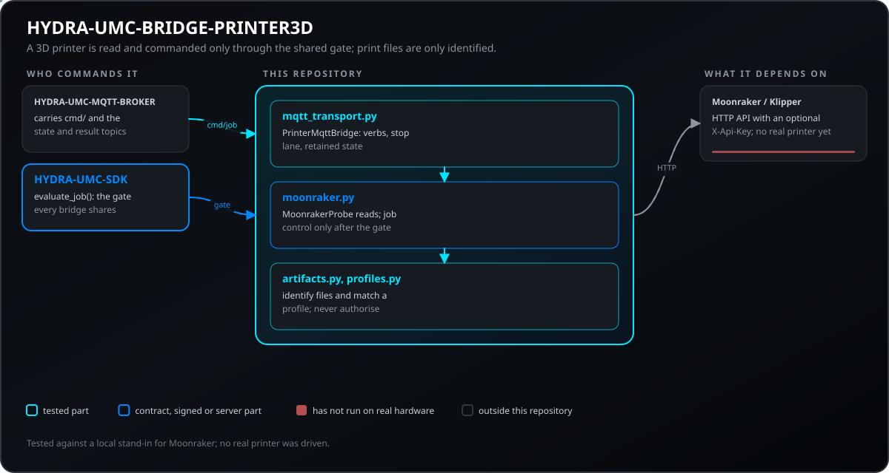
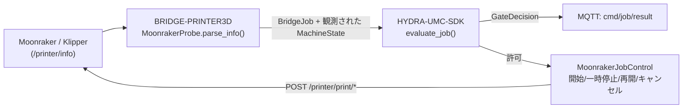
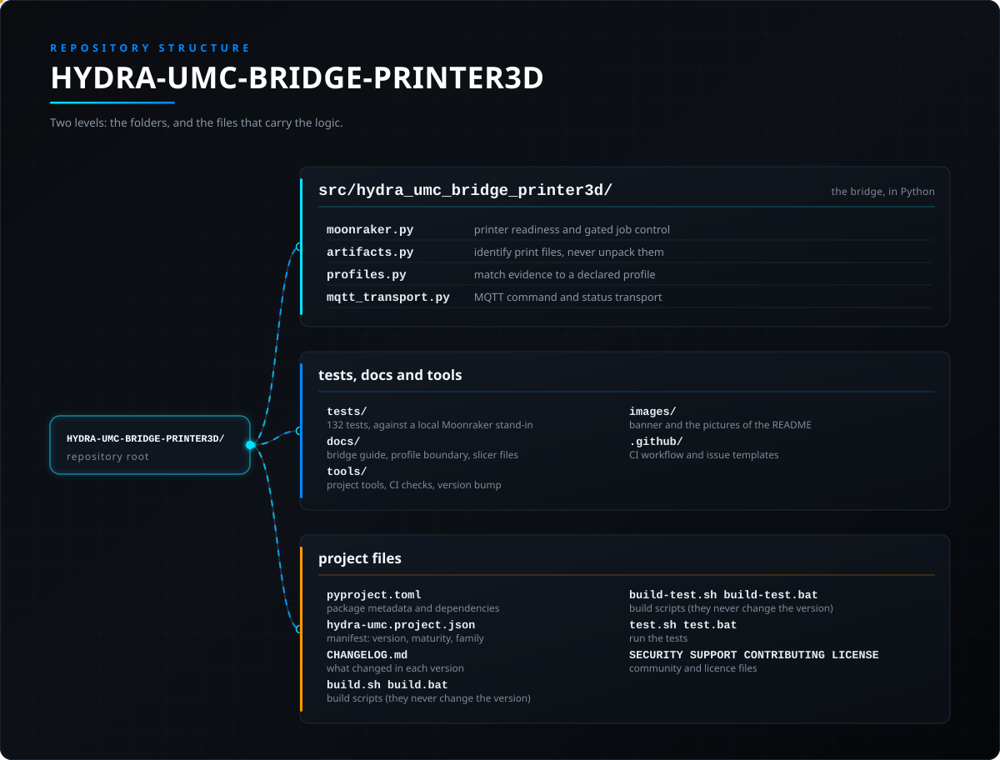

<!-- =============================================================================
HYDRA-UMC-BRIDGE-PRINTER3D - 3D printer coordination bridge
Copyright (C) JuanenRac (Electro Hobby 3D) <electrohobby3d@gmail.com>
GPL-3.0-or-later - see LICENSE
============================================================================= -->

<p align="center">
  
</p>

# 🖨️ HYDRA-UMC-BRIDGE-PRINTER3D

<p align="center"><a href="README.md">🇺🇸 English</a> | <a href="README_spa.md">🇪🇸 Español</a> | <a href="README_fra.md">🇫🇷 Français</a> | <a href="README_ita.md">🇮🇹 Italiano</a> | <a href="README_deu.md">🇩🇪 Deutsch</a> | <a href="README_zho.md">🇨🇳 简体中文</a> | 🇯🇵 <b>日本語</b> | <a href="README_por.md">🇵🇹 Português</a></p>

### 🌡️ オープンな3Dプリントソフトウェア向けフェイルセーフ連携ブリッジ

<p align="center">
  
  
  
  
  
  
</p>

---

> **誠実性チェック - 今日実際に動くもの:** Moonraker のレディネス確認と安全ゲート（`moonraker.py` の `MoonrakerProbe`/`PrinterBridge`。すべてのジョブは `HYDRA-UMC-SDK` 自身の本物の `evaluate_job()` を通過する）、本物の SDK ゲート付きジョブコマンド（`MoonrakerJobControl` の開始/一時停止/再開/キャンセル）、読み取り専用のアーティファクト/プロファイルエビデンス（`artifacts.py`、`profiles.py`）、および MQTT コマンド/状態ブリッジ（`mqtt_transport.py`）は本物であり、157件の通過する `unittest` ケースで検証されている（`python tools/build_test.py`）。Moonraker 向けのテストは、本物の Moonraker REST API の代わりとなる本物のローカル `ThreadingHTTPServer` に対して実行されており、実際のプリンタではない。MQTT 層自身の `connect_with_retry()`/メッセージルーティングロジックは、本物の `paho-mqtt` 接続やブローカーを一度も開かずにテストされている。下記の README に既に記載されている通り、このブリッジはまだ実際のプリンタ、ホットエンド、ロボットに対して検証されていない。生の G-code ストリーミングは意図的に実装されていない - 名前によって開始/一時停止/再開/キャンセルできるのは、既にアップロード済みで既にスライス済みのファイルのみである。詳細は下記の「ロードマップと既知の制限」に既に明記されており、これまでに実際に出荷された内容は `CHANGELOG.md` を参照。

> **安全性とセキュリティの現状:** このエコシステムは認証された安全システムではありません。ハードウェアの E-STOP 経路、ファームウェアが強制する制限やインターロック、検証済みの動作コマンドはまだありません。ファームウェアイメージは CRC-32 と Ed25519 署名で検査し、リリースビルドは公開済みの開発用鍵を拒否します(リレーの先のツールヘッドと拡張ボードは引き続き URTC のブートローダーを使い、署名ではなく共有鍵の HMAC-SHA256 を使います)。TLS と相互 TLS は任意で、既定では無効です。独自基板はまだ実装も試験もされていません。ここに書かれた内容を人の安全のために頼る前に、[セキュリティベースライン](https://github.com/JuanenRac/HYDRA-UMC-DOCS/blob/main/docs/SECURITY_BASELINE.md)と[脅威モデル](https://github.com/JuanenRac/HYDRA-UMC-DOCS/blob/main/docs/THREAT_MODEL.md)をお読みください。

---

## 📋 ひと目で

| | |
|---|---|
| バージョン | `0.2.1` |
| 成熟度 | 機能する |
| テスト | 157 (`python tools/build_test.py`) |
| 技術 | Python / Moonraker / Klipper / G-code / 3MF |
| 対象 | HYDRA-UMC セルの Raspberry Pi CM5 |
| 実機での確認 | シミュレーションのみ：エミュレーター、模擬部品、シミュレーターで試験済み。このバージョンについて実機での動作記録はありません |

**移動：** [概要](#-概要) · [アーキテクチャ](#-アーキテクチャ) · [機能](#-機能) · [セキュリティと安全](#-セキュリティと安全) · [インターフェース](#-インターフェース) · [設定](#-設定) · [クイックスタート](#-クイックスタート) · [テスト](#-テスト) · [トラブルシューティング](#-トラブルシューティング) · [リポジトリの構成](#-リポジトリの構成) · [関連プロジェクト](#-関連プロジェクト)

## 🚦 プロジェクトの状況

各行はこのリポジトリの一部分で、信号は今日どこまで進んでいるかを示します。計画ではなく、リポジトリが示せるもの（テスト、ビルド、実行）に基づいて書かれています。

🟢 完了・検証済み · 🟡 動作する（既知の制限あり） · 🟠 一部のみ、または未検証 · 🔴 未実装または動作しない

| 領域 | 状態 | ここでの意味 |
|---|---|---|
| ソフトウェア | 🟡 | 主な目的では動作します。足りない点は上の正直さの確認に書かれています |
| テスト | 🟢 | 自動テスト 157 件。変更のたびに実行されます |
| 実機 | 🟠 | シミュレーションのみ：エミュレーター、模擬部品、シミュレーターで試験済み。このバージョンについて実機での動作記録はありません |
| ドキュメント | 🟢 | 8 言語の README。変更のたびにマニフェストと照合されます |

## 🎯 概要

**HYDRA-UMC-BRIDGE-PRINTER3D** は、オープンな3Dプリントソフトウェア(Moonraker/Klipper)とHYDRA-UMCロボット補助装置とを結ぶ高レベルコーディネーターである。ローカルのスライサー成果物も読み取り専用で認識し、Moonraker自身のREST APIを通じて、SDKでゲート制御されたジョブコマンド(アップロード済みでスライス済みのファイルの開始/一時停止/再開/キャンセル、および強制的な緊急停止)を送信できる。テストはローカルの HTTP フィクスチャを使い、実際のプリンターには一度も送られていない。プリンターのネイティブファームウェアは常に動作、ヒーター、熱保護、機械インターロックの責任を負う —— このブリッジは生のG-codeを決してストリーミングせず、その権限を置き換えることもない。レディネスを読み取り、成果物のエビデンスを記録し、すでに安全なジョブレベルのコマンドを送り、その周辺の補助装置を連携させるだけである。

本リポジトリは **External Automation Bridges** ファミリーに属する。CNC・LASER・OPENPNP・PRINTER3D・ROS2という兄弟リポジトリ群が、すべて `HYDRA-UMC-SDK` の同じ安全契約を共有しており、いずれのブリッジも独自の「作業に安全」という定義を勝手に作ることはできない。

## 🧩 HYDRA-UMC での役割

**HYDRA-UMC-BRIDGE-PRINTER3D** は Moonraker/Klipper の 3D プリンター とロボットセルの間に位置します。相手側の報告を伝え、補助作業の前に共通ゲートへ問い合わせ、協調する機械の権限を決して引き継ぎません。

すべてのブリッジは `HYDRA-UMC-SDK` の共通の安全契約に従います。ジョブは共通の `evaluate_job()` ゲートが許可したときだけ受け付けられ、ゲートは安全側（閉）に倒れます。親プロジェクトは `HYDRA-UMC-SERVER` で、このブリッジはそれを呼び出さず、`HYDRA-UMC-MQTT-BROKER` 経由の MQTT でセルを指令する側に応答します。

## 🏛️ アーキテクチャ

<p align="center">
  
</p>

<details>
<summary>図のテキスト版（Mermaid）</summary>



</details>

**この作りにした理由**

* **なぜMoonrakerの文字列 `"ready"` のみがアイドルにマッピングされるのか。** `parse_info()` の状態マッピングは意図的に狭く設計されている。`ready` → `IDLE`、`shutdown`/`error` → `FAULT`(フェイルクローズド)、それ以外または欠落した値 → `OFFLINE`。認識されないプリンター状態に対して「デフォルトで安全」という前提は一切存在しない。
* **なぜパース処理はネットワーク取得とは別の `@staticmethod` になっているのか。** `MoonrakerProbe.parse_info()` は単純な `dict` を受け取り、ネットワーク呼び出しや稼働中のプリンターなしに完全にユニットテスト可能である。`fetch()` はそれを呼び出す薄い、必然的にネットワークを伴う部分である。安全に関わるロジックは、テストに実物のプリンターを一切必要としない部分に存在する。
* **なぜプローブはMoonrakerクライアントライブラリではなく標準ライブラリの `urlopen`/`json` を使うのか。** 依存範囲をPython標準ライブラリに限定することで、安全に関わる解析処理を最小限かつ監査可能に保ち、リトライやタイムアウト、エラー処理に関するサードパーティクライアント独自の前提を排除できる。
* **なぜブリッジは新しい `BridgeJob` を組み立て、独自の受理/拒否ロジックを書く代わりに共有の `evaluate_job()` に委譲するのか。** 5つのExternal Automation Bridges(CNC、LASER、OPENPNP、PRINTER3D、ROS2)はすべて `HYDRA-UMC-SDK` の全く同じ `bridge_contract` を再利用しており、「何をもってジョブ開始が安全とみなすか」がそれぞれの間で静かに食い違うことがない。
* **なぜジョブコマンド(start/pause/resume/cancel)は実物であり、生のG-codeストリーミングはまだそうではないのか。** Moonrakerの `/printer/print/*` エンドポイントは、すでにアップロード済みでスライス済みのファイルを名前で参照するだけである - Moonraker/Klipper自身がそのファイルに対してすでに適用している同じ安全の枠組みである。任意の生のG-codeは根本的に異なる、はるかに大きな信頼サーフェスであり(何でも含みうる)、テスト済みプロファイル、認証、物理的安全レビューがまだ必要であり、このブリッジにはまだそれがない。
* **なぜ `resume_job()` は汎用の `evaluate_job()` ゲートを再利用しないのか。** そのゲートは「生産的な作業にはIDLE状態のマシンが必要」という考え方で構築されている - これは一時停止したジョブの再開とは逆であり、`HOLDING` からのみ意味をなす。DROIDSの `stand_request()`/`sit_request()` ですでに使われているのと同じ、独立したゲートの理屈である。
* **エコシステムの他部分とどう関係するか。** BRIDGE-PRINTER3DはMoonraker/Klipperと `HYDRA-UMC-SDK` → `HYDRA-UMC-MQTT-BROKER` → セル安全との間に位置する。プリンターの周辺で補助ロボット作業を連携させるものであり、ネイティブファームウェア、ヒーター、熱保護を置き換えることは決してない。

## ✨ 機能

* ✅ **実在するMoonrakerレディネスプローブ:** `moonraker.py` の `MoonrakerProbe` は、標準ライブラリのみに基づく小さなクライアント(`urlopen` + `json`)でMoonraker公式ドキュメントの `/printer/info` エンドポイントを利用する —— Python標準ライブラリ以外に追加の依存はない。*(実装済み、`tests/test_moonraker.py` でテスト済み)*
* ✅ **実在するフェイルクローズドな状態解析:** `parse_info()` は文字列 `"ready"` のみを `MachineState.IDLE` にマッピングする。`shutdown`/`error` は `FAULT` に、それ以外(不正な形式のレスポンスを含む)はすべて `OFFLINE` にマッピングされる —— プリンター周辺でロボットの計画を許可してしまうような状態には決してマッピングされない。*(実装済み)*
* ✅ **実在する共有安全ゲート:** 観測されたすべてのジョブは `HYDRA-UMC-SDK` の `bridge_contract` にある `evaluate_job()` を通じて再評価される。これは他のすべての兄弟ブリッジが使うのと同じゲートである。*(実装済み)*
* ✅ **スライサー非依存の成果物検査:** `artifacts.py` はOrcaSlicer、Ultimaker Cura、PrusaSlicer、Bambu Studioなどが生成する通常のFDM G-codeをローカル証拠だけで識別する。また、3MFパッケージとLychee互換のレジンスライスも、展開、コマンド解析、アップロード、印刷をせずに認識する。*(実装済み、`tests/test_artifacts.py` でテスト済み)*
* ✅ **プロファイル証跡の境界:** `profiles.py` は検査済みのアーティファクトを宣言済みの FDM または樹脂プロファイルと照合できるが、一致した場合でも `execution_authorized=False` を返す。*(実装済み、`tests/test_profiles.py` でテスト済み)*
* ✅ **実際の、SDK によってゲートされたジョブコマンド:** `MoonrakerJobControl` は Moonraker の文書化された `/printer/print/start|pause|resume|cancel` エンドポイントに実際の `POST` リクエストを送信する —— `start_job()` は、このエコシステムのすべての生産的ディスパッチが使う同じ `evaluate_job()` の判定によってゲートされる。`pause_job()`/`cancel_job()` は常に許可される（`ABORT` と同じデエスカレーションの理由による）。`resume_job()` はプリンターが本当に `HOLDING` 状態であることを要求する。すでにアップロード済み・スライス済みのファイルを名前で開始するだけであり、生の G-code をストリーミングすることは決してない。*(実装済み、`tests/test_moonraker.py` でテスト済み)*
* ✅ **非破壊的なビルド/テスト:** `build-test.bat`/`.sh` は、G-codeを送信せず、バージョンを変更せず、プリンターに一切触れずに、レスポンスパーサーと安全ゲートをコンパイルする。*(実装済み、下記「ビルドとリリース」を参照)*
* 🔜 **生の G-code ストリーミング:** 意図的に依然として保留されている——任意の低レベルコマンド（名前付きの、すでにスライス済みのジョブではない）を送信するには、テスト済みのプロファイル、認証、そしてこのブリッジがまだ持っていない物理的安全レビューが必要である。*(計画中)*
* ✅ **重複した冪等キー:** `PrinterMqttBridge` は `IdempotencyStore` を受け取り、重複したジョブキーには再評価せず初回の応答を返すため、重複した `cmd/start` が 2 回目の印刷を開始することはありません。*（実装済み、`tests/test_idempotency.py` でテスト済み）*
* ✅ **堅牢化されたMQTTループ:** 大きすぎる(16 KiB超)または読めないペイロード、深くネストされたJSON、想定外の障害には、結果トピックで拒否を返し、ループは決して終了しない。一時停止・キャンセル・新しい `cmd/emergency_stop`(KlipperのM112)は専用レーンで処理されるため、Moonrakerが遅くても停止が遅れることはない。冪等キーは動詞ごとに分かれる(`job:`/`start:`)。`cmd/job` の応答には `"mode": "gate-only"` が付き、そこを通したABORTは何も停止していないことを明示する。状態には `observed_at` が含まれ、ブリッジはLast Will付きの `availability` トピックで自らを告知する。MoonrakerのAPIキー(`MOONRAKER_API_KEY`、`X-Api-Key` として送信)に対応し、開始はMoonrakerが知っているファイルに対してのみ送る。*(実装済み、`tests/test_hardening.py` でテスト済み)*
* ✅ **グローバル停止に従う（既定ではオフ）:** `HYDRA_UMC_PRINTER3D_GLOBAL_STOP=1` で、ブリッジは `hydra/swarm/safety/estop` のサーバーの保持通知を読みます。それが `SAFE_STOP` の間、または読み取れない間は、理由を付けて次を拒否します：再開、開始とジョブ（中止は通す）。停止と読み取り専用の要求は動き続け、拒否を解くのは `READY` だけです。*（実装済み、実際のブローカーに対してテスト済み。実際のサーバーでは未実行）*

### スライサー成果物の互換性

読み取り専用の成果物レーンは、OrcaSlicer、Ultimaker Cura、PrusaSlicer、Bambu Studioなどが生成する通常のFDM G-code(`.gcode`、`.gco`、`.gc`)をサポートする。既知のコメントは出所のヒントとなり、マーカーがない場合は `unknown-slicer` のままとなる。`.gcode.3mf` と汎用 `.3mf` は識別するが、展開は一切しない。Lychee互換ワークフローのレジンスライス(`.ctb`、`.goo`、`.photon`、`.pwmo`、`.pws`、`.sl1`)は意図的に不透明として扱い、特定のプリンターやスライサーに帰属させない。

これは**出力成果物**との互換性であり、これらのアプリケーションのリモート制御ではない。ブリッジはスライサーを起動せず、プロファイルを変更せず、G-codeを解析/実行せず、ファイルをアップロードせず、クラウドサービスに接続せず、印刷を開始しない。正確なマトリックスと将来の制御要件は[スライサー成果物の互換性](docs/SLICER_ARTIFACT_COMPATIBILITY.md)を参照。

成果物・プロファイルの一致は依然として単なる証拠にすぎず、印刷の許可では決してない。[Print Profile Admission Boundary](docs/PRINT_PROFILE_BOUNDARY.md) は、将来のネイティブコントローラー操作の前に必要な別個の検証を定義している。

## 🔒 セキュリティと安全

| 脅威 | 防御 | 場所 |
|---|---|---|
| 安全でない状態のセルや機械へのジョブ | すべてのジョブは SDK の共通 `evaluate_job()` ゲートを通り、ゲートは安全側に倒れます。ブリッジ自身に受理・拒否のロジックはありません | SDK `bridge_contract` |
| 過大なジョブデータ | パラメーターは最大 32 個、キーは 64 文字、値は 1024 文字、識別子は 128 文字まで（`MAX_PARAMETERS`、`MAX_PARAMETER_KEY_CHARS`、`MAX_PARAMETER_VALUE_CHARS`、`MAX_IDENTIFIER_CHARS`） | SDK `bridge_contract` |
| 繰り返された、または再送された命令 | `IdempotencyStore` は各キーを 24 時間、最大 10 000 件まで記憶し、再送には再評価せず最初の応答を返します | SDK `job_intake` |
| 巨大または悪意のある MQTT ペイロード | 16 KiB を超えるペイロード、読めない・深く入れ子になった JSON、想定外の失敗は、結果トピックで拒否として応答され、ループを終わらせません | `mqtt_transport.py` |
| 安全でない命令で開始されるプリンター | `MoonrakerJobControl`（開始・一時停止・再開・取消）は SDK のゲートの後ろでのみ動きます。ブリッジは準備状態を読むだけで、ファームウェアやヒーターは制御せず、停止系の `cmd/pause`・`cmd/cancel`・`cmd/emergency_stop` は専用レーンで動きます | `moonraker.py`, `mqtt_transport.py` |
| 悪意のある印刷ファイル | `artifacts.py` はファイルを展開・実行・送信せずに識別します（`.gcode.3mf` と `.3mf` は指紋だけで開きません）。`profiles.py` は証拠を宣言済みプロファイルと照合するだけで、印刷を許可しません | `artifacts.py`, `profiles.py` |
| 漏えいする Moonraker の API キー | キーは `X-Api-Key` ヘッダーでのみ送られ、`MOONRAKER_API_KEY` から読まれます | `moonraker.py` |

**絶対にしないこと：** ファームウェアやヒーターは制御せず、印刷ファイルを展開も実行もしません。

## 🔌 インターフェース

`hydra/bridges/printer3d/` 以下のトピック。各コマンドは `<verb>/result` で応答されます。

| トピックまたはルート | 内容 |
|---|---|
| `cmd/status`, `cmd/job` | プリンターの準備状態。`BridgeJob` に `GateDecision` で応答 |
| `cmd/start`, `cmd/resume` | ゲート付き：ゲートが許可したときだけ実際の `POST /printer/print/*` |
| `cmd/pause`, `cmd/cancel`, `cmd/emergency_stop` | 停止系の動詞（専用レーン） |
| `state`, `availability` | 保持されたプリンター状態と `online`/`offline` |

## ⚙️ 設定

| 変数 | 既定値 | 設定する内容 |
|---|---|---|
| `MOONRAKER_API_KEY` | 未設定（キーなし） | Moonraker の API キー（`X-Api-Key` として送信） |
| `HYDRA_UMC_PRINTER3D_GLOBAL_STOP` | オフ | `1` でサーバーのグローバル停止に従います。保持トピック `hydra/swarm/safety/estop` の最新の通知が `SAFE_STOP`（または読み取れない）の間、ブリッジは理由を付けて次を拒否します：再開、開始とジョブ（中止は通す）。解除は `READY` のみです。`HYDRA_UMC_PRINTER3D_GLOBAL_STOP_TOPIC` でトピックを変更でき、`HYDRA_UMC_PRINTER3D_GLOBAL_STOP_STRICT=1` は最初の通知が届くまでも拒否します |
| `HYDRA_MQTT_USERNAME` | なし | MQTT のユーザー名。ブローカーはクライアント ID のプレフィックスに結び付けます |
| `HYDRA_MQTT_PASSWORD` | なし | パスワード。ユーザー名と一緒にのみ有効です |
| `HYDRA_MQTT_PASSWORD_FILE` | なし | ファイルから読むパスワード（Docker や systemd のシークレット）。`HYDRA_MQTT_PASSWORD` があれば無視されます |
| `HYDRA_MQTT_TLS_CA` | なし | ブローカーの証明書に署名した CA のファイル。接続は TLS になり、証明書が検証されます |
| `HYDRA_MQTT_TLS` | オフ | `1` で TLS を有効にし、システムの信頼する CA で検証します |
| `HYDRA_MQTT_TLS_CERT` / `HYDRA_MQTT_TLS_KEY` | なし | 相互 TLS を求めるブローカー用のクライアント証明書とその鍵。両方が必要です |

## 🚀 クイックスタート

Python 3.11 以上が必要です。テストとビルドスクリプトは、このリポジトリの隣にある `HYDRA-UMC-SDK`（`../HYDRA-UMC-SDK`）、または `HYDRA_UMC_SDK_ROOT` で指定した場所を前提にします。

ハードウェアなしで試す（エミュレーターと模擬部品でブリッジ全体を確認します）：

```bash
py -3 tools/build_test.py          # Windows
python3 tools/build_test.py         # Linux, macOS
```

サービスを起動する（コンソールスクリプトはありません。サービスは MQTT トランスポートの `run_forever()` で、自分の起動コードから呼び出します）：

```python
from hydra_umc_bridge_printer3d.mqtt_transport import PrinterMqttBridge, run_forever
bridge = PrinterMqttBridge("http://192.168.0.50:7125", cell_state=lambda: cell_state)   # the Moonraker address; the key from MOONRAKER_API_KEY
run_forever(bridge, host="192.168.0.180")                                              # serves cmd/# forever
```

ユーザー名、パスワード、TLS ファイルは `HYDRA_MQTT_*` 変数から読まれます（設定を参照）。上のコード自体に認証情報は不要です。

## 🧪 テスト

`python tools/build_test.py` で自動 `unittest` 157 件を実行します（各モジュールのコンパイルも行います）。テストにハードウェア、ネットワーク、オプションのパッケージは不要で、`paho-mqtt`・`pyserial`・ベンダーのライブラリが必要なものは代用品を使うか、パッケージがなければスキップされます。

| テストファイル | テスト数 | 対象 |
|---|---|---|
| `test_global_stop.py`, `test_global_stop_broker.py` | - | グローバル停止のガードと理由付きの拒否、および空いているローカルポートの実際のブローカーに対する同じ試験（QoS 0・1・2 での通知、接続時に保持された停止に従うこと、読めない通知は安全側に倒れること） |
| `test_broker_integration.py`, `broker_harness.py` | - | 空いているローカルポート上の実際の HYDRA-UMC-MQTT-BROKER に対する MQTT クライアントの試験：クライアント経由の指示、保持された状態と遺言、ブローカーが落ちて戻った後の復帰。Node.js、`paho-mqtt`、またはインストール済みのブローカー（`HYDRA_UMC_TEST_BROKER_DIR`、既定は隣のフォルダー）がなければ自動的にスキップされます |
| `test_moonraker.py` | - | 準備状態の解析と、ローカルの代替相手に対するゲート付きジョブコマンド |
| `test_artifacts.py`, `test_profiles.py` | - | ファイルの識別とプロファイルの照合 |
| `test_mqtt_transport.py`, `test_mqtt_environment.py`, `test_hardening.py`, `test_edge_cases.py`, `test_idempotency.py` | - | トピックの振り分け、環境の認証情報、悪意あるクライアント、境界ケース、繰り返しキー |

CI は `HYDRA_UMC_CI=1 python tools/ci_validate.py` を実行し、マニフェスト、文書、8 つの README、図を検査し、SDK のチェックアウトを使ってテストを実行します。

## 🏗️ ビルドとリリース

Python 3.11以上が必要。`tools/build_test.py` は `HYDRA-UMC-SDK` が兄弟ディレクトリ(`../HYDRA-UMC-SDK`)としてチェックアウトされているか、環境変数 `HYDRA_UMC_SDK_ROOT` で指定されていることを期待する。

```bash
# Windows
build-test.bat      # 検証のみ —— バージョン/CHANGELOGの変更なし
build.bat            # 検証後、成功時にバージョン + CHANGELOG を更新

# Linux/macOS
bash build-test.sh
bash build.sh
```

`build-test` は `src/` と `tools/` 配下の各モジュールを `py_compile` でコンパイルし、`tests/` 配下で検出される `unittest` の全スイート(`test_moonraker.py`、`test_artifacts.py`、`test_profiles.py`、`test_mqtt_transport.py`、`test_hardening.py`、`test_idempotency.py`、`test_mqtt_environment.py` - 157件のテスト)を実行して、レディネスレスポンスの解析、成果物検査、フェイルセーフゲートを実証する —— G-codeを一切送信せず、プリンターに触れず、リポジトリを一切変更しない。`build` はまず同じ検証を実行し、成功した場合のみ `tools/bump_version.py` を呼び出して `pyproject.toml`、`hydra-umc.project.json`、`CHANGELOG.md` の間でバージョンを同期する。実際のプリンター向け `run` コマンドはまだ存在しない —— それには事前にテスト済みプロファイル、認証、物理的安全レビューが必要である。

プリンターに接続せずローカルのスライサー出力を検査するには:

```bash
py tools/inspect_print_artifact.py パス/ジョブ.gcode      # Windows
python3 tools/inspect_print_artifact.py パス/ジョブ.gcode  # Linux / macOS
```

## 🩺 トラブルシューティング

| 表示 | 原因 | 対処 |
|---|---|---|
| `ModuleNotFoundError: hydra_umc_sdk` | SDK がインストールされておらず、このリポジトリの隣にもありません | `HYDRA-UMC-SDK` をこのリポジトリの隣に置くか、`HYDRA_UMC_SDK_ROOT` を設定します |
| `paho-mqtt is not installed` | MQTT クライアントはオプションの追加パッケージです | `pip install ".[mqtt]"`（`paho-mqtt` 2.1 以上 3 未満が必要） |
| `password was given without a username` | MQTT の認証情報にはユーザー名とパスワードの両方が必要です | パスワードに加えて `HYDRA_MQTT_USERNAME` も設定します |
| `could not reach the MQTT broker after N attempts` | ブローカーが停止している、アドレスが違う、またはポートが閉じています | `HYDRA-UMC-MQTT-BROKER` を起動し、トランスポートに渡したホストとポートを確認します（2 秒間隔で 5 回試行。TLS ハンドシェイクの失敗は再試行しません） |
| `the MQTT broker refused the connection` | ブローカーが認証を拒否しました（または制限時間内に応答しませんでした） | `HYDRA_MQTT_USERNAME` とパスワードを確認します。クライアント ID はブローカーが認証情報に結び付けたプレフィックスで始まる必要があります |
| `"allowed": false` + `reason` | 共通ゲートまたはガードが命令を拒否しました | `reason` を読んで原因を直します。やみくもに再試行しないでください |

## 📂 リポジトリの構成

<p align="center">
  
</p>

<details>
<summary>ツリーのテキスト版</summary>

```text
HYDRA-UMC-BRIDGE-PRINTER3D/
├── src/hydra_umc_bridge_printer3d/
│   ├── moonraker.py               プリンターの準備状態とゲート付きジョブ制御
│   ├── artifacts.py               印刷ファイルを識別（展開はしない）
│   ├── profiles.py                証拠を宣言済みプロファイルと照合
│   └── mqtt_transport.py          MQTT のコマンド・状態トランスポート
├── tests/                         132 件（ローカルの Moonraker 代替相手）
├── docs/                          ブリッジガイド、プロファイルの境界、スライサーのファイル
├── tools/                         ビルド・テスト実行、バージョン引き上げ、CI 検証、README と図の生成・検査
├── images/                        バナーと README の図
├── .github/                       CI ワークフローと Issue テンプレート
├── pyproject.toml                 パッケージのメタデータと依存関係
├── hydra-umc.project.json         マニフェスト：バージョン・成熟度・ファミリー
├── CHANGELOG.md                   各バージョンの変更点
├── build.sh build.bat             ビルドスクリプト（バージョンは変えません）
├── build-test.sh build-test.bat   ビルドスクリプト（バージョンは変えません）
├── test.sh test.bat               テストを実行
└── SECURITY.md SUPPORT.md CONTRIBUTING.md CODE_OF_CONDUCT.md LICENSE LICENSE.md
```

</details>

## 🗺️ ロードマップと既知の制限

**現時点の既知の制限**

**現時点で実在するもの:** バージョン `0.2.1`。ローカルでテスト済みのMoonrakerレディネスアダプター(`MoonrakerProbe` + `PrinterBridge`)が `HYDRA-UMC-SDK` の共有ジョブゲートの上に構築されており、実際の、SDK によってゲートされたジョブコマンド(`MoonrakerJobControl`:Moonraker 自身の REST API を通じて既にアップロード済みのファイルを開始/一時停止/再開/キャンセル)、主要スライサー系の読み取り専用G-code/3MF/レジンスライス成果物証拠とプロファイル互換性、ローカルHTTP `/printer/info` 契約検証、実際の別個の `/printer/objects/query?print_stats=state` 契約、実際の `POST` ジョブコマンド検証を含む決定論的な157件の `unittest` スイートと、SDKチェックアウトを伴いCIに組み込まれた非破壊的なbuild-testスクリプトを備える。

**統合境界:** プリンターのネイティブファームウェア(Moonrakerを介したKlipper)は常に動作、ヒーター、熱保護、機械インターロックを保持する。このブリッジはレディネスを読み取り、すでに安全なジョブレベルのコマンドのみを送り(生のG-codeは決して送らない)、その周辺の*補助的な*ロボット作業をゲート制御する。

**今後の課題:** 本ブリッジはまだ実際のプリンター、ホットエンド、ロボットで検証されていない(ローカルのテスト用HTTPサーバーに対してのみ)—— 実機での最初の運用には、事前にテスト済みのプリンタープロファイルと物理的安全レビューが必要である。生のG-codeのストリーミングは意図的に実装していない。

## 🌍 言語

この README とリポジトリの文書は、英語・スペイン語・ドイツ語・フランス語・イタリア語・日本語・中国語・ポルトガル語（ポルトガル）の 8 言語で提供されています。8 つのファイルは同時に書かれ、同じ節と同じリンクを持つことを CI が確認します。 このリポジトリには独自の画面もメッセージカタログもないため、翻訳すべきインターフェース文字列はありません。

## 🔗 関連プロジェクト

本プロジェクトは、同じ作者(JuanenRac / Electro Hobby 3D)による HYDRA-UMC ロボティクスエコシステムの一部です。リクエストが実はこの中のどれかについてのものである可能性があるため、知っておく価値があります。

**親プロジェクト**
- **[HYDRA-UMC-SERVER](https://github.com/JuanenRac/HYDRA-UMC-SERVER)** — すべての制御クライアントが実際に通信する、本物のヘッドレスバックエンド(REST/WebSocket)。このブリッジはこれを呼び出さず、HYDRA-UMC-MQTT-BROKER を介したMQTTで、セルを指揮する側に応答する。

**兄弟プロジェクト** —— それぞれ独自のクライアントとして、同じく HYDRA-UMC-SERVER 自身の API と通信する
- **[HYDRA-UMC-STUDIO](https://github.com/JuanenRac/HYDRA-UMC-STUDIO)** — リアルタイムのマルチロボット 3D 可視化を備えたウェブ制御ダッシュボード。
- **[HYDRA-UMC-SUITE](https://github.com/JuanenRac/HYDRA-UMC-SUITE)** — 複数のサーバーを同時に扱えるデスクトップ(PySide6)スウォームコマンドセンター、スタンドアロン実行ファイルとしてパッケージ化。
- **[HYDRA-UMC-ANDROID-CONTROL](https://github.com/JuanenRac/HYDRA-UMC-ANDROID-CONTROL)** — 生体認証ログインとペアリングされた Wear OS コンパニオンを備えたネイティブ Android 制御アプリ。
- **[HYDRA-UMC-IOS-CONTROL](https://github.com/JuanenRac/HYDRA-UMC-IOS-CONTROL)** — リアルタイム WebSocket 同期を備えた iOS/iPadOS 制御アプリ(Flutter)。
- **[HYDRA-UMC-DSI](https://github.com/JuanenRac/HYDRA-UMC-DSI)** — 本体搭載の 7 インチ DSI タッチスクリーン向けネイティブタッチ UI、CM5 自体に組み込み。
- **[HYDRA-UMC-BRIDGE-AMR](https://github.com/JuanenRac/HYDRA-UMC-BRIDGE-AMR)** — VDA 5050 MQTT パブリッシャーによる AGV/AMR フリートの調整境界(エミュレートしたフリートに対してのみテスト済み)。
- **[HYDRA-UMC-BRIDGE-CNC](https://github.com/JuanenRac/HYDRA-UMC-BRIDGE-CNC)** — GRBL ステータス/制御バイトへのアクセスを持つ、CNC セルの高レベルコーディネーター(エミュレーターに対してのみテスト済み)。
- **[HYDRA-UMC-BRIDGE-DROIDS](https://github.com/JuanenRac/HYDRA-UMC-BRIDGE-DROIDS)** — Boston Dynamics Spot コマンド送信機能を持つ、脚型/ヒューマノイドドロイドの調整境界(エミュレーターに対してのみテスト済み)。
- **[HYDRA-UMC-BRIDGE-LASER](https://github.com/JuanenRac/HYDRA-UMC-BRIDGE-LASER)** — キー/筐体/インターロックの GPIO 信号 3 系統を読み取るレーザーセルのコーディネーター(模擬チップに対してのみテスト済み。レーザーの武装や発射はできない)。
- **[HYDRA-UMC-BRIDGE-OPENPNP](https://github.com/JuanenRac/HYDRA-UMC-BRIDGE-OPENPNP)** — OpenPnP ピックアンドプレースの基板フローを安全に統括する高レベルコーディネーター。
- **[HYDRA-UMC-BRIDGE-ROS2](https://github.com/JuanenRac/HYDRA-UMC-BRIDGE-ROS2)** — 遅延インポートの rclpy ROS 2 トランスポートを持つコーディネーター(ROS 2 環境ではまだ実行していない)。
- **[HYDRA-UMC-BRIDGE-UAV](https://github.com/JuanenRac/HYDRA-UMC-BRIDGE-UAV)** — MAVLink コマンド送信機能を持つ、カメラ搭載 UAV の調整境界(エミュレーターに対してのみテスト済み)。

**直接関連**
- **[HYDRA-UMC-SDK](https://github.com/JuanenRac/HYDRA-UMC-SDK)** — すべてのブリッジが自身のコマンドを検証する共有 JSON-Schema 契約とソフトウェアのジョブゲート境界(認証済みの安全機能ではない)。
- **[HYDRA-UMC-CONNECTOR-HUB](https://github.com/JuanenRac/HYDRA-UMC-CONNECTOR-HUB)** — 外部マシン用コネクタのための宣言的アダプターマニフェストのレジストリとバリデーター。SDK 自身の契約という発想を外部マシンにまで拡張し、産業用ゲートウェイ系のプロジェクトを置き換えることはありません。
- **[HYDRA-UMC-MQTT-BROKER](https://github.com/JuanenRac/HYDRA-UMC-MQTT-BROKER)** — このブリッジ自身の `hydra/bridges/printer3d/...` トピック向けの `mqtt_transport.py` の実際のトランスポート——ステータスに加え実際の Moonraker start/pause/resume/cancel コマンド、および共有ジョブゲート。詳細はそのリポジトリ自身の `docs/BRIDGE_TOPICS.md` を参照。
- **[HYDRA-UMC-SAFETY-ZONES](https://github.com/JuanenRac/HYDRA-UMC-SAFETY-ZONES)** — 本ブリッジ向けの将来のワークスペース安全実証。

**エコシステムの他のプロジェクト**

*コアハードウェア&プラットフォーム*
- **[HYDRA-UMC](https://github.com/JuanenRac/HYDRA-UMC)** — ロボットアームのマザーボードの設計——CM5 ホスト + デュアルコア STM32H745、CAN-OTA/SPI-OTA 経由で最大 8 本のツールアームを統括することを目指す(ファームウェアは初期段階で、実装済みの基板はまだない)。
- **[HYDRA-UMC-OS](https://github.com/JuanenRac/HYDRA-UMC-OS)** — CM5 向けの再現可能な Raspberry Pi OS プロダクト層——読み取り専用エージェント、検証済み設定/プロファイル、WiFi 初回接続プロビジョニング。

*コアバックエンド&クライアント*
- **[HYDRA-UMC-EDITOR-URDF](https://github.com/JuanenRac/HYDRA-UMC-EDITOR-URDF)** — 完成したモデルを STUDIO 自身のカタログへ送信するデスクトップ用グラフィカル URDF 作成/編集ツール。
- **[HYDRA-UMC-EDITOR-STL](https://github.com/JuanenRac/HYDRA-UMC-EDITOR-STL)** — HYDRA-UMC-EDITOR-URDF も編集する同じモデルカタログ内で、実在するパーツを変換/置換/削除/追加するデスクトップ STL モデルエディタ。

*URTC ツールプラットフォーム*
- **[URTC](https://github.com/JuanenRac/URTC)** — 物理的な Universal Robot Tool Controller 基板向けファームウェア、CAN バス経由の 25 以上のツールプロファイル。
- **[URTC-FLASHER](https://github.com/JuanenRac/URTC-FLASHER)** — URTC 基板用のデスクトップ GUI 書き込みツール、CAN-OTA およびフルチップ SWD/JTAG。
- **[URTC-TESTER](https://github.com/JuanenRac/URTC-TESTER)** — URTC 基板向けのデスクトップ CAN バスライブ診断ツール、ツールプロファイルごとに 1 パネル。
- **[URTC-WEB-STUDIO](https://github.com/JuanenRac/URTC-WEB-STUDIO)** — Web Serial API を使ったブラウザベースの URTC-TESTER の代替、ローカルインストール不要。
- **[URTC-GATEWAY](https://github.com/JuanenRac/URTC-GATEWAY)** — URTC の CAN バスの前に置くゲートウェイ：許可する識別子のリスト、レート制限、セッション鍵。コンピューター上でテスト済みで、実際のバスではまだ試していません。

*ビジョン AI ノード(Hailo-8)*
- **[HYDRA-UMC-VISION-NODE](https://github.com/JuanenRac/HYDRA-UMC-VISION-NODE)** — Hailo-8 ビジョンパイプラインの統合ハブ、段階ごとの実際のハードウェア準備状況チェック付き。
- **[HYDRA-UMC-DETECTION-HEF](https://github.com/JuanenRac/HYDRA-UMC-DETECTION-HEF)** — Hailo アーキテクチャ/チェックサムによる安全読み込み検証を備えた、実際のコンパイル済みモデルレジストリ。
- **[HYDRA-UMC-VISION-STREAMER](https://github.com/JuanenRac/HYDRA-UMC-VISION-STREAMER)** — 実際の HailoRT 統合境界を持つ、実際の GStreamer パイプライン + MediaMTX 設定生成器。
- **[HYDRA-UMC-VISUAL-SERVOING-API](https://github.com/JuanenRac/HYDRA-UMC-VISUAL-SERVOING-API)** — ゾーン状態を条件に承認する Position-Based Visual Servoing 補正則。カメラによる姿勢推定はまだない。

*コグニティブ AI ノード(Hailo-10)*
- **[HYDRA-UMC-COGNITIVE-NODE](https://github.com/JuanenRac/HYDRA-UMC-COGNITIVE-NODE)** — Hailo-10 コグニティブパイプライン(LLM/VLA/音声オーケストレーション)の統合ハブ。
- **[HYDRA-UMC-VLA-ENGINE](https://github.com/JuanenRac/HYDRA-UMC-VLA-ENGINE)** — Vision-Language-Action モデル向けの、実際のアクショントークンのエンコード/デコードと軌道生成。
- **[HYDRA-UMC-VOICE-UI](https://github.com/JuanenRac/HYDRA-UMC-VOICE-UI)** — 確認ゲート付きの限定的な Watch リレーを備えた、実際の音声フロントエンド(VAD + 意図解析)。
- **[HYDRA-UMC-SEMANTIC-PLANNER](https://github.com/JuanenRac/HYDRA-UMC-SEMANTIC-PLANNER)** — MCU エラーコードに対する、実際のルールベースのタスク分解と意味的エラー復旧。
- **[HYDRA-UMC-DOCS-QA](https://github.com/JuanenRac/HYDRA-UMC-DOCS-QA)** — このエコシステム自身の Markdown ドキュメントに対する、標準ライブラリのみの実際の TF-IDF 文書検索。
- **[HYDRA-UMC-LOCAL-TECHNICIAN](https://github.com/JuanenRac/HYDRA-UMC-LOCAL-TECHNICIAN)** — エコシステム自身のための、ローカルでポリシーゲート付きのAIメンテナンス技術者 — 観察、診断し、修正を提案する;最上位の2つのリスクレベルは意図的にまだ実装されていない。

*オーケストレーション&スウォーム*
- **[HYDRA-UMC-ORCHESTRATOR](https://github.com/JuanenRac/HYDRA-UMC-ORCHESTRATOR)** — 実際の gRPC/Protobuf ヘルスレポート契約とミッションステートマシンを持つ統合ハブ。
- **[HYDRA-UMC-JOB-DISPATCHER](https://github.com/JuanenRac/HYDRA-UMC-JOB-DISPATCHER)** — 実際の HTTP API 上に構築された、優先度ベースの実際のジョブキュー(重複排除付き)。
- **[HYDRA-UMC-NODE-HEALING](https://github.com/JuanenRac/HYDRA-UMC-NODE-HEALING)** — リトライ/バックオフとアイデンティティ不一致検出を備えた、実際の gRPC ベースのフリートヘルスウォッチドッグ。
- **[HYDRA-UMC-PATH-PLANNER-3D](https://github.com/JuanenRac/HYDRA-UMC-PATH-PLANNER-3D)** — 実際の障害物/ワークスペース衝突検証を備えた、実際の RRT ベースの 3D 経路プランナー。
- **[HYDRA-UMC-SWARM-SYNC](https://github.com/JuanenRac/HYDRA-UMC-SWARM-SYNC)** — 複数セルの収束についてプロパティテストされた、実際の CRDT LWW-Element-Map 状態同期。

*デジタルツイン&シミュレーション*
- **[HYDRA-UMC-TWIN](https://github.com/JuanenRac/HYDRA-UMC-TWIN)** — 実際のバージョン互換性同期契約を持つ、デジタルツインエンジンの統合ハブ。
- **[HYDRA-UMC-HIL-BRIDGE](https://github.com/JuanenRac/HYDRA-UMC-HIL-BRIDGE)** — シミュレーションと実機の間にソフトウェアの衝突インターロックを備えたハードウェア・イン・ザ・ループのルーター(実機なしでテスト済み)。
- **[HYDRA-UMC-PHYSICS-REPLICA](https://github.com/JuanenRac/HYDRA-UMC-PHYSICS-REPLICA)** — 実際の URDF サブセットに対する、実際の順運動学と関節限界検証。
- **[HYDRA-UMC-SYNTHETIC-DATA-GEN](https://github.com/JuanenRac/HYDRA-UMC-SYNTHETIC-DATA-GEN)** — YOLO/COCO アノテーションのエクスポート機能を持つ、実際のプロシージャル 2D シーンジェネレーター。

*データ&分析*
- **[HYDRA-UMC-DATALAKE](https://github.com/JuanenRac/HYDRA-UMC-DATALAKE)** — 実際の取り込み/クエリ HTTP API を備えた、実際の sqlite3 ベースの時系列ストア。
- **[HYDRA-UMC-ANOMALY-DETECTOR](https://github.com/JuanenRac/HYDRA-UMC-ANOMALY-DETECTOR)** — ドリフト監視を備えた、実際の FFT + 統計ベースラインによる異常検知器。
- **[HYDRA-UMC-PRODUCTION-REPORTS](https://github.com/JuanenRac/HYDRA-UMC-PRODUCTION-REPORTS)** — DATALAKE の履歴に対する実際の OEE/稼働率計算、再現可能な CSV エクスポート付き。
- **[HYDRA-UMC-TELEMETRY-COLLECTOR](https://github.com/JuanenRac/HYDRA-UMC-TELEMETRY-COLLECTOR)** — シーケンス重複排除機能を備えた、DATALAKE への実際の CAN/WebSocket 取り込みパイプライン。

*産業用ゲートウェイ*
- **[HYDRA-UMC-GATEWAY-INDUSTRIAL](https://github.com/JuanenRac/HYDRA-UMC-GATEWAY-INDUSTRIAL)** — 実際のコマンド許可リスト/バックプレッシャー層を持つ、産業用プロトコルへ中継する統合ハブ。
- **[HYDRA-UMC-OPCUA-SERVER](https://github.com/JuanenRac/HYDRA-UMC-OPCUA-SERVER)** — 実際のバイナリプロトコルクライアントセッションで検証された、実際の OPC-UA アドレス空間。
- **[HYDRA-UMC-MTCONNECT-ADAPTER](https://github.com/JuanenRac/HYDRA-UMC-MTCONNECT-ADAPTER)** — 縮退モード出力を備えた、実際の MTConnect `/probe` および `/current` XML エンドポイント。

*補完ツール&エコシステム運用*
- **[HYDRA-UMC-DASHBOARD-AI](https://github.com/JuanenRac/HYDRA-UMC-DASHBOARD-AI)** — 誠実な統計フォールバックを備えた、DATALAKE/ANOMALY-DETECTOR 上のスマートサマリーと異常ハイライトパネル。
- **[HYDRA-UMC-TOOL-CLI](https://github.com/JuanenRac/HYDRA-UMC-TOOL-CLI)** — 実際の安定した終了コード契約を持つフリート CLI、HYDRA-UMC-SERVER 自身の API の本物のライブクライアント。
- **[HYDRA-UMC-WATCH](https://github.com/JuanenRac/HYDRA-UMC-WATCH)** — 触覚アラートのパターンとペアリング済みスマートフォンへの音声リレーを備えた WearOS コンパニオンアプリ(物理的なウォッチではまだ実行していない)。
- **[URTC-SMART-RACK](https://github.com/JuanenRac/URTC-SMART-RACK)** — 実際の工具 ID デコードと Smart Idle 予熱ロジックを備えた、基板搭載ラック用ファームウェア。
- **[URTC-VISION-TOOL](https://github.com/JuanenRac/URTC-VISION-TOOL)** — サーマル/RGB 検査ツールヘッド向けの、ファームウェアと実際の Python ビジョンコンパニオン。
- **[HYDRA-UMC-UPDATER](https://github.com/JuanenRac/HYDRA-UMC-UPDATER)** — このエコシステム内のすべてのリポジトリを検出・クローン・更新する、管理用デスクトップツール。
- **[HYDRA-UMC-OS-REBUILDER](https://github.com/JuanenRac/HYDRA-UMC-OS-REBUILDER)** — エコシステムの最新バージョンをプリロードした、書き込み可能なCM5イメージを構築するWindows/Linuxデスクトップツール。Raspberry Pi Imager方式の初回起動Wi-Fi/ユーザー/SSH設定を備える。
- **[HYDRA-UMC-OPS-AGENT](https://github.com/JuanenRac/HYDRA-UMC-OPS-AGENT)** — 保守インシデントコーディネーター: 低権限のエッジ役割がサニタイズされたインベントリ/ヘルスのスナップショットを収集し、コントロールプレーン役割がそれを読み取り専用でレンダリングして AI プロバイダーに診断の提案を依頼します - パッチを適用することも、何かをデプロイすることも決してありません。
- **[HYDRA-UMC-DEV-SERVER](https://github.com/JuanenRac/HYDRA-UMC-DEV-SERVER)** — 再現可能な開発ホスト（Raspberry Pi 5 / CM5）。エコシステムのソースコードを保管し、永続キューのもとで境界の明確なビルド/テストタスクを実行する。運用中の CM5 とは明確に異なる、開発専用の役割。

## 📚 ドキュメント

さらに読むには：

* [docs/BRIDGE_GUIDE.md](docs/BRIDGE_GUIDE.md) - 範囲、Moonraker、スクリプト、ハードウェア受け入れゲート
* [docs/SLICER_ARTIFACT_COMPATIBILITY.md](docs/SLICER_ARTIFACT_COMPATIBILITY.md) - 認識されるスライサーのファイルとその方法
* [docs/PRINT_PROFILE_BOUNDARY.md](docs/PRINT_PROFILE_BOUNDARY.md) - ネイティブコントローラーを操作する前に必要な検証
* [エコシステムのセキュリティ基準](https://github.com/JuanenRac/HYDRA-UMC-DOCS/blob/main/docs/SECURITY_BASELINE.md)
* [エコシステムの脅威モデル](https://github.com/JuanenRac/HYDRA-UMC-DOCS/blob/main/docs/THREAT_MODEL.md)
* [このリポジトリの変更履歴](CHANGELOG.md)
* [このリポジトリのライセンス](LICENSE.md)

## 🤝 コントリビュートとコミュニティ

* プルリクエストの前に `HYDRA_UMC_CI=1 py -3 tools/ci_validate.py`（または `HYDRA_UMC_CI=1 python3 tools/ci_validate.py`）を実行してください。`CI_VALIDATION=PASS` と表示される必要があります。この確認に `build.sh` や `build.bat` は使わないでください。ビルドは検査ではありません。
* 8 つの README は HYDRA-UMC-DOCS の 1 つのソースから書かれます。手で編集しないでください。ソースを変更し、`tools/make_readmes.py` で書き直します。
* 実行していないことを README に書かないでください。事実であれば「シミュレーションのみ」「実機では未確認」と書きます。
* [CONTRIBUTING.md](CONTRIBUTING.md)、[行動規範](CODE_OF_CONDUCT.md)、[SECURITY.md](SECURITY.md)、[SUPPORT.md](SUPPORT.md) を参照してください。

## 👤 作者

**JuanenRac (Electro Hobby 3D)** · electrohobby3d@gmail.com

## 📜 ライセンス

GPL-3.0-or-later - [LICENSE](LICENSE).
