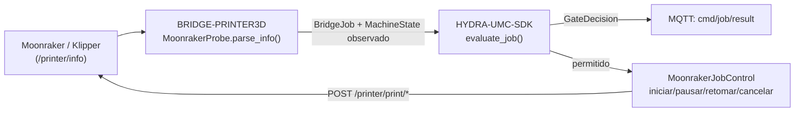

<!-- =============================================================================
HYDRA-UMC-BRIDGE-PRINTER3D - Open 3D-printing software coordination bridge
Copyright (C) 2026 JuanenRac (Electro Hobby 3D) <electrohobby3d@gmail.com>
GPL-3.0-or-later - see LICENSE
============================================================================= -->

<p align="center">
  
</p>

# 🖨️ HYDRA-UMC-BRIDGE-PRINTER3D

<p align="center"><a href="README.md">🇺🇸 English</a> | <a href="README_spa.md">🇪🇸 Español</a> | <a href="README_fra.md">🇫🇷 Français</a> | <a href="README_ita.md">🇮🇹 Italiano</a> | <a href="README_deu.md">🇩🇪 Deutsch</a> | <a href="README_zho.md">🇨🇳 简体中文</a> | <a href="README_jpn.md">🇯🇵 日本語</a> | 🇵🇹 <b>Português</b></p>

### 🌡️ Bridge de coordenação de falha segura para software aberto de impressão 3D

<p align="center">
  
  
  
</p>

---

> **Verificação de honestidade - o que realmente corre hoje:** a sonda de prontidão do Moonraker e a porta de segurança (o `MoonrakerProbe`/`PrinterBridge` de `moonraker.py`, que encaminha cada trabalho pelo `evaluate_job()` do próprio `HYDRA-UMC-SDK`), os comandos de trabalho reais protegidos pelo SDK (o iniciar/pausar/retomar/cancelar de `MoonrakerJobControl`), a evidência só de leitura de artefactos/perfis (`artifacts.py`, `profiles.py`) e o bridge MQTT de comandos/estado (`mqtt_transport.py`) são reais e estão cobertos por 103 casos `unittest` que passam (`python tools/build_test.py`). Os testes viradas ao Moonraker correm contra uma fixture real e local `ThreadingHTTPServer` que faz as vezes da API REST do próprio Moonraker, não uma impressora real, e a lógica `connect_with_retry()`/encaminhamento de mensagens da própria camada MQTT testa-se sem nunca abrir uma ligação `paho-mqtt` nem um broker reais. Como o README já indica abaixo, este bridge ainda não foi exercitado contra uma impressora, um hotend ou um robô reais. O envio de G-code em bruto não está implementado de propósito: só um ficheiro já carregado e já fatiado se pode iniciar/pausar/retomar/cancelar pelo nome. Ver «Estado atual e próximos passos» abaixo, que já o diz com clareza, e `CHANGELOG.md` para saber exatamente o que foi entregue até agora.

> **Estado de segurança (safety e security):** este ecossistema não é um sistema de segurança certificado. Ainda não existe um caminho de E-STOP por hardware, nem limites ou interlocks impostos pelo firmware, nem um comando de movimento verificado; as imagens de firmware são verificadas com CRC32 e um HMAC-SHA256 de chave partilhada, não com uma assinatura assimétrica; TLS e TLS mútuo são opcionais e estão desativados por defeito; nenhuma placa própria foi ainda montada ou testada. Leia a [base de segurança](https://github.com/JuanenRac/HYDRA-UMC-DOCS/blob/main/docs/SECURITY_BASELINE.md) e o [modelo de ameaças](https://github.com/JuanenRac/HYDRA-UMC-DOCS/blob/main/docs/THREAT_MODEL.md) antes de confiar em qualquer afirmação aqui para a segurança de uma pessoa.

## 📋 Num relance

| | |
|---|---|
| Versão | `0.1.8` |
| Maturidade | Funcional |
| Testes | 103 (`python tools/build_test.py`) |
| Tecnologia | Python / Moonraker / Klipper / G-code / 3MF |
| Destino | O Raspberry Pi CM5 de uma célula HYDRA-UMC |
| Em hardware real | Só simulado: testado com emuladores, dublês de teste ou simuladores; não há registo de execução em hardware real para esta versão |

## 1. 🛠️ VISÃO TÉCNICA GERAL

O **HYDRA-UMC-BRIDGE-PRINTER3D** é o coordenador de alto nível do software aberto de impressão 3D (Moonraker/Klipper) e dos auxiliares robóticos do HYDRA-UMC. Reconhece também, só em leitura, artefactos locais de fatiadores e pode enviar comandos de trabalho protegidos pelo SDK (iniciar/pausar/retomar/cancelar um ficheiro já carregado e já fatiado), pela API REST do próprio Moonraker; os testes usam um servidor HTTP local e nenhuma impressora real recebeu algum. O firmware nativo da impressora continua a ser responsável em todo o momento pelo movimento, pelos aquecedores, pela proteção térmica e pelos interlocks da máquina: este bridge nunca transmite G-code em bruto e nunca substitui essa autoridade; apenas lê a prontidão, regista evidência de artefactos, envia comandos de nível de trabalho já seguros e coordena os auxiliares à sua volta.

Pertence à família de **Bridges de automação externa**: um conjunto de repositórios irmãos (CNC, LASER, OPENPNP, PRINTER3D, ROS2) que falam todos o mesmo contrato de segurança partilhado do `HYDRA-UMC-SDK`, de modo que nenhum bridge possa inventar a sua própria definição de «seguro para trabalhar».

### Funcionalidades principais:
* ✅ **Sonda real de prontidão do Moonraker:** o `MoonrakerProbe` de `moonraker.py` consome o endpoint documentado `/printer/info` do Moonraker com um pequeno cliente só da biblioteca padrão (`urlopen` + `json`), sem nenhuma dependência para além da biblioteca padrão do Python. *(implementado, testado em `tests/test_moonraker.py`)*
* ✅ **Análise real de estados com falha segura:** `parse_info()` só associa a cadeia literal `"ready"` a `MachineState.IDLE`; `shutdown`/`error` correspondem a `FAULT` e tudo o resto (incluindo uma resposta malformada) a `OFFLINE`, nunca a um estado que permitisse planear um robô à volta da impressora. *(implementado)*
* ✅ **Porta de segurança partilhada real:** cada trabalho observado é reavaliado pelo `evaluate_job()` do `bridge_contract` do `HYDRA-UMC-SDK`, a mesma porta que usam todos os bridges irmãos. *(implementado)*
* ✅ **Inspeção de artefactos independente do fatiador:** `artifacts.py` identifica G-code FDM simples do OrcaSlicer, Ultimaker Cura, PrusaSlicer, Bambu Studio e outros fatiadores apenas com evidência local; reconhece também pacotes 3MF e fatias de resina opacas compatíveis com o Lychee sem as desempacotar, analisar comandos, enviar nem imprimir. *(implementado, testado em `tests/test_artifacts.py`)*
* ✅ **Limite de evidência de perfis:** `profiles.py` pode associar um artefacto inspecionado a um perfil FDM ou de resina declarado, mas devolve `execution_authorized=False` mesmo havendo correspondência. *(implementado, testado em `tests/test_profiles.py`)*
* ✅ **Comandos de trabalho reais protegidos pelo SDK:** o `MoonrakerJobControl` envia pedidos `POST` reais aos endpoints documentados `/printer/print/start|pause|resume|cancel` do Moonraker; `start_job()` passa pela mesma decisão de `evaluate_job()` que usa cada despacho produtivo deste ecossistema; `pause_job()`/`cancel_job()` permitem-se sempre (o mesmo raciocínio de desescalada que `ABORT`); `resume_job()` exige uma impressora genuinamente em `HOLDING`. Só inicia um ficheiro já carregado e já fatiado, pelo nome: nunca transmite G-code em bruto. *(implementado, testado em `tests/test_moonraker.py`)*
* ✅ **Compilação/teste que não altera nada:** `build-test.bat`/`.sh` compilam o analisador de respostas e a porta de segurança sem enviar nenhum comando real, alterar versões nem tocar numa impressora. *(implementado, ver COMPILAR E EXECUTAR abaixo)*
* 🔜 **Envio de G-code em bruto:** continua adiado de propósito: enviar comandos arbitrários de baixo nível (que não sejam um trabalho com nome e já fatiado) exige um perfil testado, autenticação e uma revisão de segurança física que este bridge ainda não tem. *(planeado)*
* ✅ **Chaves de idempotência repetidas:** `PrinterMqttBridge` aceita um `IdempotencyStore`: uma chave de trabalho repetida recebe a resposta dada da primeira vez em vez de ser avaliada de novo, de modo que um `cmd/start` repetido nunca inicia uma segunda impressão. *(implementado, testado em `tests/test_idempotency.py`)*
* ✅ **Ciclo MQTT blindado:** uma carga demasiado grande (mais de 16 KiB) ou ilegível, um JSON profundamente aninhado e qualquer falha inesperada recebem uma recusa no tópico de resultado e nunca terminam o ciclo; pausa, cancelamento e o novo `cmd/emergency_stop` (M112 do Klipper) são tratados numa faixa própria, pelo que um Moonraker lento nunca atrasa uma paragem; as chaves de idempotência são por verbo (`job:`/`start:`); as respostas de `cmd/job` indicam `"mode": "gate-only"` e um ABORT por aí diz que nada foi parado; o estado inclui `observed_at` e o bridge anuncia-se num tópico `availability` com Last Will; a chave API do Moonraker (`MOONRAKER_API_KEY`, enviada como `X-Api-Key`) é suportada, e um arranque só é enviado para um ficheiro que o Moonraker conheça. *(implementado, testado em `tests/test_hardening.py`)*

---

## 2. 🔄 FLUXO DE COORDENAÇÃO DA IMPRESSORA



---

## 3. 🧱 ARQUITETURA E DECISÕES DE DESENHO

* **Porque só o estado literal `"ready"` do Moonraker corresponde a inativo.** O mapeamento de estados de `parse_info()` é estreito de propósito: `ready` → `IDLE`, `shutdown`/`error` → `FAULT`, `startup` → `OFFLINE` (falha segura) e qualquer outro valor ou valor em falta → `OFFLINE`. Não há nenhum pressuposto de «seguro por omissão» para um estado de impressora não reconhecido.
* **Porque a análise é um `@staticmethod` separado da obtenção pela rede.** `MoonrakerProbe.parse_info()` recebe um `dict` simples e testa-se por completo sem chamada de rede nem impressora em funcionamento; `fetch()` é a peça fina e necessariamente de rede que o chama. A lógica relevante para a segurança vive na parte que nunca precisa de uma impressora viva para se testar.
* **Porque a sonda usa `urlopen`/`json` da biblioteca padrão em vez de uma biblioteca cliente do Moonraker.** Limitar a superfície de dependências à biblioteca padrão do Python mantém mínima e auditável a análise relevante para a segurança e livre dos pressupostos de um cliente de terceiros sobre repetições, tempos limite ou tratamento de erros.
* **Porque o bridge constrói um novo `BridgeJob` e delega no `evaluate_job()` partilhado em vez de escrever a sua própria lógica de aceitar/rejeitar.** Os cinco Bridges de automação externa (CNC, LASER, OPENPNP, PRINTER3D, ROS2) reutilizam exatamente o mesmo `bridge_contract` do `HYDRA-UMC-SDK`, de modo que o que conta como «seguro para iniciar um trabalho» não pode divergir em silêncio entre eles.
* **Porque os comandos de trabalho (iniciar/pausar/retomar/cancelar) são reais mas o envio de G-code em bruto ainda não.** Os endpoints `/printer/print/*` do Moonraker só referenciam um ficheiro já carregado e já fatiado, pelo nome: o mesmo envelope de segurança que o próprio Moonraker/Klipper já impõem a esse ficheiro. O G-code em bruto arbitrário é uma superfície de confiança fundamentalmente diferente e muito maior (pode conter qualquer coisa) e ainda exige um perfil testado, autenticação e uma revisão de segurança física que este bridge não tem.
* **Porque `resume_job()` não reutiliza a porta genérica `evaluate_job()`.** Essa porta assenta em «o trabalho produtivo precisa de uma máquina IDLE», o que é ao contrário para retomar um trabalho em pausa, que só faz sentido a partir de `HOLDING`. O mesmo raciocínio de porta autónoma já usado em `stand_request()`/`sit_request()` do DROIDS.
* **Como se encaixa no resto do ecossistema.** O BRIDGE-PRINTER3D fica entre o Moonraker/Klipper e o `HYDRA-UMC-SDK` → `HYDRA-UMC-MQTT-BROKER` → segurança da célula: coordena o trabalho auxiliar do robô em redor da impressora e envia agora comandos de trabalho reais e protegidos, mas nunca transmite G-code em bruto e nunca substitui o firmware nativo, os aquecedores nem a proteção térmica.

## 🧾 COMPATIBILIDADE COM ARTEFACTOS DE FATIADORES

A via de artefactos só de leitura suporta G-code FDM normal (`.gcode`, `.gco`, `.gc`) produzido pelo OrcaSlicer, Ultimaker Cura, PrusaSlicer, Bambu Studio e outros fatiadores. Os comentários habituais dão uma pista da origem; um marcador em falta continua a ser `unknown-slicer`. `.gcode.3mf` e `.3mf` genérico recebem impressão digital mas nunca se desempacotam. As fatias de resina (`.ctb`, `.goo`, `.photon`, `.pwmo`, `.pws`, `.sl1`) de fluxos compatíveis com o Lychee são opacas de propósito e nunca se atribuem a uma impressora ou fatiador concretos.

Isto é compatibilidade com **artefactos de saída**, não controlo remoto dessas aplicações. O bridge não inicia fatiadores, não altera perfis, não analisa/executa G-code, não envia ficheiros, não contacta serviços na nuvem nem inicia impressões. Ver [Compatibilidade com artefactos de fatiadores](docs/SLICER_ARTIFACT_COMPATIBILITY.md) para a matriz exata e os pré-requisitos de um controlo futuro.

Uma correspondência entre artefacto e perfil continua a ser evidência, nunca permissão para imprimir. O [Limite de admissão de perfis de impressão](docs/PRINT_PROFILE_BOUNDARY.md) documenta a validação separada exigida antes de qualquer operação futura do controlador nativo.

---

## 📂 ESTRUTURA DE DIRETORIAS

```text
HYDRA-UMC-BRIDGE-PRINTER3D/
├── src/
│   └── hydra_umc_bridge_printer3d/
│       ├── __init__.py
│       ├── artifacts.py         # Evidência só de leitura de G-code, 3MF e fatias de resina
│       ├── profiles.py          # Evidência de compatibilidade de perfis; nunca autorização de impressão
│       ├── moonraker.py         # MoonrakerProbe + porta de segurança PrinterBridge
│       └── mqtt_transport.py    # Transporte real por broker MQTT para os comandos Moonraker já reais deste bridge
├── tests/
│   ├── test_artifacts.py         # Testes de evidência de artefactos de fatiadores (sem E/S de impressora)
│   ├── test_profiles.py          # A correspondência de perfis nega sempre a execução
│   ├── test_moonraker.py        # Testes da análise de prontidão e da porta de falha segura
│   ├── test_mqtt_transport.py   # Testes do formato de comandos/estado MQTT contra um cliente de broker falso
│   ├── test_mqtt_environment.py # As credenciais MQTT e o TLS do ambiente do serviço chegam ao cliente
│   ├── test_idempotency.py      # Uma chave de idempotência repetida é respondida uma só vez
│   └── test_hardening.py        # Cargas hostis, respostas honestas, ciclo MQTT blindado
├── tools/
│   ├── build_test.py            # Executor de compilação + testes que não altera nada (build-test.bat/.sh)
│   ├── inspect_print_artifact.py # CLI de JSON de evidência de artefactos local
│   ├── assess_print_profile.py  # CLI offline de correspondência perfil/artefacto; nunca autoriza a execução
│   ├── ci_validate.py           # Base de CI sem dependências e não destrutiva (usada por .github/workflows/ci.yml)
│   └── bump_version.py          # Sincroniza pyproject.toml, o manifesto e CHANGELOG.md
├── docs/
│   ├── BRIDGE_GUIDE.md                        # Âmbito, plataformas compatíveis, scripts, porta de aceitação de hardware
│   ├── PRINT_PROFILE_BOUNDARY.md              # O que significa a evidência de compatibilidade de perfis face à autorização de impressão
│   └── SLICER_ARTIFACT_COMPATIBILITY.md       # Que formatos de artefactos de fatiadores este bridge pode ler como evidência
├── images/
│   └── HYDRA_UMC_BANNER.svg     # Banner do README
├── build-test.bat / build-test.sh  # Só valida, nunca modifica o repositório
├── build.bat / build.sh            # Valida e, se correr bem, sobe a versão + CHANGELOG
├── pyproject.toml               # Metadados do pacote; depende do HYDRA-UMC-SDK (git)
├── hydra-umc.project.json       # Manifesto do ecossistema (versão, maturidade, família)
├── CHANGELOG.md
├── CODE_OF_CONDUCT.md / CONTRIBUTING.md / SECURITY.md / SUPPORT.md
├── LICENSE / LICENSE.md
└── README.md / README_*.md      # Este ficheiro e as suas 7 traduções
```

---

## 4. ⚙️ COMPILAR E EXECUTAR

Requer Python 3.11+. `tools/build_test.py` espera o `HYDRA-UMC-SDK` extraído como diretoria irmã (`../HYDRA-UMC-SDK`) ou indicado pela variável de ambiente `HYDRA_UMC_SDK_ROOT`.

```bash
# Windows
build-test.bat      # só valida - sem alteração de versão/CHANGELOG
build.bat            # valida e, se correr bem, sobe a versão + CHANGELOG

# Linux/macOS
bash build-test.sh
bash build.sh
```

`build-test` compila com `py_compile` cada módulo em `src/` e `tools/` e executa a suíte `unittest` completa descoberta em `tests/` (`test_moonraker.py`, `test_artifacts.py`, `test_profiles.py`, `test_mqtt_transport.py`, `test_hardening.py`, `test_idempotency.py`, `test_mqtt_environment.py` - 103 testes), que prova, entre tudo o resto que cobre, a análise das respostas de prontidão, a inspeção de artefactos e a porta de falha segura; não envia G-code, não toca em nenhuma impressora e nunca modifica o repositório. `build` executa primeiro essa mesma validação e, só se correr bem, chama `tools/bump_version.py` para sincronizar a versão em `pyproject.toml`, `hydra-umc.project.json` e `CHANGELOG.md`. Ainda não há comando `run` de impressora viva: exige um perfil testado, autenticação e uma revisão de segurança física.

Para inspecionar uma saída local de um fatiador sem contactar uma impressora:

```bash
py tools/inspect_print_artifact.py path/to/job.gcode      # Windows
python3 tools/inspect_print_artifact.py path/to/job.gcode  # Linux / macOS
```

---

## ✅ Estado atual e próximos passos

**Real hoje:** versão `0.1.8`, um adaptador de prontidão do Moonraker testado localmente (`MoonrakerProbe` + `PrinterBridge`) apoiado pela porta de trabalhos partilhada do `HYDRA-UMC-SDK`, comandos de trabalho reais protegidos pelo SDK (`MoonrakerJobControl`: iniciar/pausar/retomar/cancelar um ficheiro já carregado pela API REST do próprio Moonraker), evidência só de leitura de G-code/3MF/fatias de resina e de compatibilidade de perfis para as principais famílias de fatiadores, uma suíte `unittest` determinista de 103 testes que inclui HTTP local `/printer/info`, o contrato real e separado `/printer/objects/query?print_stats=state` e a verificação real de comandos de trabalho por `POST`, e scripts build-test que não alteram nada ligados ao CI com um checkout do SDK.

**Fronteira de integração:** o firmware nativo da impressora (Klipper através do Moonraker) mantém em todo o momento o movimento, os aquecedores, a proteção térmica e os interlocks da máquina; este bridge lê a prontidão, envia apenas comandos de nível de trabalho já seguros (nunca G-code em bruto) e regula o trabalho robótico *auxiliar* à sua volta.

**Ainda por fazer:** o bridge ainda não foi exercitado contra uma impressora, um hotend ou um robô reais (só contra um servidor HTTP local de fixture): uma primeira execução numa impressora real continua a exigir primeiro um perfil de impressora testado e uma revisão de segurança física; o envio de G-code em bruto não está implementado, de propósito.

---

## 🔗 Projetos relacionados

Este projeto faz parte do ecossistema de robótica HYDRA-UMC do mesmo autor (JuanenRac / Electro Hobby 3D). Vale a pena conhecê-los, porque um pedido pode ser, na verdade, sobre um destes e não sobre este repositório.

**Projeto-mãe**
- **[HYDRA-UMC-SERVER](https://github.com/JuanenRac/HYDRA-UMC-SERVER)** — o verdadeiro backend sem interface (REST/WebSocket) com que falam todos os clientes de controlo; este bridge não o chama: responde por MQTT, através do HYDRA-UMC-MQTT-BROKER, a quem comanda a célula.

**Projetos irmãos** — também falam com a API do próprio HYDRA-UMC-SERVER, cada um como cliente próprio
- **[HYDRA-UMC-STUDIO](https://github.com/JuanenRac/HYDRA-UMC-STUDIO)** — painel web de controlo com visualização 3D em tempo real de vários robôs.
- **[HYDRA-UMC-SUITE](https://github.com/JuanenRac/HYDRA-UMC-SUITE)** — centro de comando de enxame para desktop (PySide6) para vários servidores ao mesmo tempo, empacotado como executável independente.
- **[HYDRA-UMC-ANDROID-CONTROL](https://github.com/JuanenRac/HYDRA-UMC-ANDROID-CONTROL)** — aplicação Android nativa de controlo, com início de sessão biométrico e um companheiro Wear OS emparelhado.
- **[HYDRA-UMC-IOS-CONTROL](https://github.com/JuanenRac/HYDRA-UMC-IOS-CONTROL)** — aplicação de controlo para iOS/iPadOS (Flutter) com sincronização WebSocket em tempo real.
- **[HYDRA-UMC-DSI](https://github.com/JuanenRac/HYDRA-UMC-DSI)** — interface tátil nativa para o ecrã tátil DSI de 7" integrado, executada no próprio CM5.
- **[HYDRA-UMC-BRIDGE-AMR](https://github.com/JuanenRac/HYDRA-UMC-BRIDGE-AMR)** — fronteira de coordenação para frotas AGV/AMR através de um publicador MQTT VDA 5050 (testado apenas contra uma frota emulada).
- **[HYDRA-UMC-BRIDGE-CNC](https://github.com/JuanenRac/HYDRA-UMC-BRIDGE-CNC)** — coordenador de células CNC de alto nível com acesso ao estado GRBL e aos bytes de controlo (testado apenas contra um emulador).
- **[HYDRA-UMC-BRIDGE-DROIDS](https://github.com/JuanenRac/HYDRA-UMC-BRIDGE-DROIDS)** — fronteira de coordenação para droides com patas/humanoides, com um emissor de comandos para o Boston Dynamics Spot (testado apenas contra um emulador).
- **[HYDRA-UMC-BRIDGE-LASER](https://github.com/JuanenRac/HYDRA-UMC-BRIDGE-LASER)** — coordenador de células laser que lê 3 sinais GPIO (chave, caixa e interlock) (testado apenas contra um chip simulado; não pode armar nem disparar um laser).
- **[HYDRA-UMC-BRIDGE-OPENPNP](https://github.com/JuanenRac/HYDRA-UMC-BRIDGE-OPENPNP)** — coordenador seguro de fluxo de placa de alto nível para pick-and-place com OpenPnP.
- **[HYDRA-UMC-BRIDGE-ROS2](https://github.com/JuanenRac/HYDRA-UMC-BRIDGE-ROS2)** — coordenador com um transporte ROS 2 baseado em rclpy importado sob demanda (ainda não executado contra uma instalação ROS 2).
- **[HYDRA-UMC-BRIDGE-UAV](https://github.com/JuanenRac/HYDRA-UMC-BRIDGE-UAV)** — fronteira de coordenação para UAV com câmara, com um emissor de comandos MAVLink (testado apenas contra um emulador).

**Diretamente relacionados**
- **[HYDRA-UMC-SDK](https://github.com/JuanenRac/HYDRA-UMC-SDK)** — o contrato JSON-Schema partilhado e a fronteira de software de controlo de trabalhos contra a qual cada bridge valida os seus comandos (não é uma função de segurança certificada).
- **[HYDRA-UMC-CONNECTOR-HUB](https://github.com/JuanenRac/HYDRA-UMC-CONNECTOR-HUB)** — registo declarativo de manifestos de adaptador e validador para conectores de máquinas externas; estende a ideia de contrato do SDK a máquinas externas sem substituir os projetos de gateway industrial.
- **[HYDRA-UMC-MQTT-BROKER](https://github.com/JuanenRac/HYDRA-UMC-MQTT-BROKER)** — o transporte real de `mqtt_transport.py` para os tópicos `hydra/bridges/printer3d/...` deste bridge: estado mais comandos reais de iniciar/pausar/retomar/cancelar do Moonraker, junto com a porta de trabalhos partilhada; ver o `docs/BRIDGE_TOPICS.md` desse repositório.
- **[HYDRA-UMC-SAFETY-ZONES](https://github.com/JuanenRac/HYDRA-UMC-SAFETY-ZONES)** — evidência futura de segurança do espaço de trabalho para este bridge.

**Também fazem parte do ecossistema**

*Hardware e plataforma centrais*
- **[HYDRA-UMC](https://github.com/JuanenRac/HYDRA-UMC)** — o desenho da placa-mãe do braço robótico: anfitrião CM5 + STM32H745 de dois núcleos, pensado para orquestrar até 8 braços de ferramenta por CAN-OTA/SPI-OTA (firmware numa fase inicial; ainda sem placa montada).
- **[HYDRA-UMC-OS](https://github.com/JuanenRac/HYDRA-UMC-OS)** — camada de produto reproduzível do Raspberry Pi OS para o CM5: agente só de leitura, configuração/perfis validados, aprovisionamento Wi-Fi de primeiro contacto.

*Backend central e clientes*
- **[HYDRA-UMC-EDITOR-URDF](https://github.com/JuanenRac/HYDRA-UMC-EDITOR-URDF)** — criador/editor gráfico de URDF para desktop que envia os modelos concluídos para o catálogo do STUDIO.
- **[HYDRA-UMC-EDITOR-STL](https://github.com/JuanenRac/HYDRA-UMC-EDITOR-STL)** — editor de modelos STL para desktop que transforma/substitui/remove/adiciona peças reais no mesmo catálogo de modelos que o HYDRA-UMC-EDITOR-URDF também edita.

*Plataforma de ferramentas URTC*
- **[URTC](https://github.com/JuanenRac/URTC)** — firmware da placa física Universal Robot Tool Controller, mais de 25 perfis de ferramenta por barramento CAN.
- **[URTC-FLASHER](https://github.com/JuanenRac/URTC-FLASHER)** — ferramenta gráfica de gravação para desktop das placas URTC, por CAN-OTA e também SWD/JTAG de chip completo.
- **[URTC-TESTER](https://github.com/JuanenRac/URTC-TESTER)** — ferramenta de diagnóstico CAN em tempo real para desktop das placas URTC, com um painel por perfil de ferramenta.
- **[URTC-WEB-STUDIO](https://github.com/JuanenRac/URTC-WEB-STUDIO)** — alternativa no navegador ao URTC-TESTER através da Web Serial API, sem instalação local.

*Nó de IA de visão (Hailo-8)*
- **[HYDRA-UMC-VISION-NODE](https://github.com/JuanenRac/HYDRA-UMC-VISION-NODE)** — centro de integração do pipeline de visão Hailo-8, com uma verificação real de prontidão de hardware por fase.
- **[HYDRA-UMC-DETECTION-HEF](https://github.com/JuanenRac/HYDRA-UMC-DETECTION-HEF)** — registo real de modelos compilados com verificação segura de carga por arquitetura Hailo e soma de verificação.
- **[HYDRA-UMC-VISION-STREAMER](https://github.com/JuanenRac/HYDRA-UMC-VISION-STREAMER)** — pipeline GStreamer real e gerador de configuração MediaMTX com uma fronteira de integração HailoRT real.
- **[HYDRA-UMC-VISUAL-SERVOING-API](https://github.com/JuanenRac/HYDRA-UMC-VISUAL-SERVOING-API)** — lei de correção de servovisão baseada em posição com autorização condicionada ao estado da zona; ainda sem estimativa de pose por câmara.

*Nó de IA cognitiva (Hailo-10)*
- **[HYDRA-UMC-COGNITIVE-NODE](https://github.com/JuanenRac/HYDRA-UMC-COGNITIVE-NODE)** — centro de integração do pipeline cognitivo do Hailo-10 (orquestração de LLM/VLA/voz).
- **[HYDRA-UMC-VLA-ENGINE](https://github.com/JuanenRac/HYDRA-UMC-VLA-ENGINE)** — codificação/descodificação real de tokens de ação e geração de trajetórias para um modelo Visão-Linguagem-Ação.
- **[HYDRA-UMC-VOICE-UI](https://github.com/JuanenRac/HYDRA-UMC-VOICE-UI)** — front-end de voz real (VAD + analisador de intenções) com um relé para o relógio limitado e protegido por confirmação.
- **[HYDRA-UMC-SEMANTIC-PLANNER](https://github.com/JuanenRac/HYDRA-UMC-SEMANTIC-PLANNER)** — decomposição real de tarefas baseada em regras e recuperação semântica de erros sobre os códigos de erro do MCU.
- **[HYDRA-UMC-DOCS-QA](https://github.com/JuanenRac/HYDRA-UMC-DOCS-QA)** — pesquisa real de documentos TF-IDF só com a biblioteca padrão sobre a documentação Markdown deste ecossistema.
- **[HYDRA-UMC-LOCAL-TECHNICIAN](https://github.com/JuanenRac/HYDRA-UMC-LOCAL-TECHNICIAN)** — técnico de manutenção de IA local, protegido por políticas, para o próprio ecossistema: observa, diagnostica e propõe correções; os dois níveis de maior risco não estão implementados de propósito.

*Orquestração e enxame*
- **[HYDRA-UMC-ORCHESTRATOR](https://github.com/JuanenRac/HYDRA-UMC-ORCHESTRATOR)** — centro de integração com um contrato real de relatório de saúde gRPC/Protobuf e uma máquina de estados de missões.
- **[HYDRA-UMC-JOB-DISPATCHER](https://github.com/JuanenRac/HYDRA-UMC-JOB-DISPATCHER)** — fila real de trabalhos por prioridade com deduplicação, sobre uma API HTTP real.
- **[HYDRA-UMC-NODE-HEALING](https://github.com/JuanenRac/HYDRA-UMC-NODE-HEALING)** — vigilante real de saúde da frota por gRPC com repetição/recuo e deteção de identidade incoerente.
- **[HYDRA-UMC-PATH-PLANNER-3D](https://github.com/JuanenRac/HYDRA-UMC-PATH-PLANNER-3D)** — planeador real de trajetórias 3D baseado em RRT com validação real de colisões com obstáculos e espaço de trabalho.
- **[HYDRA-UMC-SWARM-SYNC](https://github.com/JuanenRac/HYDRA-UMC-SWARM-SYNC)** — sincronização real de estado CRDT LWW-Element-Map, testada por propriedades para a convergência de várias células.

*Gémeo digital e simulação*
- **[HYDRA-UMC-TWIN](https://github.com/JuanenRac/HYDRA-UMC-TWIN)** — centro de integração do motor de gémeo digital, com um contrato real de sincronização de compatibilidade de versões.
- **[HYDRA-UMC-HIL-BRIDGE](https://github.com/JuanenRac/HYDRA-UMC-HIL-BRIDGE)** — encaminhador hardware-in-the-loop com um interlock de software de colisão entre a simulação e o hardware real (testado sem hardware real).
- **[HYDRA-UMC-PHYSICS-REPLICA](https://github.com/JuanenRac/HYDRA-UMC-PHYSICS-REPLICA)** — cinemática direta real e validação de limites de juntas sobre um subconjunto real de URDF.
- **[HYDRA-UMC-SYNTHETIC-DATA-GEN](https://github.com/JuanenRac/HYDRA-UMC-SYNTHETIC-DATA-GEN)** — gerador procedural real de cenas 2D com exportação de anotações YOLO/COCO.

*Dados e análise*
- **[HYDRA-UMC-DATALAKE](https://github.com/JuanenRac/HYDRA-UMC-DATALAKE)** — armazém real de séries temporais sobre sqlite3 com uma API HTTP real de ingestão/consulta.
- **[HYDRA-UMC-ANOMALY-DETECTOR](https://github.com/JuanenRac/HYDRA-UMC-ANOMALY-DETECTOR)** — detetor real de anomalias por FFT e linha de base estatística, com monitorização de deriva.
- **[HYDRA-UMC-PRODUCTION-REPORTS](https://github.com/JuanenRac/HYDRA-UMC-PRODUCTION-REPORTS)** — cálculo real de OEE/disponibilidade sobre o histórico do DATALAKE, com exportação CSV reprodutível.
- **[HYDRA-UMC-TELEMETRY-COLLECTOR](https://github.com/JuanenRac/HYDRA-UMC-TELEMETRY-COLLECTOR)** — pipeline real de ingestão CAN/WebSocket para o DATALAKE, com deduplicação por sequência.

*Gateway industrial*
- **[HYDRA-UMC-GATEWAY-INDUSTRIAL](https://github.com/JuanenRac/HYDRA-UMC-GATEWAY-INDUSTRIAL)** — centro de integração que retransmite para protocolos industriais, com uma camada real de lista de comandos permitidos e contrapressão.
- **[HYDRA-UMC-OPCUA-SERVER](https://github.com/JuanenRac/HYDRA-UMC-OPCUA-SERVER)** — espaço de endereços OPC-UA real, verificado com uma sessão de cliente real do protocolo binário.
- **[HYDRA-UMC-MTCONNECT-ADAPTER](https://github.com/JuanenRac/HYDRA-UMC-MTCONNECT-ADAPTER)** — endpoints XML MTConnect `/probe` e `/current` reais com saída em modo degradado.

*Ferramentas complementares e operações do ecossistema*
- **[HYDRA-UMC-DASHBOARD-AI](https://github.com/JuanenRac/HYDRA-UMC-DASHBOARD-AI)** — painéis de Resumos Inteligentes e Realce de Anomalias sobre o DATALAKE/ANOMALY-DETECTOR, com um recurso estatístico honesto.
- **[HYDRA-UMC-TOOL-CLI](https://github.com/JuanenRac/HYDRA-UMC-TOOL-CLI)** — CLI da frota com um contrato de códigos de saída real e estável, um cliente vivo genuíno da API do HYDRA-UMC-SERVER.
- **[HYDRA-UMC-WATCH](https://github.com/JuanenRac/HYDRA-UMC-WATCH)** — aplicação companheira WearOS com padrões de alerta tátil e um relé de voz para o telemóvel emparelhado (ainda não executada num relógio físico).
- **[URTC-SMART-RACK](https://github.com/JuanenRac/URTC-SMART-RACK)** — firmware de um rack de montagem de placas com descodificação real do ID da ferramenta e lógica de pré-aquecimento Smart Idle.
- **[URTC-VISION-TOOL](https://github.com/JuanenRac/URTC-VISION-TOOL)** — firmware mais um companheiro de visão em Python real para uma cabeça de ferramenta de inspeção térmica/RGB.
- **[HYDRA-UMC-UPDATER](https://github.com/JuanenRac/HYDRA-UMC-UPDATER)** — ferramenta administrativa de desktop que descobre, clona e atualiza todos os repositórios deste ecossistema.
- **[HYDRA-UMC-OS-REBUILDER](https://github.com/JuanenRac/HYDRA-UMC-OS-REBUILDER)** — ferramenta de desktop para Windows/Linux que constrói uma imagem do CM5 pronta a gravar com as versões mais recentes do ecossistema, com configuração de primeiro arranque de Wi-Fi/utilizador/SSH ao estilo do Raspberry Pi Imager.
- **[HYDRA-UMC-OPS-AGENT](https://github.com/JuanenRac/HYDRA-UMC-OPS-AGENT)** — coordenador de incidentes de manutenção: um papel de borda de poucos privilégios recolhe um inventário/estado higienizado, um papel de plano de controlo mostra-o só de leitura e pede a um fornecedor de IA que sugira um diagnóstico; nunca aplica um patch nem implanta nada.
- **[HYDRA-UMC-DEV-SERVER](https://github.com/JuanenRac/HYDRA-UMC-DEV-SERVER)** — anfitrião de desenvolvimento reproduzível (Raspberry Pi 5 / CM5) que guarda o código-fonte do ecossistema e executa tarefas limitadas de compilação/teste numa fila durável; um papel de desenvolvimento dedicado, explicitamente não um CM5 operacional.

---

## 📚 Documentação e comunidade

- **[CONTRIBUTING.md](CONTRIBUTING.md)** — pilha tecnológica e diretrizes de código para um pull request.
- **[CODE_OF_CONDUCT.md](CODE_OF_CONDUCT.md)** — as normas de comportamento esperadas nesta comunidade.
- **[SECURITY.md](SECURITY.md)** — como comunicar uma vulnerabilidade e as áreas de segurança em que este projeto se concentra.
- **[SUPPORT.md](SUPPORT.md)** — onde fazer perguntas e comunicar erros.
- **[LICENSE.md](LICENSE.md)** — a licença deste projeto.

## 👤 AUTOR
**JuanenRac** (Electro Hobby 3D)
📧 electrohobby3d@gmail.com
📺 [youtube.com/@electrohobby3d](https://youtube.com/@electrohobby3d)

## 📜 LICENÇA
GPL-3.0-or-later - consulte LICENSE para mais detalhes.

