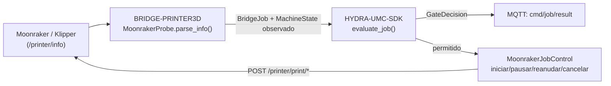

<!-- =============================================================================
HYDRA-UMC-BRIDGE-PRINTER3D - 3D printer coordination bridge
Copyright (C) JuanenRac (Electro Hobby 3D) <electrohobby3d@gmail.com>
GPL-3.0-or-later - see LICENSE
============================================================================= -->

<p align="center">
  
</p>

# 🖨️ HYDRA-UMC-BRIDGE-PRINTER3D

<p align="center"><a href="README.md">🇺🇸 English</a> | 🇪🇸 <b>Español</b> | <a href="README_fra.md">🇫🇷 Français</a> | <a href="README_ita.md">🇮🇹 Italiano</a> | <a href="README_deu.md">🇩🇪 Deutsch</a> | <a href="README_zho.md">🇨🇳 简体中文</a> | <a href="README_jpn.md">🇯🇵 日本語</a> | <a href="README_por.md">🇵🇹 Português</a></p>

### 🌡️ Puente de coordinación seguro por defecto para software abierto de impresión 3D

<p align="center">
  
  
  
  
  
  
</p>

---

> **Comprobación de honestidad - qué funciona realmente hoy:** la sonda de disponibilidad Moonraker y la puerta de seguridad (`moonraker.py` con `MoonrakerProbe`/`PrinterBridge`, que hace pasar cada trabajo por el propio `evaluate_job()` de `HYDRA-UMC-SDK`), los comandos de trabajo reales controlados por el SDK (`MoonrakerJobControl` de iniciar/pausar/reanudar/cancelar), la evidencia de solo lectura de artefactos/perfiles (`artifacts.py`, `profiles.py`), y el puente de comandos/estado MQTT (`mqtt_transport.py`) son reales y están cubiertos por 157 casos `unittest` que pasan (`python tools/build_test.py`). Los tests orientados a Moonraker corren contra un `ThreadingHTTPServer` local real que hace de sustituto de la propia API REST de Moonraker - no una impresora real -, y la lógica propia de `connect_with_retry()`/enrutado de mensajes de la capa MQTT se prueba sin abrir nunca una conexión o broker `paho-mqtt` real. Como ya indica el README más abajo, este bridge todavía no se ha probado contra una impresora, hotend o robot reales. El streaming de G-code en bruto deliberadamente no está implementado - solo se puede iniciar/pausar/reanudar/cancelar por nombre un archivo ya subido y ya laminado. Ver "Estado actual y próximos pasos" más abajo, que ya lo dice con claridad, y `CHANGELOG.md` para lo que se ha entregado exactamente hasta ahora.

> **Estado de seguridad física y de ciberseguridad:** este ecosistema no es un sistema de seguridad certificado. Todavía no existe una ruta de E-STOP por hardware, ni límites ni enclavamientos aplicados por el firmware, ni un comando de movimiento verificado; las imágenes de firmware se comprueban con CRC-32 y una firma Ed25519, y una compilación de versión rechaza las claves de desarrollo publicadas (los cabezales de herramienta y las placas de expansión detrás del relé siguen con cargadores de URTC, que usan un HMAC-SHA256 de clave compartida en lugar de una firma); TLS y TLS mutuo son opcionales y están desactivados por defecto; aún no se ha poblado ni probado ninguna placa propia. Lee la [línea base de seguridad](https://github.com/JuanenRac/HYDRA-UMC-DOCS/blob/main/docs/SECURITY_BASELINE.md) y el [modelo de amenazas](https://github.com/JuanenRac/HYDRA-UMC-DOCS/blob/main/docs/THREAT_MODEL.md) antes de fiarte de cualquier afirmación de aquí para la seguridad de una persona.

---

## 📋 De un vistazo

| | |
|---|---|
| Versión | `0.2.0` |
| Madurez | Funcional |
| Tests | 157 (`python tools/build_test.py`) |
| Tecnología | Python / Moonraker / Klipper / G-code / 3MF |
| Destino | La Raspberry Pi CM5 de una celda HYDRA-UMC |
| En hardware real | Solo simulado: probado con emuladores, dobles de prueba o simuladores; no consta ninguna ejecución en hardware real para esta versión |

**Ir a:** [Resumen](#-resumen) · [Arquitectura](#-arquitectura) · [Funciones](#-funciones) · [Seguridad y protección](#-seguridad-y-protección) · [Interfaces](#-interfaces) · [Configuración](#-configuración) · [Inicio rápido](#-inicio-rápido) · [Pruebas](#-pruebas) · [Resolución de problemas](#-resolución-de-problemas) · [Estructura del repositorio](#-estructura-del-repositorio) · [Proyectos relacionados](#-proyectos-relacionados)

## 🚦 Estado del proyecto

Cada línea es una parte de este repositorio y la luz dice hasta dónde llega hoy. Se escribe con lo que el repositorio puede demostrar (pruebas, compilaciones, ejecuciones), no con lo previsto.

🟢 Hecho y verificado · 🟡 Funciona, con límites conocidos · 🟠 Hecho a medias o sin verificar · 🔴 Sin hacer o sin funcionar

| Área | Estado | Qué significa aquí |
|---|---|---|
| Software | 🟡 | Funciona para su propósito principal; la comprobación de honestidad de arriba lista lo que aún falta |
| Pruebas | 🟢 | 157 pruebas automáticas, ejecutadas en cada cambio |
| Hardware real | 🟠 | Solo simulado: probado con emuladores, dobles de prueba o simuladores; no consta ninguna ejecución en hardware real para esta versión |
| Documentación | 🟢 | README en ocho idiomas, comprobado contra el manifiesto en cada cambio |

## 🎯 Resumen

**HYDRA-UMC-BRIDGE-PRINTER3D** es el coordinador de alto nivel para software abierto de impresión 3D (Moonraker/Klipper) y auxiliares robóticos HYDRA-UMC. También reconoce artefactos locales de slicer en modo de solo lectura y puede enviar comandos de trabajo controlados por el SDK (iniciar/pausar/reanudar/cancelar un archivo ya subido y ya laminado, más una parada de emergencia dura), a través de la propia API REST de Moonraker; las pruebas usan un servidor HTTP local de prueba y ninguna impresora real ha recibido uno. El firmware nativo de la impresora sigue siendo responsable en todo momento del movimiento, los calefactores, la protección térmica y los enclavamientos de máquina; este puente nunca transmite G-code en bruto ni sustituye esa autoridad: solo lee la disponibilidad, registra evidencia del artefacto, envía comandos ya seguros de nivel de trabajo y coordina auxiliares a su alrededor.

Pertenece a la familia **External Automation Bridges**: un conjunto de repositorios hermanos (CNC, LASER, OPENPNP, PRINTER3D, ROS2) que hablan el mismo contrato de seguridad compartido de `HYDRA-UMC-SDK`, de modo que ningún puente puede inventar su propia definición de "seguro para trabajar".

## 🧩 Papel en HYDRA-UMC

**HYDRA-UMC-BRIDGE-PRINTER3D** está entre una impresora 3D Moonraker/Klipper y la celda de robots. Cuenta lo que dice ese lado, consulta la puerta compartida antes de cualquier trabajo auxiliar y nunca asume la autoridad de la máquina con la que coordina.

Todos los bridges hablan el contrato de seguridad compartido de `HYDRA-UMC-SDK`: un trabajo solo se acepta cuando la puerta compartida `evaluate_job()` lo permite, y esa puerta falla cerrada. El proyecto padre es `HYDRA-UMC-SERVER`; este bridge no lo llama, responde por MQTT, a través de `HYDRA-UMC-MQTT-BROKER`, a quien manda en la celda.

## 🏛️ Arquitectura

<p align="center">
  
</p>

<details>
<summary>Versión en texto del diagrama (Mermaid)</summary>



</details>

**Por qué está hecho así**

* **Por qué solo el estado literal `"ready"` de Moonraker se mapea a reposo.** El mapeo de estado de `parse_info()` es deliberadamente estrecho: `ready` → `IDLE`, `shutdown`/`error` → `FAULT`, `startup` → `OFFLINE` (seguro por defecto), y cualquier otro valor o valor ausente → `OFFLINE`. No existe una suposición de "seguro por defecto" para un estado de impresora no reconocido.
* **Por qué el análisis es un `@staticmethod` separado de la obtención por red.** `MoonrakerProbe.parse_info()` recibe un `dict` sencillo y es totalmente comprobable mediante pruebas unitarias sin necesidad de una llamada de red ni una impresora en marcha; `fetch()` es la pieza delgada y necesariamente de red que lo llama. La lógica relevante para la seguridad reside en la parte que nunca necesita una impresora real para probarse.
* **Por qué la sonda usa `urlopen`/`json` de la biblioteca estándar en lugar de una librería cliente de Moonraker.** Mantener la superficie de dependencias limitada a la biblioteca estándar de Python mantiene el análisis relevante para la seguridad mínimo, auditable y libre de las propias suposiciones de un cliente de terceros sobre reintentos, tiempos de espera o manejo de errores.
* **Por qué el puente construye un nuevo `BridgeJob` y delega en el `evaluate_job()` compartido en lugar de escribir su propia lógica de aceptación/rechazo.** Los cinco External Automation Bridges (CNC, LASER, OPENPNP, PRINTER3D, ROS2) reutilizan exactamente el mismo `bridge_contract` de `HYDRA-UMC-SDK`, de modo que "qué cuenta como seguro para iniciar un trabajo" no puede divergir silenciosamente entre ellos.
* **Por qué los comandos de trabajo (start/pause/resume/cancel) son reales pero la transmisión de G-code en bruto todavía no lo es.** Los endpoints `/printer/print/*` de Moonraker solo referencian por nombre un archivo ya subido y ya laminado - el mismo margen de seguridad que Moonraker/Klipper ya aplican sobre ese archivo. El G-code arbitrario en bruto es una superficie de confianza fundamentalmente distinta y mucho mayor (puede contener cualquier cosa) y todavía necesita un perfil probado, autenticación y una revisión de seguridad física que este puente aún no tiene.
* **Por qué `resume_job()` no reutiliza la puerta genérica de `evaluate_job()`.** Esa puerta está construida en torno a "el trabajo productivo necesita una máquina IDLE" - lo contrario de reanudar un trabajo pausado, que solo tiene sentido desde `HOLDING`. Mismo razonamiento de puerta independiente ya usado para `stand_request()`/`sit_request()` de DROIDS.
* **Cómo encaja en el resto del ecosistema.** BRIDGE-PRINTER3D se sitúa entre Moonraker/Klipper y `HYDRA-UMC-SDK` → `HYDRA-UMC-MQTT-BROKER` → seguridad de celda: coordina trabajo robótico auxiliar alrededor de la impresora, nunca reemplaza el firmware nativo, los calefactores ni la protección térmica.

## ✨ Funciones

* ✅ **Sonda de disponibilidad Moonraker, real:** `moonraker.py` — `MoonrakerProbe` consume el endpoint documentado `/printer/info` de Moonraker con un pequeño cliente basado únicamente en la biblioteca estándar (`urlopen` + `json`), sin dependencias adicionales más allá de la biblioteca estándar de Python. *(implementado, probado en `tests/test_moonraker.py`)*
* ✅ **Análisis de estado seguro por defecto, real:** `parse_info()` solo mapea la cadena literal `"ready"` a `MachineState.IDLE`; `shutdown`/`error` se mapean a `FAULT`, y cualquier otra cosa (incluida una respuesta malformada) se mapea a `OFFLINE` — nunca a un estado que permitiría planificar un robot alrededor de la impresora. *(implementado)*
* ✅ **Puerta de seguridad compartida, real:** cada trabajo observado se reevalúa mediante `evaluate_job()` de `bridge_contract` en `HYDRA-UMC-SDK`, la misma puerta que usan todos los puentes hermanos. *(implementado)*
* ✅ **Inspección de artefactos independiente del slicer:** `artifacts.py` identifica G-code FDM simple de OrcaSlicer, Ultimaker Cura, PrusaSlicer, Bambu Studio y otros slicers solo mediante evidencia local; también reconoce paquetes 3MF y slices de resina compatibles con Lychee sin desempaquetar, analizar comandos, subir ni imprimir. *(implementado, probado en `tests/test_artifacts.py`)*
* ✅ **Frontera de evidencia de perfil:** `profiles.py` puede emparejar un artefacto inspeccionado con un perfil FDM o de resina declarado, pero devuelve `execution_authorized=False` incluso cuando hay coincidencia. *(implementado, probado en `tests/test_profiles.py`)*
* ✅ **Comandos de trabajo reales, controlados por el SDK:** `MoonrakerJobControl` envía peticiones `POST` reales a los endpoints documentados `/printer/print/start|pause|resume|cancel` de Moonraker — `start_job()` está condicionado a la misma decisión de `evaluate_job()` que usa todo despacho productivo de este ecosistema; `pause_job()`/`cancel_job()` siempre están permitidos (mismo razonamiento de desescalada que `ABORT`); `resume_job()` requiere que la impresora esté genuinamente en `HOLDING`. Solo inicia por nombre un archivo ya subido y ya laminado — nunca transmite G-code en bruto. *(implementado, probado en `tests/test_moonraker.py`)*
* ✅ **Compilación/prueba no mutante:** `build-test.bat`/`.sh` compilan el analizador de respuestas y la puerta de seguridad sin enviar G-code, cambiar versiones ni tocar una impresora. *(implementado, ver Compilación y publicación más abajo)*
* 🔜 **Transmisión de G-code en bruto** — deliberadamente aplazada aún: enviar comandos arbitrarios de bajo nivel (no un trabajo con nombre, ya laminado) necesita un perfil probado, autenticación y una revisión de seguridad física que este puente todavía no tiene. *(planeado)*
* ✅ **Claves de idempotencia repetidas:** `PrinterMqttBridge` acepta un `IdempotencyStore`: una clave de trabajo repetida recibe la respuesta dada la primera vez en lugar de evaluarse de nuevo, de modo que un `cmd/start` repetido nunca inicia una segunda impresión. *(implementado, probado en `tests/test_idempotency.py`)*
* ✅ **Bucle MQTT blindado:** una carga demasiado grande (más de 16 KiB) o ilegible, un JSON profundamente anidado y cualquier fallo inesperado reciben una negativa en el topic de resultado y nunca terminan el bucle; pause, cancel y el nuevo `cmd/emergency_stop` (M112 de Klipper) se atienden en un carril propio, de modo que un Moonraker lento nunca retrasa una parada; las claves de idempotencia son por verbo (`job:`/`start:`); las respuestas de `cmd/job` indican `"mode": "gate-only"` y un ABORT por ahí dice que no se detuvo nada; el estado lleva `observed_at` y el bridge se anuncia en un topic `availability` con Last Will; se admite la clave API de Moonraker (`MOONRAKER_API_KEY`, enviada como `X-Api-Key`) y un inicio solo se envía para un archivo que Moonraker conoce. *(implementado, probado en `tests/test_hardening.py`)*
* ✅ **Sigue la parada global (apagado por defecto):** con `HYDRA_UMC_PRINTER3D_GLOBAL_STOP=1` el bridge lee el anuncio retenido del servidor en `hydra/swarm/safety/estop`; mientras diga `SAFE_STOP`, o no se pueda leer, rechaza con un motivo: una reanudación, un inicio y un trabajo (un aborto pasa). Las paradas y las peticiones de solo lectura siguen funcionando y solo `READY` termina el rechazo. *(implementado, probado contra un broker real; nunca ejecutado con un servidor real)*

### COMPATIBILIDAD DE ARTEFACTOS DE SLICER

La vía de artefactos de solo lectura admite G-code FDM normal (`.gcode`, `.gco`, `.gc`) generado por OrcaSlicer, Ultimaker Cura, PrusaSlicer, Bambu Studio y otros slicers. Los comentarios habituales aportan una pista de origen; si falta una marca se conserva `unknown-slicer`. `.gcode.3mf` y `.3mf` genérico se identifican, pero nunca se desempaquetan. Los slices de resina (`.ctb`, `.goo`, `.photon`, `.pwmo`, `.pws`, `.sl1`) de flujos compatibles con Lychee se tratan deliberadamente como opacos y nunca se atribuyen a una impresora o slicer concreto.

Esta es compatibilidad con **artefactos de salida**, no control remoto de esas aplicaciones. El puente no inicia slicers, altera perfiles, analiza/ejecuta G-code, sube archivos, contacta servicios en la nube ni inicia impresiones. Consulta [Compatibilidad de artefactos de slicer](docs/SLICER_ARTIFACT_COMPATIBILITY.md) para la matriz precisa y los requisitos de control futuro.

Una coincidencia de artefacto/perfil sigue siendo solo evidencia, nunca permiso para imprimir. [Print Profile Admission Boundary](docs/PRINT_PROFILE_BOUNDARY.md) documenta la validación separada necesaria antes de cualquier futura operación con el controlador nativo.

## 🔒 Seguridad y protección

| Amenaza | Defensa | Dónde |
|---|---|---|
| Un trabajo para una celda o máquina que no está en estado seguro | Todo trabajo pasa por la puerta compartida `evaluate_job()` del SDK, que falla cerrada; el bridge no tiene lógica propia de aceptar o rechazar | SDK `bridge_contract` |
| Datos de trabajo desmesurados | Como máximo 32 parámetros, claves de hasta 64 caracteres, valores de hasta 1024, identificadores de hasta 128 (`MAX_PARAMETERS`, `MAX_PARAMETER_KEY_CHARS`, `MAX_PARAMETER_VALUE_CHARS`, `MAX_IDENTIFIER_CHARS`) | SDK `bridge_contract` |
| Una orden repetida o reenviada | Un `IdempotencyStore` recuerda cada clave 24 horas y como máximo 10 000 entradas; una repetición recibe la primera respuesta en vez de evaluarse otra vez | SDK `job_intake` |
| Una carga MQTT enorme u hostil | Una carga de más de 16 KiB, un JSON ilegible o muy anidado y cualquier fallo inesperado se responden con un rechazo en el topic de resultado y nunca terminan el bucle | `mqtt_transport.py` |
| Una impresora que arranca por una orden insegura | `MoonrakerJobControl` (arrancar, pausar, reanudar, cancelar) solo actúa tras la puerta del SDK; el bridge lee el estado y nunca controla el firmware ni los calentadores; los verbos de parada `cmd/pause`, `cmd/cancel` y `cmd/emergency_stop` corren en un carril propio | `moonraker.py`, `mqtt_transport.py` |
| Un fichero de impresión hostil | `artifacts.py` identifica un fichero sin desempaquetarlo, ejecutarlo ni enviarlo (`.gcode.3mf` y `.3mf` se huellan, nunca se abren); `profiles.py` solo casa evidencia con un perfil declarado y nunca autoriza imprimir | `artifacts.py`, `profiles.py` |
| Una clave de API de Moonraker expuesta | La clave solo se envía en la cabecera `X-Api-Key` y se lee de `MOONRAKER_API_KEY` | `moonraker.py` |

**Lo que nunca hace:** nunca controla el firmware ni los calentadores y nunca desempaqueta ni ejecuta un fichero de impresión.

## 🔌 Interfaces

Topics bajo `hydra/bridges/printer3d/`; cada orden se responde en `<verbo>/result`.

| Topic o ruta | Qué lleva |
|---|---|
| `cmd/status`, `cmd/job` | el estado de la impresora; un `BridgeJob` respondido con una `GateDecision` |
| `cmd/start`, `cmd/resume` | con puerta: un `POST /printer/print/*` real solo si la puerta lo permite |
| `cmd/pause`, `cmd/cancel`, `cmd/emergency_stop` | los verbos de parada, en un carril propio |
| `state`, `availability` | el estado retenido de la impresora y `online`/`offline` |

## ⚙️ Configuración

| Variable | Por defecto | Qué fija |
|---|---|---|
| `MOONRAKER_API_KEY` | sin definir (sin clave) | la clave de API de Moonraker, enviada como `X-Api-Key` |
| `HYDRA_UMC_PRINTER3D_GLOBAL_STOP` | desactivado | `1` sigue la parada global del servidor: mientras el último anuncio del tema retenido `hydra/swarm/safety/estop` diga `SAFE_STOP` (o no se pueda leer), el bridge rechaza con un motivo: una reanudación, un inicio y un trabajo (un aborto pasa); solo `READY` lo termina. `HYDRA_UMC_PRINTER3D_GLOBAL_STOP_TOPIC` cambia el tema y `HYDRA_UMC_PRINTER3D_GLOBAL_STOP_STRICT=1` rechaza también hasta que llegue el primer anuncio |
| `HYDRA_MQTT_USERNAME` | ninguno | El usuario MQTT; el broker lo liga a un prefijo de ID de cliente |
| `HYDRA_MQTT_PASSWORD` | ninguno | La contraseña; solo vale junto con el usuario |
| `HYDRA_MQTT_PASSWORD_FILE` | ninguno | La contraseña leída de un fichero (secreto de Docker o systemd); se ignora si hay `HYDRA_MQTT_PASSWORD` |
| `HYDRA_MQTT_TLS_CA` | ninguno | El fichero de la CA que firmó el certificado del broker: la conexión es TLS y se verifica el certificado |
| `HYDRA_MQTT_TLS` | desactivado | `1` activa TLS, verificado con las CA de confianza del sistema |
| `HYDRA_MQTT_TLS_CERT` / `HYDRA_MQTT_TLS_KEY` | ninguno | El certificado de cliente y su clave para un broker que exige TLS mutuo; hacen falta los dos |

## 🚀 Inicio rápido

Requiere Python 3.11 o superior. Las pruebas y los scripts de compilación esperan `HYDRA-UMC-SDK` clonado junto a este repositorio (`../HYDRA-UMC-SDK`) o indicado con `HYDRA_UMC_SDK_ROOT`.

Pruébalo sin hardware (esto comprueba todo el bridge contra sus emuladores y dobles de prueba):

```bash
py -3 tools/build_test.py          # Windows
python3 tools/build_test.py         # Linux, macOS
```

Arranca el servicio (no hay un script de consola: el servicio es el `run_forever()` del transporte MQTT, que llamas desde tu propio código de arranque):

```python
from hydra_umc_bridge_printer3d.mqtt_transport import PrinterMqttBridge, run_forever
bridge = PrinterMqttBridge("http://192.168.0.50:7125", cell_state=lambda: cell_state)   # the Moonraker address; the key from MOONRAKER_API_KEY
run_forever(bridge, host="192.168.0.180")                                              # serves cmd/# forever
```

El usuario, la contraseña y los ficheros TLS salen de las variables `HYDRA_MQTT_*` (ver Configuración); el código de arriba no necesita credenciales propias.

## 🧪 Pruebas

157 casos automáticos de `unittest` se ejecutan con `python tools/build_test.py` (que también compila cada módulo). Las pruebas no necesitan hardware, red ni paquetes opcionales: las que necesitarían `paho-mqtt`, `pyserial` o una biblioteca del fabricante usan un sustituto o se saltan si falta el paquete.

| Fichero de pruebas | Pruebas | Qué cubre |
|---|---|---|
| `test_global_stop.py`, `test_global_stop_broker.py` | - | la guardia de la parada global y sus rechazos con el motivo, y lo mismo contra un broker real en un puerto local libre (el anuncio en QoS 0, 1 y 2, una parada retenida obedecida al conectar, una ilegible que falla cerrada) |
| `test_broker_integration.py`, `broker_harness.py` | - | el cliente MQTT contra un HYDRA-UMC-MQTT-BROKER real en un puerto local libre: una orden a través del cliente, el estado retenido y la última voluntad, y la vuelta tras caer y volver el broker; se omite si faltan Node.js, `paho-mqtt` o el broker instalado (`HYDRA_UMC_TEST_BROKER_DIR`, por defecto la carpeta contigua) |
| `test_moonraker.py` | - | lectura del estado y órdenes de trabajo con puerta contra un sustituto local |
| `test_artifacts.py`, `test_profiles.py` | - | identificación de ficheros y casado de perfiles |
| `test_mqtt_transport.py`, `test_mqtt_environment.py`, `test_hardening.py`, `test_edge_cases.py`, `test_idempotency.py` | - | despacho de topics, las credenciales del entorno, clientes hostiles, casos límite, claves repetidas |

El CI ejecuta `HYDRA_UMC_CI=1 python tools/ci_validate.py`, que comprueba el manifiesto, los documentos, los ocho README y las imágenes, y ejecuta las pruebas con una copia del SDK.

## 🏗️ Compilación y publicación

Requiere Python 3.11+. `tools/build_test.py` espera que `HYDRA-UMC-SDK` esté clonado como directorio hermano (`../HYDRA-UMC-SDK`) o indicado mediante la variable de entorno `HYDRA_UMC_SDK_ROOT`.

```bash
# Windows
build-test.bat      # solo valida — sin cambio de versión/CHANGELOG
build.bat            # Valida y compila (compilar nunca cambia la versión)

# Linux/macOS
bash build-test.sh
bash build.sh
```

`build-test` compila cada módulo de `src/` y `tools/` con `py_compile` y ejecuta la batería completa de `unittest` descubierta en `tests/` (`test_moonraker.py`, `test_artifacts.py`, `test_profiles.py`, `test_mqtt_transport.py`, `test_hardening.py`, `test_idempotency.py`, `test_mqtt_environment.py` - 157 tests), demostrando el análisis de disponibilidad, la inspección de artefactos y la puerta de seguridad entre todo lo demás cubierto — no envía G-code, no toca una impresora y nunca modifica el repositorio. `build` ejecuta primero esa misma validación y, solo si tiene éxito, llama a `tools/bump_version.py` para sincronizar la versión en `pyproject.toml`, `hydra-umc.project.json` y `CHANGELOG.md`. Todavía no existe un comando `run` real de impresora — eso requiere un perfil probado, autenticación y revisión de seguridad física.

Para inspeccionar una salida de slicer local sin contactar una impresora:

```bash
py tools/inspect_print_artifact.py ruta/al/trabajo.gcode      # Windows
python3 tools/inspect_print_artifact.py ruta/al/trabajo.gcode  # Linux / macOS
```

## 🩺 Resolución de problemas

| Ves | Porque | Haz |
|---|---|---|
| `ModuleNotFoundError: hydra_umc_sdk` | El SDK no está instalado ni junto a este repositorio | Clona `HYDRA-UMC-SDK` junto a este repositorio o define `HYDRA_UMC_SDK_ROOT` |
| `paho-mqtt is not installed` | El cliente MQTT es un extra opcional | `pip install ".[mqtt]"` (necesita `paho-mqtt` 2.1 o superior, menor que 3) |
| `password was given without a username` | Las credenciales MQTT necesitan las dos partes | Define `HYDRA_MQTT_USERNAME` además de la contraseña |
| `could not reach the MQTT broker after N attempts` | El broker está caído, la dirección es errónea o el puerto está cerrado | Arranca `HYDRA-UMC-MQTT-BROKER` y revisa el host y el puerto dados al transporte (lo intenta 5 veces, con 2 segundos de pausa); un fallo del handshake TLS no se reintenta |
| `the MQTT broker refused the connection` | El broker rechazó la credencial (o no respondió dentro del plazo) | Revisa `HYDRA_MQTT_USERNAME` y la contraseña; el ID de cliente debe empezar por el prefijo que el broker ligó a la credencial |
| `"allowed": false` + `reason` | La puerta compartida o una guarda rechazó la orden | Lee `reason` y arregla la causa; no reintentes a ciegas |

## 📂 Estructura del repositorio

<p align="center">
  
</p>

<details>
<summary>Versión en texto del árbol</summary>

```text
HYDRA-UMC-BRIDGE-PRINTER3D/
├── src/hydra_umc_bridge_printer3d/
│   ├── moonraker.py               estado de la impresora y control de trabajos con puerta
│   ├── artifacts.py               identifica ficheros de impresión, nunca los desempaqueta
│   ├── profiles.py                casa la evidencia con un perfil declarado
│   └── mqtt_transport.py          transporte MQTT de órdenes y estado
├── tests/                         132 pruebas, contra un sustituto local de Moonraker
├── docs/                          guía del bridge, límite de perfiles, ficheros de laminador
├── tools/                         ejecutor de compilación y pruebas, subida de versión, validador de CI, generadores y comprobaciones de README e imágenes
├── images/                        banner y las imágenes del README
├── .github/                       flujo de CI y plantillas de incidencias
├── pyproject.toml                 metadatos del paquete y dependencias
├── hydra-umc.project.json         manifiesto: versión, madurez, familia
├── CHANGELOG.md                   qué cambió en cada versión
├── build.sh build.bat             scripts de compilación (nunca cambian la versión)
├── build-test.sh build-test.bat   scripts de compilación (nunca cambian la versión)
├── test.sh test.bat               ejecutan las pruebas
└── SECURITY.md SUPPORT.md CONTRIBUTING.md CODE_OF_CONDUCT.md LICENSE LICENSE.md
```

</details>

## 🗺️ Hoja de ruta y límites conocidos

**Límites conocidos hoy**

**Real hoy:** versión `0.2.0`, un adaptador de disponibilidad Moonraker probado en local (`MoonrakerProbe` + `PrinterBridge`) apoyado en la puerta de trabajo compartida de `HYDRA-UMC-SDK`, comandos de trabajo reales controlados por el SDK (`MoonrakerJobControl`: iniciar/pausar/reanudar/cancelar un archivo ya subido a través de la propia API REST de Moonraker), evidencia de artefactos G-code/3MF/slices de resina y de compatibilidad de perfil en solo lectura para las principales familias de laminadores, una batería `unittest` determinista de 157 pruebas que incluye la verificación del contrato HTTP local `/printer/info`, el contrato real y separado `/printer/objects/query?print_stats=state`, y la verificación real de comandos de trabajo `POST`, y scripts de build-test no mutantes conectados a CI con clonado del SDK.

**Frontera de integración:** el firmware nativo de la impresora (Klipper vía Moonraker) conserva en todo momento el movimiento, los calefactores, la protección térmica y los enclavamientos de máquina; este puente lee la disponibilidad, envía solo comandos ya seguros de nivel de trabajo (nunca G-code en bruto) y regula el trabajo robótico *auxiliar* a su alrededor.

**Todavía pendiente:** el puente aún no se ha probado con una impresora, un hotend ni un robot reales (solo con un servidor HTTP local de prueba): una primera ejecución con una impresora real requiere antes un perfil de impresora probado y una revisión de seguridad física; la transmisión de G-code en bruto no está implementada a propósito.

## 🌍 Idiomas

Este README y los documentos del repositorio existen en ocho idiomas: inglés, español, alemán, francés, italiano, japonés, chino y portugués (Portugal). Se escriben a la vez y el CI comprueba que los ocho ficheros tengan las mismas secciones y los mismos enlaces. Este repositorio no tiene pantalla ni catálogo de mensajes propios, así que no hay cadenas de interfaz que traducir.

## 🔗 Proyectos relacionados

Este proyecto es parte del ecosistema de robótica HYDRA-UMC del mismo autor (JuanenRac / Electro Hobby 3D). Vale la pena conocerlo, ya que una petición podría en realidad ser sobre alguno de estos en vez de sobre este repositorio.

**Proyecto Padre**
- **[HYDRA-UMC-SERVER](https://github.com/JuanenRac/HYDRA-UMC-SERVER)** — el backend headless real (REST/WebSocket) con el que habla de verdad cada cliente de control; este bridge no lo llama: responde por MQTT, a través de HYDRA-UMC-MQTT-BROKER, a quien manda en la celda.

**Proyectos Hermanos** — también hablan con la propia API de HYDRA-UMC-SERVER, cada uno como su propio cliente
- **[HYDRA-UMC-STUDIO](https://github.com/JuanenRac/HYDRA-UMC-STUDIO)** — panel de control web con visualización 3D multi-robot en tiempo real.
- **[HYDRA-UMC-SUITE](https://github.com/JuanenRac/HYDRA-UMC-SUITE)** — centro de mando de enjambre de escritorio (PySide6) para varios servidores a la vez, empaquetado como ejecutable independiente.
- **[HYDRA-UMC-ANDROID-CONTROL](https://github.com/JuanenRac/HYDRA-UMC-ANDROID-CONTROL)** — app nativa de control para Android con inicio de sesión biométrico y un compañero Wear OS emparejado.
- **[HYDRA-UMC-IOS-CONTROL](https://github.com/JuanenRac/HYDRA-UMC-IOS-CONTROL)** — app de control para iOS/iPadOS (Flutter) con sincronización en tiempo real por WebSocket.
- **[HYDRA-UMC-DSI](https://github.com/JuanenRac/HYDRA-UMC-DSI)** — interfaz táctil nativa para la pantalla táctil DSI de 7" a bordo, embebida en el propio CM5.
- **[HYDRA-UMC-BRIDGE-AMR](https://github.com/JuanenRac/HYDRA-UMC-BRIDGE-AMR)** — barrera de coordinación para flotas AGV/AMR mediante un publicador MQTT VDA 5050 (probado solo contra una flota emulada).
- **[HYDRA-UMC-BRIDGE-CNC](https://github.com/JuanenRac/HYDRA-UMC-BRIDGE-CNC)** — coordinador de alto nivel para celdas CNC con acceso a estado/bytes de control GRBL (probado solo contra un emulador).
- **[HYDRA-UMC-BRIDGE-DROIDS](https://github.com/JuanenRac/HYDRA-UMC-BRIDGE-DROIDS)** — barrera de coordinación para droides con patas/humanoides, con un emisor de comandos para Boston Dynamics Spot (probado solo contra un emulador).
- **[HYDRA-UMC-BRIDGE-LASER](https://github.com/JuanenRac/HYDRA-UMC-BRIDGE-LASER)** — coordinador de celdas láser que lee 3 señales GPIO de llave/carcasa/enclavamiento (probado solo contra un chip simulado; no puede armar ni disparar un láser).
- **[HYDRA-UMC-BRIDGE-OPENPNP](https://github.com/JuanenRac/HYDRA-UMC-BRIDGE-OPENPNP)** — coordinador de alto nivel seguro para el flujo de placas de pick-and-place OpenPnP.
- **[HYDRA-UMC-BRIDGE-ROS2](https://github.com/JuanenRac/HYDRA-UMC-BRIDGE-ROS2)** — coordinador con un transporte ROS 2 rclpy importado de forma perezosa (todavía no ejecutado contra una instalación de ROS 2).
- **[HYDRA-UMC-BRIDGE-UAV](https://github.com/JuanenRac/HYDRA-UMC-BRIDGE-UAV)** — barrera de coordinación para UAV equipados con cámara, con un emisor de comandos MAVLink (probado solo contra un emulador).

**Directamente Relacionados**
- **[HYDRA-UMC-SDK](https://github.com/JuanenRac/HYDRA-UMC-SDK)** — el contrato JSON-Schema compartido y la barrera de software de puerta de trabajos contra la que cada bridge valida sus comandos (no es una función de seguridad certificada).
- **[HYDRA-UMC-CONNECTOR-HUB](https://github.com/JuanenRac/HYDRA-UMC-CONNECTOR-HUB)** — registro declarativo y validador de manifiestos de adaptador para conectores de máquinas externas; extiende la propia idea de contrato del SDK a máquinas externas sin sustituir a los proyectos de pasarela industrial.
- **[HYDRA-UMC-MQTT-BROKER](https://github.com/JuanenRac/HYDRA-UMC-MQTT-BROKER)** — el transporte real de `mqtt_transport.py` para los propios tópicos `hydra/bridges/printer3d/...` de este bridge — estado más los comandos reales de Moonraker start/pause/resume/cancel, junto con la barrera de trabajos compartida; ver el propio `docs/BRIDGE_TOPICS.md` de ese repositorio.
- **[HYDRA-UMC-SAFETY-ZONES](https://github.com/JuanenRac/HYDRA-UMC-SAFETY-ZONES)** — futura evidencia de seguridad del espacio de trabajo para este bridge.

**También Forma Parte del Ecosistema**

*Hardware y Plataforma Base*
- **[HYDRA-UMC](https://github.com/JuanenRac/HYDRA-UMC)** — el diseño de la placa madre del brazo robótico: host CM5 + coprocesador STM32H745 de doble núcleo, pensado para coordinar hasta 8 brazos herramienta por CAN-OTA/SPI-OTA (firmware en fase temprana; todavía no hay ninguna placa poblada).
- **[HYDRA-UMC-OS](https://github.com/JuanenRac/HYDRA-UMC-OS)** — capa de producto reproducible sobre Raspberry Pi OS para el CM5: agente de solo lectura, config/perfiles validados, aprovisionamiento WiFi de primer contacto.

*Backend Central y Clientes*
- **[HYDRA-UMC-EDITOR-URDF](https://github.com/JuanenRac/HYDRA-UMC-EDITOR-URDF)** — creador/editor gráfico de URDF de escritorio que envía los modelos terminados al propio catálogo de STUDIO.
- **[HYDRA-UMC-EDITOR-STL](https://github.com/JuanenRac/HYDRA-UMC-EDITOR-STL)** — editor de escritorio de modelos STL, que transforma/reemplaza/quita/añade piezas reales en el mismo catálogo de modelos que también edita HYDRA-UMC-EDITOR-URDF.

*Plataforma de Herramientas URTC*
- **[URTC](https://github.com/JuanenRac/URTC)** — firmware para la placa física del Universal Robot Tool Controller, más de 25 perfiles de herramienta por bus CAN.
- **[URTC-FLASHER](https://github.com/JuanenRac/URTC-FLASHER)** — herramienta de escritorio con GUI para flashear placas URTC, CAN-OTA más SWD/JTAG de chip completo.
- **[URTC-TESTER](https://github.com/JuanenRac/URTC-TESTER)** — herramienta de escritorio de diagnóstico CAN-bus en vivo para placas URTC, un panel por perfil de herramienta.
- **[URTC-WEB-STUDIO](https://github.com/JuanenRac/URTC-WEB-STUDIO)** — alternativa basada en navegador a URTC-TESTER mediante la Web Serial API, sin instalación local.
- **[URTC-GATEWAY](https://github.com/JuanenRac/URTC-GATEWAY)** — pasarela delante del bus CAN de URTC: lista de identificadores permitidos, límite de tasa y clave de sesión; software probado en ordenador, aún no en un bus real.

*Nodo IA de Visión (Hailo-8)*
- **[HYDRA-UMC-VISION-NODE](https://github.com/JuanenRac/HYDRA-UMC-VISION-NODE)** — nodo de integración para el pipeline de visión Hailo-8, con una comprobación real de disponibilidad de hardware por etapa.
- **[HYDRA-UMC-DETECTION-HEF](https://github.com/JuanenRac/HYDRA-UMC-DETECTION-HEF)** — registro real de modelos compilados con verificación de carga segura por arquitectura Hailo/checksum.
- **[HYDRA-UMC-VISION-STREAMER](https://github.com/JuanenRac/HYDRA-UMC-VISION-STREAMER)** — generador real de pipeline GStreamer + config MediaMTX, con una frontera de integración HailoRT real.
- **[HYDRA-UMC-VISUAL-SERVOING-API](https://github.com/JuanenRac/HYDRA-UMC-VISUAL-SERVOING-API)** — ley de corrección Position-Based Visual Servoing con autorización condicionada al estado de zona; todavía sin estimación de pose por cámara.

*Nodo IA Cognitivo (Hailo-10)*
- **[HYDRA-UMC-COGNITIVE-NODE](https://github.com/JuanenRac/HYDRA-UMC-COGNITIVE-NODE)** — nodo de integración para el pipeline cognitivo Hailo-10 (orquestación de LLM/VLA/voz).
- **[HYDRA-UMC-VLA-ENGINE](https://github.com/JuanenRac/HYDRA-UMC-VLA-ENGINE)** — codificación/decodificación real de tokens de acción y generación de trayectoria para un modelo Vision-Language-Action.
- **[HYDRA-UMC-VOICE-UI](https://github.com/JuanenRac/HYDRA-UMC-VOICE-UI)** — front-end de voz real (VAD + analizador de intención) con un relé a Watch acotado y con confirmación.
- **[HYDRA-UMC-SEMANTIC-PLANNER](https://github.com/JuanenRac/HYDRA-UMC-SEMANTIC-PLANNER)** — descomposición real de tareas basada en reglas y recuperación semántica de errores sobre códigos de error del MCU.
- **[HYDRA-UMC-DOCS-QA](https://github.com/JuanenRac/HYDRA-UMC-DOCS-QA)** — búsqueda real de documentos TF-IDF (solo librería estándar) sobre los propios documentos Markdown de este ecosistema.
- **[HYDRA-UMC-LOCAL-TECHNICIAN](https://github.com/JuanenRac/HYDRA-UMC-LOCAL-TECHNICIAN)** — técnico de mantenimiento con IA local y con puertas de política para el propio ecosistema - observa, diagnostica y propone arreglos; los dos niveles de riesgo más altos están deliberadamente sin implementar todavía.

*Orquestación y Enjambre*
- **[HYDRA-UMC-ORCHESTRATOR](https://github.com/JuanenRac/HYDRA-UMC-ORCHESTRATOR)** — nodo de integración con un contrato real de informe de salud gRPC/Protobuf y una máquina de estados de misión.
- **[HYDRA-UMC-JOB-DISPATCHER](https://github.com/JuanenRac/HYDRA-UMC-JOB-DISPATCHER)** — cola de trabajos real basada en prioridad con deduplicación, sobre una API HTTP real.
- **[HYDRA-UMC-NODE-HEALING](https://github.com/JuanenRac/HYDRA-UMC-NODE-HEALING)** — watchdog de salud de flota real basado en gRPC, con reintento/backoff y detección de discrepancia de identidad.
- **[HYDRA-UMC-PATH-PLANNER-3D](https://github.com/JuanenRac/HYDRA-UMC-PATH-PLANNER-3D)** — planificador de rutas 3D real basado en RRT, con validación real de colisión de obstáculos/espacio de trabajo.
- **[HYDRA-UMC-SWARM-SYNC](https://github.com/JuanenRac/HYDRA-UMC-SWARM-SYNC)** — sincronización de estado real mediante CRDT LWW-Element-Map, con pruebas de propiedades para convergencia multi-celda.

*Gemelo Digital y Simulación*
- **[HYDRA-UMC-TWIN](https://github.com/JuanenRac/HYDRA-UMC-TWIN)** — nodo de integración para el motor de gemelo digital, con un contrato real de sincronización por compatibilidad de versión.
- **[HYDRA-UMC-HIL-BRIDGE](https://github.com/JuanenRac/HYDRA-UMC-HIL-BRIDGE)** — enrutador hardware-in-the-loop con un enclavamiento de software por colisión entre simulación y hardware real (probado sin hardware real).
- **[HYDRA-UMC-PHYSICS-REPLICA](https://github.com/JuanenRac/HYDRA-UMC-PHYSICS-REPLICA)** — cinemática directa real y validación de límites articulares sobre un subconjunto real de URDF.
- **[HYDRA-UMC-SYNTHETIC-DATA-GEN](https://github.com/JuanenRac/HYDRA-UMC-SYNTHETIC-DATA-GEN)** — generador real de escenas 2D procedurales con exportación de anotaciones YOLO/COCO.

*Datos y Analítica*
- **[HYDRA-UMC-DATALAKE](https://github.com/JuanenRac/HYDRA-UMC-DATALAKE)** — almacén de series temporales real respaldado por sqlite3, con una API HTTP real de ingesta/consulta.
- **[HYDRA-UMC-ANOMALY-DETECTOR](https://github.com/JuanenRac/HYDRA-UMC-ANOMALY-DETECTOR)** — detector de anomalías real basado en FFT + línea base estadística, con monitorización de deriva.
- **[HYDRA-UMC-PRODUCTION-REPORTS](https://github.com/JuanenRac/HYDRA-UMC-PRODUCTION-REPORTS)** — cálculo real de OEE/disponibilidad sobre el histórico de DATALAKE, con exportación CSV reproducible.
- **[HYDRA-UMC-TELEMETRY-COLLECTOR](https://github.com/JuanenRac/HYDRA-UMC-TELEMETRY-COLLECTOR)** — pipeline real de ingesta CAN/WebSocket hacia DATALAKE, con deduplicación por secuencia.

*Pasarela Industrial*
- **[HYDRA-UMC-GATEWAY-INDUSTRIAL](https://github.com/JuanenRac/HYDRA-UMC-GATEWAY-INDUSTRIAL)** — nodo de integración que retransmite a protocolos industriales, con una capa real de lista blanca de comandos/contrapresión.
- **[HYDRA-UMC-OPCUA-SERVER](https://github.com/JuanenRac/HYDRA-UMC-OPCUA-SERVER)** — espacio de direcciones OPC-UA real, verificado con una sesión de cliente real del protocolo binario.
- **[HYDRA-UMC-MTCONNECT-ADAPTER](https://github.com/JuanenRac/HYDRA-UMC-MTCONNECT-ADAPTER)** — endpoints XML reales `/probe` y `/current` de MTConnect, con salida en modo degradado.

*Herramientas Complementarias y Operaciones del Ecosistema*
- **[HYDRA-UMC-DASHBOARD-AI](https://github.com/JuanenRac/HYDRA-UMC-DASHBOARD-AI)** — paneles de Resúmenes Inteligentes y Resaltado de Anomalías sobre DATALAKE/ANOMALY-DETECTOR, con un respaldo estadístico honesto.
- **[HYDRA-UMC-TOOL-CLI](https://github.com/JuanenRac/HYDRA-UMC-TOOL-CLI)** — CLI de flota con un contrato real y estable de códigos de salida, cliente real y en vivo de la propia API de HYDRA-UMC-SERVER.
- **[HYDRA-UMC-WATCH](https://github.com/JuanenRac/HYDRA-UMC-WATCH)** — app compañera de WearOS con patrones de alerta háptica y un relé de voz al teléfono emparejado (todavía no ejecutada en un reloj físico).
- **[URTC-SMART-RACK](https://github.com/JuanenRac/URTC-SMART-RACK)** — firmware para un rack de montaje de placas con decodificación real de ID de herramienta y lógica de precalentamiento Smart Idle.
- **[URTC-VISION-TOOL](https://github.com/JuanenRac/URTC-VISION-TOOL)** — firmware más un compañero de visión real en Python para un cabezal de inspección térmica/RGB.
- **[HYDRA-UMC-UPDATER](https://github.com/JuanenRac/HYDRA-UMC-UPDATER)** — herramienta administrativa de escritorio que descubre, clona y actualiza cada repositorio de este ecosistema.
- **[HYDRA-UMC-OS-REBUILDER](https://github.com/JuanenRac/HYDRA-UMC-OS-REBUILDER)** — herramienta de escritorio Windows/Linux que construye una imagen de la CM5 lista para grabar, precargada con las versiones más actuales del ecosistema, con configuración de primer arranque de Wi-Fi/usuario/SSH al estilo de Raspberry Pi Imager.
- **[HYDRA-UMC-OPS-AGENT](https://github.com/JuanenRac/HYDRA-UMC-OPS-AGENT)** — coordinador de incidencias de mantenimiento: un rol edge de bajo privilegio recopila un snapshot de inventario/salud saneado, un rol control-plane lo renderiza de solo lectura y pide a un proveedor de IA que sugiera un diagnóstico - nunca aplica un parche ni despliega nada.
- **[HYDRA-UMC-DEV-SERVER](https://github.com/JuanenRac/HYDRA-UMC-DEV-SERVER)** — host de desarrollo reproducible (Raspberry Pi 5 / CM5) que almacena el código del ecosistema y ejecuta tareas acotadas de compilación/pruebas bajo una cola duradera; un rol de desarrollo dedicado, explícitamente distinto de un CM5 operativo.

## 📚 Documentación

Dónde leer más:

* [docs/BRIDGE_GUIDE.md](docs/BRIDGE_GUIDE.md) - alcance, Moonraker, scripts, la puerta de aceptación en hardware
* [docs/SLICER_ARTIFACT_COMPATIBILITY.md](docs/SLICER_ARTIFACT_COMPATIBILITY.md) - qué ficheros de laminador se reconocen y cómo
* [docs/PRINT_PROFILE_BOUNDARY.md](docs/PRINT_PROFILE_BOUNDARY.md) - la validación necesaria antes de cualquier operación con el controlador nativo
* [Base de seguridad del ecosistema](https://github.com/JuanenRac/HYDRA-UMC-DOCS/blob/main/docs/SECURITY_BASELINE.md)
* [Modelo de amenazas del ecosistema](https://github.com/JuanenRac/HYDRA-UMC-DOCS/blob/main/docs/THREAT_MODEL.md)
* [Historial de cambios de este repositorio](CHANGELOG.md)
* [Licencia de este repositorio](LICENSE.md)

## 🤝 Contribuir y comunidad

* Antes de un pull request ejecuta `HYDRA_UMC_CI=1 py -3 tools/ci_validate.py` (o `HYDRA_UMC_CI=1 python3 tools/ci_validate.py`): debe imprimir `CI_VALIDATION=PASS`. No ejecutes `build.sh` ni `build.bat` para esta comprobación; compilar no es comprobar.
* Los ocho README se escriben desde una sola fuente en HYDRA-UMC-DOCS; no los edites a mano. Cambia la fuente y vuelve a escribirlos con `tools/make_readmes.py`.
* No afirmes en un README lo que no se ha ejecutado: di «simulado» o «sin probar en hardware» cuando esa sea la verdad.
* Mira [CONTRIBUTING.md](CONTRIBUTING.md), el [código de conducta](CODE_OF_CONDUCT.md), [SECURITY.md](SECURITY.md) y [SUPPORT.md](SUPPORT.md).

## 👤 AUTOR

**JuanenRac (Electro Hobby 3D)** · electrohobby3d@gmail.com

## 📜 LICENCIA

GPL-3.0-or-later - [LICENSE](LICENSE).
